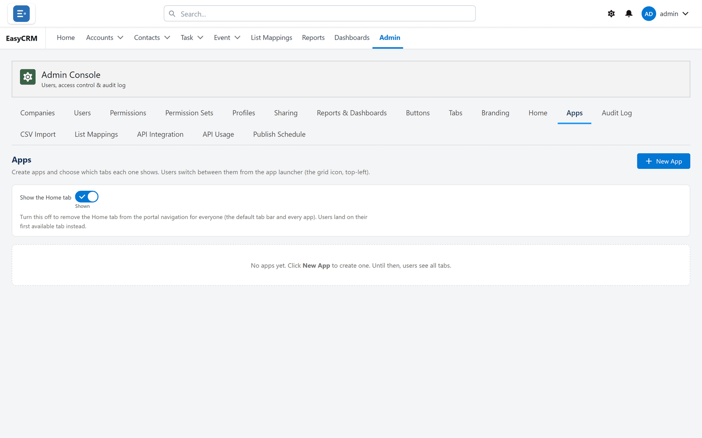

# Apps

**What it is.** A named group of tabs.

**What it does.** People switch between apps, and each app shows its own set of tabs.

**Why it helps.** Sales and support see different tabs without either having to ignore the
other's.

**Who can use it.** Only a **Super Admin**. The **Apps** tab edits the apps of every company at
once, so it is never shown to a company Admin and cannot be granted to one — it is not offered
under **Admin Tabs** or **Console Tabs**.

## Opening it

**Where:** In the portal → **Admin** → **Apps**

1. Click **Admin** in the top menu.
2. Click **Apps** in the row of tabs.

Each app is listed with its **App Name**, how many **Tabs** it shows, and whether it is the
**Default**. With none yet: **No apps yet. Click New App to create one. Until then, users see all
tabs.**

## Creating one

**Where:** In the portal → **Admin** → **Apps** → **New App**

1. Click **Admin**, then **Apps**.
2. Click **New App**.
3. Give it an **App Name** people will recognise, such as "Sales".
4. Pick an **App Icon**, or upload a **Custom Logo** (an image under about 90 KB), which replaces
   the icon.
5. Under **Tabs**, move the tabs it shows from **Available** to **Selected (in order)**, in the
   order they should appear. **Reports** and **Dashboards** are offered too.
6. Tick **Set as the default app** if it should be the one people land in.
7. Click **Save**. The message **Apps saved. Users see the change on their next refresh.** confirms
   it.

The first app you create becomes the default. When Home is shown, it always comes first, and the
**Admin** tab stays available to admins whatever the app.

The object tabs available here are the ones turned on under [Tabs](./tabs.md). Turn a tab on there
first if it is missing.

## Changing or removing one

| Control | What it does |
|---|---|
| **Edit** (pencil) | Opens the app to change its name, icon, logo or tabs. |
| **Delete** (bin) | Removes the app at once, without asking. If it was the default, the first remaining app becomes the default. |
| **Set default** | Makes this the app people land in. |

Every change saves immediately and is written to the [Audit Log](../operations/audit-log.md) as
**Change Permission** — `App Launcher apps updated`.

## Show the Home tab

The **Show the Home tab** switch at the top (**Shown** / **Hidden**) removes the Home tab from the
navigation for everyone — the default tab bar and every app. People land on their first available
tab instead. It saves as soon as you change it.

The same switch is on the [Tabs](./tabs.md#show-the-home-tab) screen, where a company Admin given
that tab can use it too.

## Deciding who gets which app

Two places, one inside the other:

| Where | Decides |
|---|---|
| [Companies](../companies/index.md) → **Edit** → **Apps** | Which apps a company sees. Nothing ticked means all of them. |
| [Users](../users/index.md) → **Assign Apps** | Which of the company's apps one Standard user sees. Nothing ticked means all the company's apps. |

**Leaving a list blank means everybody sees every app**, not nobody. That catches people out.

An app list controls what is **shown**, not what data can be reached — record and field access are
set separately.

## Switching app

People switch using the **App Launcher** — the nine-dot square at the start of the tab row in the
**Top bar** layout, or beside the logo at the top left in the **Left sidebar** layout. It appears
for anybody with at least one app; somebody with no app at all does not get it.

In the **Top bar** layout the App Launcher also has a search box that finds apps, the person's
tabs, and every kind of record they may read — see
[Getting around](../../use/start/the-screen.md#the-app-launcher).

## Giving an app its own home page

See [Home](./home.md). Choose the app in the **Default (all apps)** box and set its cards
separately.
