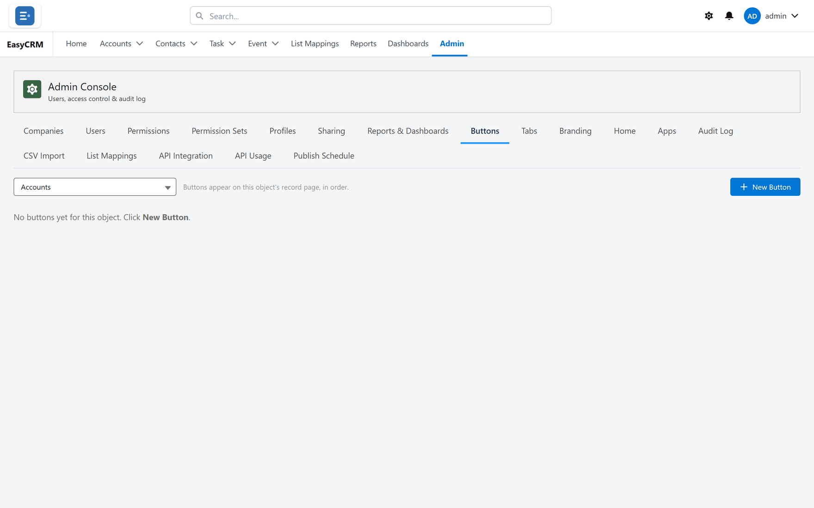

# Buttons

**What it is.** Your own buttons, added to record pages and list pages.

**What it does.** A button can open another system with the record already loaded, run a
Salesforce flow, create a linked record, or open a screen of your own.

**Why it helps.** If your team opens the same other system for every customer, this removes
the copying and pasting.

## Opening it

**Where:** In the portal → **Admin** → **Buttons**

1. Click **Admin** in the top menu.
2. Click **Buttons** in the row of tabs.
3. Choose the kind of record in the box at the top left. **Buttons appear on this object's
   record page, in order.**

## Adding one

**Where:** In the portal → **Admin** → **Buttons** → **New Button**

1. Click **Admin**, then **Buttons**, and choose the kind of record.
2. Click **New Button**.
3. Fill in:
   - **Button Label** — what it says on the button. Keep it short; it sits in a row with others.
   - **What it does** — see the table below.
   - **Show on** — **Record page** or **List page**.
4. Click **Save**.

The button appears on that kind of record for everybody who may use it.

## What a button can do

| **What it does** | Needs | On a record page |
|---|---|---|
| **URL / link** | The address, in the box labelled `URL (use {recordId} for the record's Id)` | Opens the address in a new browser tab, with `{recordId}` replaced by the record's Id. |
| **Flow** | **Flow** — chosen from the org's active screen flows | Runs the flow in a window over the page. When it finishes, the page says **Done.** and reloads. |
| **New Child Record** | **Child Object API Name** and **Lookup field on child (points back to this record)** | Opens the **New** window for that kind of record, already linked to this one. |
| **Component (a portal screen)** | **Screen** (and **Argument** where the screen takes one), or a **Component Key** | Opens a screen from your organisation's own extension. |
| **Server action** | **Server action name** | Runs an action from your organisation's own extension. |

**Component** and **Server action** buttons need an extension class named in Salesforce; without
one they are hidden rather than shown and failing — see
[Settings only Salesforce can change](../salesforce/switches.md#extension-class).

## What a flow receives

A flow is given only the inputs it declares, so any screen flow works. Declare a Text input
variable, available for input, with one of these names to receive it:

| Input variable | Receives |
|---|---|
| `recordId` | The record's Id (record-page buttons). |
| `portalUserId` | The portal user's Id. |
| `portalUsername` | Their portal username. |
| `portalUserRole` | Their role. |
| `ids` | On a **List page** button, the rows the user ticked — as Salesforce passes them to a list button. It must be a Text **collection**, named exactly `ids`. |

## Buttons on list pages

With **Show on** set to **List page**, the button sits beside **New** at the top of that object's
list. Only **Flow** and **URL / link** buttons do anything there; other kinds do nothing, as
there is no single record to work on.

A **Flow** button on a list opens its flow **full page in place of the list**, as Salesforce does:

- The flow page has the button's label as its title and a **Back to Accounts** button (the
  kind of record's plural name) to return without finishing.
- If the flow has an `ids` input, the rows ticked when the button was clicked are passed to it.
- When the flow finishes, the list comes back with nothing ticked, says **Done.** and reloads.
- The flow page has its own address, so the browser's **Back** returns to the list.

A flow page that takes ticked rows cannot be reopened by reloading the browser: the ticks are not
kept, so the list says **Select the records again, then click “Update Status”. The ticked rows
are not kept when the page is reloaded.** (with the button's label) and shows the list.

What the user sees is described in
[Buttons your administrator added](../../use/records/lists.md#buttons-your-administrator-added).

## Putting the record's details into a link

A link is most useful when it carries something from the record into the other system. Put
`{recordId}` in the **URL** where the record's Id belongs —
`https://billing.example.com/customer?id={recordId}`, for example.

## Checking it works

1. Open any record of that kind (or its list, for a **List page** button).
2. Find your button in the row at the top right.
3. Click it.

If nothing happens on a link button, the address is wrong. Edit the button and try again.

A record page arranged in the [layout builder](../layouts/layout-builder.md) with its own header
shows the buttons in the order chosen there, some of them perhaps under a ▾ menu. A button added
here after that header was saved appears at the end — see
[The header](../layouts/layout-builder.md#the-header).

## Removing one

Find it in the list and delete it. Nothing on any record changes — the button simply stops
appearing. To hide it for a while instead, untick **Active**.

## The whole screen, control by control

| Control | What it does |
|---|---|
| **New Button** | Creates a button on the chosen object. |
| The object box | Which kind of record's buttons are listed. |
| **Button Label** | The words on the button. |
| **What it does** | The kind of button — see [What a button can do](#what-a-button-can-do). |
| **Icon (e.g. utility:send)** | The icon, given by name. |
| **Button color** | **Neutral**, **Brand (blue)** or **Destructive (red)**. |
| **Ask for confirmation first** | Makes the user confirm before anything happens. |
| **Confirmation message** | What that prompt says. Without one it asks **Are you sure?** |
| **Show on** | **Record page** or **List page**. |
| **Who can use it** | **Everyone**, **Admins and Super Admins**, or **Super Admins only**. |
| **Record Types** | Limits it to particular record types: move them to **Show button on**. **Select none to show the button on every record type.** |
| **Order** | Where it sits among the other buttons. |
| **Active** | Whether it appears at all. |

The list shows each button's **Order**, **Label**, **Type**, what it **Does**, and whether it is
**Active**, with **Edit** and **Delete** at the end of the row.

Turn confirmation on for anything that writes, sends or deletes. **No buttons yet for this
object. Click New Button.** simply means none have been created.

## What goes wrong

| Symptom | Cause |
|---|---|
| A flow button shows an error instead of its first screen | The flow could not start. Check in Salesforce that it is still an active screen flow. |
| A list button does nothing | Only **Flow** and **URL / link** buttons work on a list page. |
| A list flow ignores the ticked rows | Its input must be a Text collection named exactly `ids`, available for input. |
| **That button has no component key set.** | A **Component** button has no screen chosen. Edit it. |
| A button is missing for some people | **Who can use it**, **Record Types** or **Active** leaves them out. |
