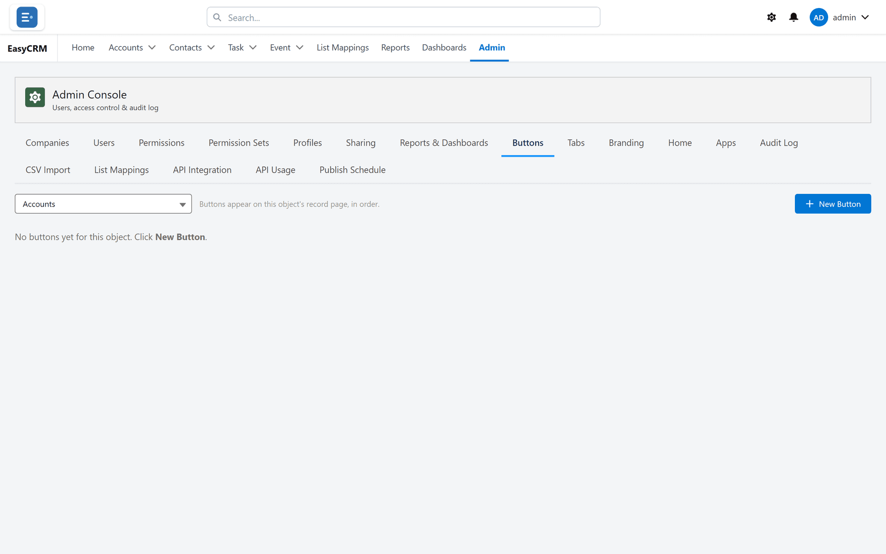

# Buttons

**What it is.** Your own buttons, added to record pages.

**What it does.** A button can open another system, with the record already loaded.

**Why it helps.** If your team opens the same other system for every customer, this removes
the copying and pasting.

## Opening it

**Where:** In the portal → **Admin** → **Buttons**

1. Click **Admin** in the top menu.
2. Click **Buttons** in the row of tabs.

## Adding one

**Where:** In the portal → **Admin** → **Buttons** → **New Button**

1. Click **Admin**, then **Buttons**.
2. Click **New Button**.
3. Fill in:
   - **Label** — what it says on the button. Keep it short; it sits in a row with others.
   - **Object** — which kind of record it appears on.
   - What it does — usually a web address to open.
4. Click **Save**.

The button appears on that kind of record for everybody who can see it.

## Putting the record's details into a link

A button is most useful when it carries something from the record — the account's name, say,
or its id — into the other system. The editor shows which values you can insert.

## Checking it works

1. Open any record of that kind.
2. Find your button in the row at the top right.
3. Click it.

If nothing happens, the address is wrong. Edit the button and try again.

## Removing one

Find it in the list and delete it. Nothing on any record changes — the button simply stops
appearing.

## The whole screen, control by control

| Control | What it does |
|---|---|
| **New Button** | Creates a button on the chosen object. |
| **Object** | What the button appears on. |
| **Button Label** | The words on the button. |
| **Button color** | Its colour. |
| **Icon (e.g. utility:send)** | The icon, given by name. |
| **Order** | Where it sits among the other buttons. |
| **Active** | Whether it appears at all. |
| **Show button on** / **Show on** | The screens it appears on. |
| **Record Types** | Limits it to particular record types. |
| **Who can use it** | Which roles see it. |

### What the button does

| **Type** | What it needs |
|---|---|
| **Flow** | **Flow API Name** — the flow to run. |
| **Screen** | The screen to open. |
| **Server action name** | A named server action. |
| **Component Key** | A component to render. |
| **Child Object API Name** | The related object, where the action works on children. |
| **Argument** | A value passed to whatever is being called. |

### Confirmation

| Control | What it does |
|---|---|
| **Ask for confirmation first** | Makes the user confirm before anything happens. |
| **Confirmation message** | What that prompt says. |

Turn confirmation on for anything that writes, sends or deletes. **No buttons yet for this
object** simply means none have been created.
