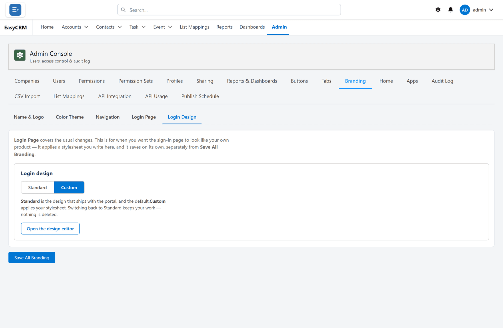
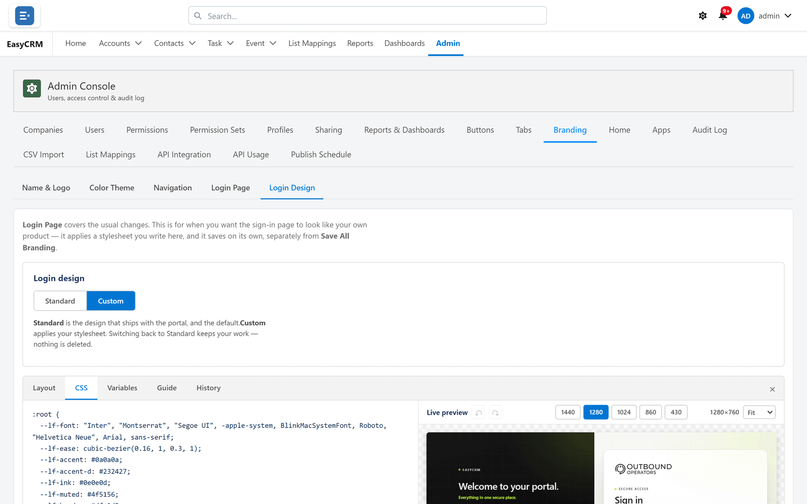

# The sign-in page

**What it is.** An editor for the page people see before they sign in.

**What it does.** You build the page out of blocks — headings, text, images, logos, links —
and arrange them across the two halves of the screen.

**Why it helps.** The sign-in page is the first thing anybody sees, and the only page people
who are not signed in ever see. This lets you make it look like your company without anybody
writing code.

## Opening the designer

**Where:** In the portal → **Admin** → **Branding** → **Login Design**

1. Click **Admin** in the top menu.
2. Click **Branding** in the row of tabs.
3. Click **Login Design**.

For simple changes — heading, tagline, bullet points, footer — use **Login Page** instead,
which is the panel above it. See [Branding](./branding.md).

## Draft, preview, publish

Nothing you do takes effect for anybody until you publish. There are three states, and keeping
them straight is the whole point.

| Action | What happens |
|---|---|
| **Save draft** | Kept for you. Nobody else sees it. |
| **Live preview** | Shows the result as you work. |
| **Publish** | Everybody sees it from now on. |

Work in a draft, check the preview on both desktop and phone, then publish.

**Restore** puts back an earlier version. Use it the moment a published change turns out to be
wrong — it is faster than undoing by hand.

## Building with blocks

Click anything in the preview to edit it. Each block has its own settings: alignment, width,
height, tone, and whether it is clickable.

| Block | What it is for |
|---|---|
| **Heading** | The big line. |
| **Text** | A sentence or two. |
| **Eyebrow** | A small label above a heading, with an optional dot. |
| **Logo** | Your uploaded logo, or an image you add. |
| **Link** | A clickable line, such as your website. |
| **Separator** | A dividing line. |
| **Spacer** | Breathing room between blocks. |

Blocks sit in regions: the **brand** panel on the left, and above or below the sign-in form on
the right.

## Desktop and phone

Switch between **Desktop** and **Phone** in the preview.

A layout that looks balanced on a wide screen can be cramped on a phone, and plenty of people
sign in on one. Check both before publishing.

## Standard or custom

| Mode | What people get |
|---|---|
| **Standard** | The built-in design with your name, logo and colours. |
| **Custom** | The blocks you have built. |

Switching to **Standard** does not delete your custom design. You can switch back and it is
still there.

## If you want help with the design

The editor can produce a prompt to paste into an AI tool, and accept the answer back as a
design. **Copy AI prompt**, paste the reply into **Paste AI answer**, and check the preview
before publishing.

Treat whatever comes back as a draft, not a finished page.

## The sign-in boxes cannot be moved

The username box, the password box and the **Log In** button are fixed. Nothing you add here
can move them, hide them, or imitate them.

That is deliberate. It means no design change — by anybody, deliberate or not — can turn the
sign-in page into something that collects passwords and sends them elsewhere.

## The whole editor, control by control

**Where:** In the portal → **Admin** → **Branding** → **Login Design** → **Open the design editor**

### Standard or Custom

| Control | What it does |
|---|---|
| **Standard** | The design that ships with the portal. The default. |
| **Custom** | Applies your own stylesheet instead. |
| **Open the design editor** | Opens the editor below. |

Switching back to **Standard** keeps your work — nothing is deleted, so it is a safe way to
compare the two.

:::note It saves separately
Login Design saves on its own, **not** with **Save All Branding**. Saving the rest of the
Branding tab does not save your design, and vice versa.
:::

### The editor

Five tabs on the left, a live preview on the right.

| Tab | What it is for |
|---|---|
| **Layout** | The blocks on the page — add them, label them, link them, and set which opens first. |
| **CSS** | The stylesheet itself. This is where most of the work happens. |
| **Variables** | The design variables the stylesheet reads, such as `--lf-accent` and `--lf-ink`. Change these to restyle without writing rules. |
| **Guide** | The written instructions, in the product. |
| **History** | Previously published versions, so you can go back to one. |

**Variables before CSS.** Most changes — colours, fonts, spacing — are a variable, not a rule.
Reach for the CSS tab when a variable cannot express what you want.

### Blocks, on the Layout tab

| Control | What it does |
|---|---|
| **Insert** | Adds a block to the page. |
| **Label** | Its visible text. |
| **Link (https:// or mailto:)** | Where it goes when clicked. |
| **Clickable** | Whether it is a link at all — untick for a fixed panel. |
| **Or upload an image for this block** | Uses an image instead of text. |
| **Align** / **Left** / **Centre** | Horizontal placement. |
| **Height** / **Colour & size** | Its size and appearance. |
| **Highlight** | Marks it as the emphasised block. |
| **Opens first** | The block the visitor lands on. |

### Live preview

| Control | What it does |
|---|---|
| **Live preview** | The sign-in page as it will look, updating as you type. |
| **1440 / 1280 / 1024 / 860 / 430** | Preview at that width — the last is a phone. |
| **Fit** | Scales the preview to the space available. |

Check **430** before publishing. A design that works on a laptop and not on a phone is the
common failure, and the preview is the only place you will see it first.

### Saving and publishing

| Control | What it does |
|---|---|
| **Save this design** | Saves your work as a draft. Visitors still see the old page. |
| **Publish** | Makes it the live sign-in page. |
| **History** → **Open** | Loads an earlier published version. |
| **Reset to Default** | Returns to the standard sign-in page. |

:::caution Saving is not publishing
**Save this design** keeps your work and changes nothing for visitors. Only **Publish** does. You
can leave the editor mid-change without anybody seeing it.
:::

### Building it with AI

| Control | What it does |
|---|---|
| **I want to…** | Describe the design you want. |
| **Copy AI prompt** | Copies a prompt to paste into an AI assistant. |
| **Paste AI answer** | Paste the reply back — all of it, exactly as it came. |
| **Recipes** | Ready-made designs to start from. |
| **JSON** | The design as text, to keep a copy or edit by hand. |

The AI route expects the assistant's **whole reply**, both sections. A trimmed paste is the usual
reason an import is rejected.
