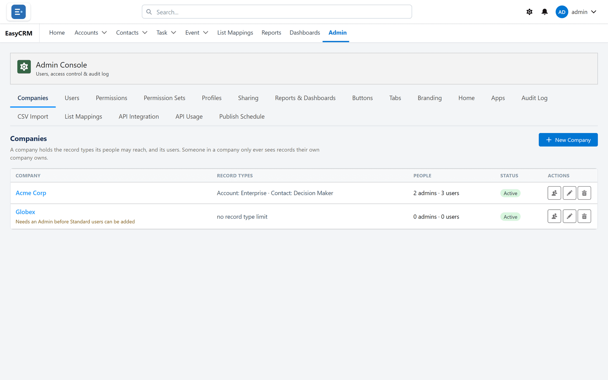
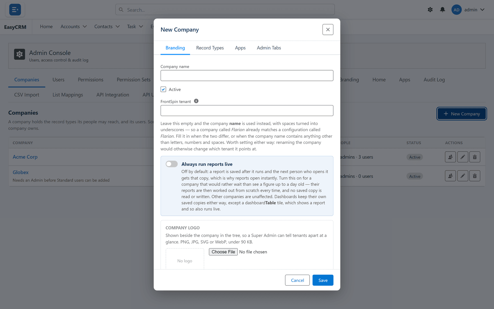

# Companies

**What it is.** The companies whose people use the portal.

**What it does.** A company groups users together, and most access rules work company by
company: the record types its people may reach, the apps they see, the console tabs its Admins get.

**Why it matters.** An Admin manages only their own company's people, and report folders are
shared per company. Somebody with no company matches no company rule.

**Who can use it.** Only a **Super Admin**. The **Companies** tab is never shown to a company
Admin and cannot be granted to one.

## Opening it

**Where:** In the portal → **Admin** → **Companies**

1. Click **Admin** in the top menu.
2. Click **Companies** in the row of tabs.

Each company is listed with its **Record types**, its **People** (how many Admins and users), its
**Status**, and **People**, **Edit** and **Delete** buttons. A company with no Admin yet is marked
**Needs an Admin before Standard users can be added**.

## Adding a company

**Where:** In the portal → **Admin** → **Companies** → **New Company**

1. Click **Admin**, then **Companies**.
2. Click **New Company**. The **New Company** window opens on its **Branding** tab.
3. Type the **Company name**.

   

4. Set anything else you need on the four tabs — see [The Edit window](#the-edit-window).
5. Click **Save**. One **Save** keeps every tab.

Create the company **before** you add its people, and give it an Admin before its Standard users.

## Seeing who belongs to a company

1. Find the company in the list.
2. Click **People** beside it, or its name.

**People in *company*** lists everybody there, with their **Role**, **Manager** and **Record
types**. On a Standard user's row, **Assign record types** and **Assign apps** open the same
windows as on the [Users](../users/index.md) tab; **Remove from company** takes anybody out.

### Adding somebody to a company

Users are created on the [Users](../users/index.md) tab, where there is no Company field. Bring them
in here:

1. Open the company's **People**.
2. Choose them under **Add a user who has no company**.
3. Click **Add to company**.

A Standard user added to a company with exactly one Admin gets that Admin as their manager
automatically. With nobody left to add, the panel reads **Every portal user already belongs to a
company. Create new users on the Users tab, then add them here.**

## Renaming or removing one

- **Edit** opens the company's settings — see below.
- **Delete** asks **Delete *company*? Its users are released, not deleted.**

Deleting a company does not delete its people: they are left with no company and no manager. A
blank company matches no rule — which usually means they stop seeing records, or nobody but a Super
Admin can manage them. Move the people to their new company first.

## The Edit window

**Edit** opens **Edit Company**, with four tabs.

<!-- SHOT: admin/companies-edit-branding.png | Super Admin; Companies → Edit on a company; "Edit Company" window on its Branding tab showing Company name, Active, FrontSpin tenant with its note, the "Always run reports live" switch and the Company logo block -->

### Branding

| Control | What it does |
|---|---|
| **Company name** / **Active** | Its name, and whether it is in use. |
| **FrontSpin tenant** | The FrontSpin configuration this company syncs with. Left blank, the company name is used with spaces turned into underscores. Worth setting either way: renaming the company would otherwise change which tenant it points at. |
| **Always run reports live** | Never use saved report copies for this company. Off by default. Slower, always current — other companies are unaffected. Dashboards keep their own saved copies, except a dashboard **Table** tile. |
| **Company logo** / **No logo** / **Remove logo** | A logo shown beside the company, so a Super Admin can tell companies apart. PNG, JPG, SVG or WebP, under 90 KB. |

The whole portal can be set to run reports live at once, under **Users** → **Report speed** — see
[What an Admin can see](../users/what-admins-can-see.md#report-speed).

### Record Types

| Control | What it does |
|---|---|
| **Let this company's Admins assign record types** | When on, its Admins get **Assign Record Types** on the Users tab, for their own Standard users, within the types below. Off by default. |
| **Record types** | The ceiling for everyone in the company. An Admin gets all of them; a Standard user can only be granted from within them. Nothing ticked means no record-type limit. |

### Apps

| Control | What it does |
|---|---|
| **Let this company's Admins assign apps** | When on, its Admins get **Assign Apps** on the Users tab, for their own Standard users, within the apps below. Off by default. |
| **Apps** | Which apps the company sees in the app launcher. With nothing ticked it reads **Nothing selected — this company sees all apps.** |

The apps themselves are created on the [Apps](../appearance/apps.md) tab, which only a Super Admin
has. With none yet, this tab says so.

### Admin Tabs

| Control | What it does |
|---|---|
| **Allow company admins to manage API access** | When on, its Admins can issue API keys to their own Standard users. When off, their **API Integration** tab disappears and existing keys keep working. Off by default. |
| **Admin Console tabs** | Which console tabs the company's Admins see. With nothing ticked it reads **Nothing selected — this company’s Admins see every console tab.** |

Fifteen tabs can be offered here. **Companies**, **Apps** and **Publish Schedule** are not among
them: they are Super Admin only, always. A single Admin can be narrowed further with **Console
Tabs** on the [Users](../users/index.md#the-buttons-above-the-table) tab, never widened.

These lists control what is **shown**. Every screen still checks the Admin's role on the server,
so a hidden tab is tidiness, not a lock.

## Why every user needs a company

It is the most common setup mistake, and it shows up in confusing ways:

- An Admin cannot see or manage somebody.
- Somebody cannot see a report folder shared with their company.
- An app assigned to a company does not appear for them.

All three are the same cause: a user with no company. Add them under **People**.

## What goes wrong

| Symptom | Cause |
|---|---|
| **Add an Admin to "*company*" first - a Standard user needs one to manage them.** | Add the company's Admin before its Standard users. |
| **A Super Admin is not in any single company - they administer all of them.** | Super Admins cannot be added to a company. |
| **Company limit reached** | Your licence will not allow another company. **Contact support** asks to raise it; existing companies keep working. |
| A company's Admin does not see a tab | It is not ticked under **Admin Tabs**, or **Console Tabs** narrows that Admin. |

## Where this fits

Companies hold users; [Users](../users/index.md) creates them. What a company's people may do is
set under [Permissions](../access/permissions.md), and which records they reach under
[Sharing](../sharing/index.md).
