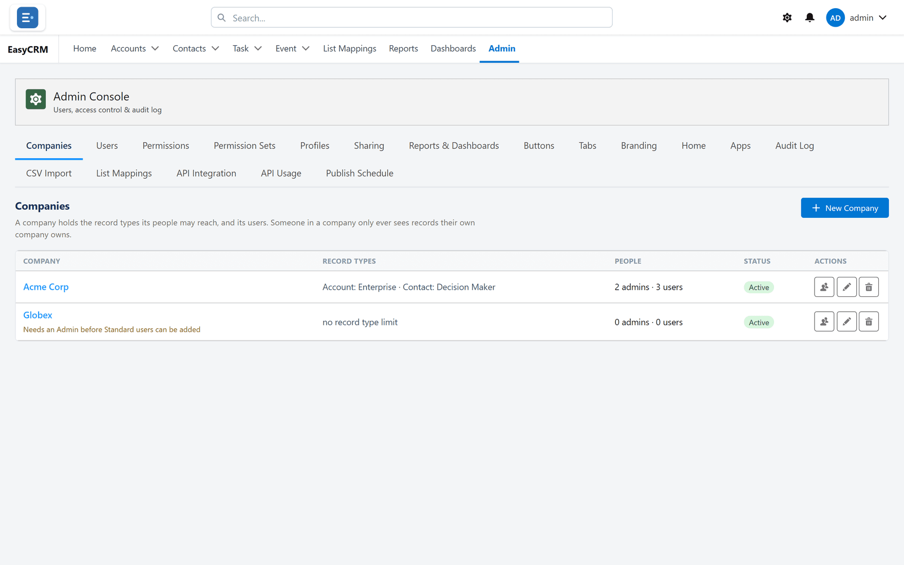
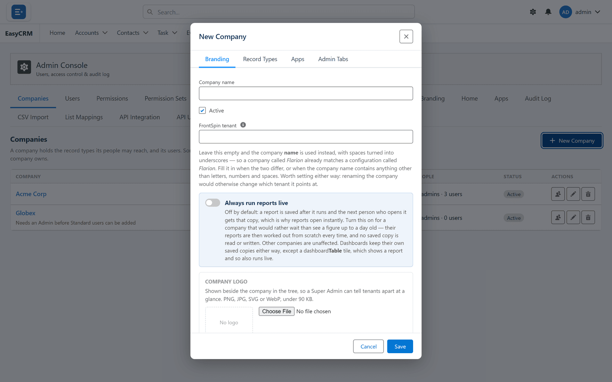

# Companies

**What it is.** The companies whose people use the portal.

**What it does.** A company groups users together, and most access rules work company by
company.

**Why it matters.** An Admin manages only their own company's people, and report folders are
shared per company. Somebody with no company matches no company rule.

## Opening it

**Where:** In the portal → **Admin** → **Companies**

1. Click **Admin** in the top menu.
2. Click **Companies** in the row of tabs.

Each company is listed with how many people belong to it.

## Adding a company

**Where:** In the portal → **Admin** → **Companies** → **New Company**

1. Click **Admin**, then **Companies**.
2. Click **New Company**.
3. Type the company's name.

   

4. Click **Save**.

Create the company **before** you add its people, so you can set their company as you create
them.

## Seeing who belongs to a company

1. Find the company in the list.
2. Click **People** beside it.

You see everybody at that company, and can jump to any of them in
[Users](../users/index.md).

## Renaming or removing one

- **Edit** changes the name.
- **Delete** removes the company.

**Do not delete a company that still has people.** Their company becomes blank, and a blank
company matches no rule — which usually means they stop seeing records, or their Admin stops
being able to manage them. Move the people first.

## Why every user needs a company

It is the most common setup mistake, and it shows up in confusing ways:

- An Admin cannot see or manage somebody.
- Somebody cannot see a report folder shared with their company.
- An app assigned to a company does not appear for them.

All three are the same cause: a blank company field. Set it when you create the user.

## The whole screen, control by control

| Control | What it does |
|---|---|
| **New Company** | Creates a company. |
| **Company name** | Its name. |
| **Company logo** / **No logo** / **Remove logo** | A logo for this company's people. |
| **Status** / **Active** | Whether it is in use. |
| **People** / **Username** / **Role** / **Manager** | Who belongs to it. |
| **Add to company** / **Add a user who has no company** | Moves an unassigned user in. |

### What this company's Admins may do

| Control | What it does |
|---|---|
| **Admin Console tabs** / **Admin Tabs** | Which console tabs their Admins see. |
| **Let this company's Admins assign apps** | Lets them run **Assign Apps** themselves. |
| **Let this company's Admins assign record types** | The same for **Assign Record Types**. |
| **Allow company admins to manage API access** | Lets them issue API keys. Super Admin only. |

**Leave this empty and the company…** gets the default — an empty list means *everything*, not
*nothing*, for tab access.

### Data and integration

| Control | What it does |
|---|---|
| **Always run reports live** | Never use cached results for this company. Slower, always current. |
| **FrontSpin tenant** | The FrontSpin tenant to match. Left blank, the company name is used with spaces replaced by underscores. |
| **Apps** / **Assign Apps** | Which apps the company sees. |
| **Record Types** / **Assign Record Types** | Which record types it may use. |

### Limits

**Company limit reached** means your licence will not allow another company — **Contact support**
to raise it. Existing companies keep working.
