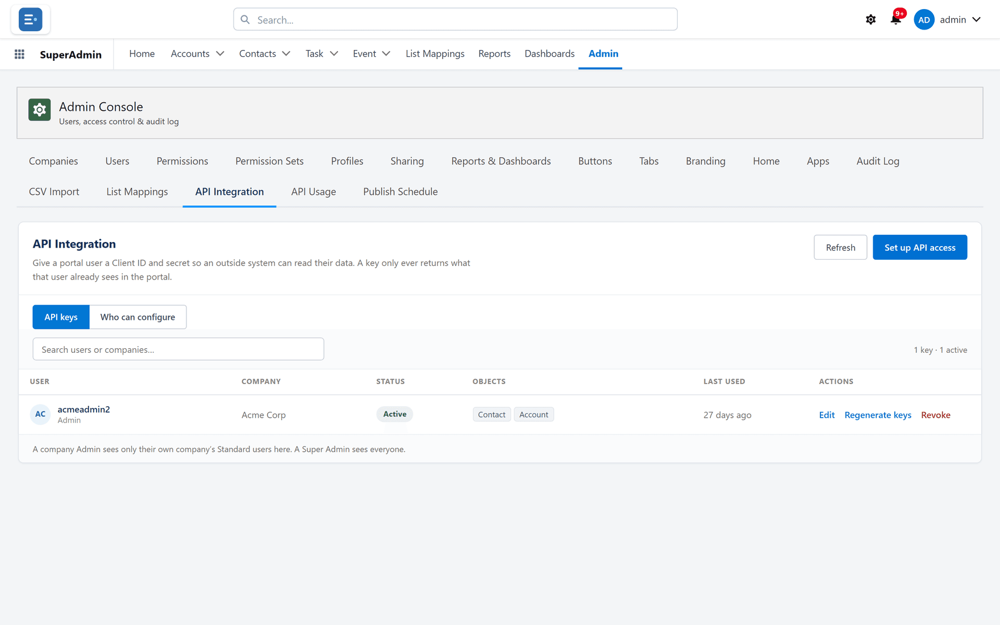
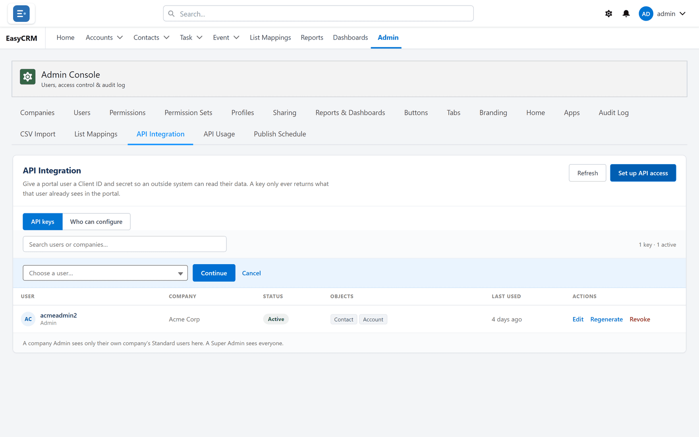
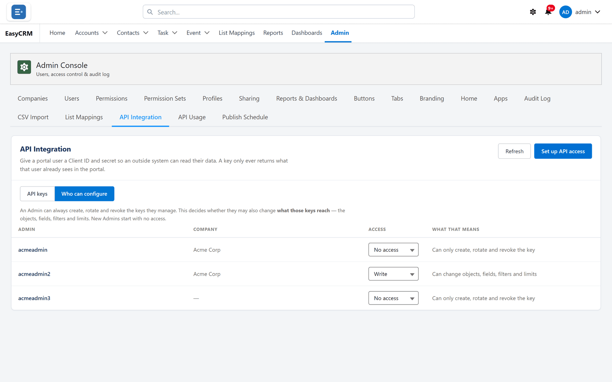
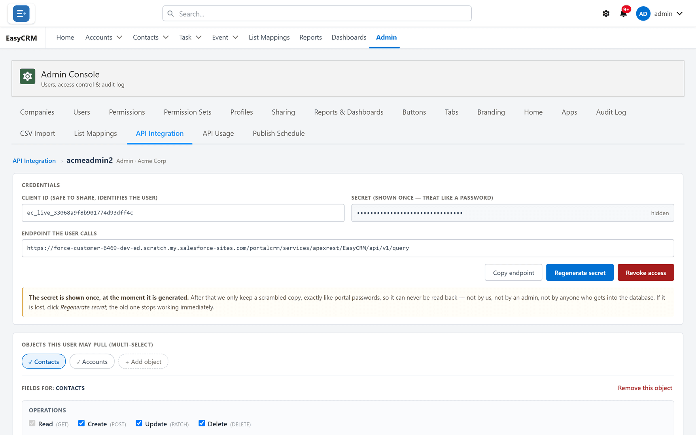

# API Integration

**What it is.** A way to let another system read your portal data automatically — and, only if
you allow it, create, update or delete records.

**What it does.** You create a key, choose exactly what it may reach and do, and give it to
whoever is building the other system.

**Why it is safe.** A key does only what you tick. Each object it reaches has four
**Operations** — **Read**, **Create**, **Update** and **Delete** — and a key you leave on **Read**
alone can change nothing. Whatever you tick, it can never do more than its user could do in the
portal.

## Opening it

**Where:** In the portal → **Admin** → **API Integration**

1. Click **Admin** in the top menu.
2. Click **API Integration** in the row of tabs.

Everybody who currently holds a key is listed.

## Creating a key

**Where:** In the portal → **Admin** → **API Integration** → **Set up API access**

1. Click **Admin**, then **API Integration**.
2. Click **Set up API access**.

   

3. Choose the person the key belongs to. The key sees what that person can see, so choose
   somebody whose access matches what the other system should get.
4. Choose which kinds of record it may reach, which fields, and — under **Operations** — what it
   may do with each.
5. Add filters if it should only see some records.
6. Click **Save**.

## Copy the secret now

When the key is created, the **Secret** is shown **once**.

Copy it immediately and give it to whoever needs it, through something secure. If it is lost,
you cannot look it up — you have to regenerate the keys, which produces a new Client ID and
secret and stops the old ones working. See [Regenerating keys](#regenerating-keys).

## Giving a key less, not more

Two habits worth keeping:

- Attach the key to somebody with **only** the access the other system needs. A key on a Super
  Admin can read everything.
- Choose fields deliberately. If the other system needs names and emails, do not give it
  everything else as well.
- Tick only the operations the other system needs. A system that only reports on your data needs
  **Read** and nothing else.

## Managing an existing key

| Button | What it does |
|---|---|
| **Edit** | Change which records and fields the key may reach, and what it may do with them. The only way to change a key's setup. |
| **Regenerate keys** | Issue a new Client ID and secret, and show them to copy. The old ones stop working at once. A revoked key is switched back on. Nothing else about the key changes. |
| **Revoke** | Switch the key off completely. Only on a key that is active. |

**Regenerate keys** when a secret may have been seen by the wrong person, or has been lost.
**Revoke** when the other system is being retired.

Either one breaks the other system immediately, so tell whoever runs it first.

### Regenerating keys

**Where:** **Admin** → **API Integration** → the key's row → **Regenerate keys**

1. Click **Regenerate keys** on the person's row.
2. Confirm. The question names the person — *Regenerate the API keys for* (username)*?* — and
   warns that *the current ones stop working at once. Anything using them stops until it is
   updated.* On a revoked key it adds that this **turns it back on**.
3. A window titled **New API keys for** (username) shows the new **Client ID** and **Secret**,
   each with a **Copy** button (it changes to **Copied ✓**). On a key that was revoked it also
   says **API access for** (username) **is active again.**
4. Copy both, then click **Done**.

**Copy both now.** *The secret is shown only this once — after you close this window it can
never be shown again. The old Client ID and secret have stopped working.* Where the browser does
not allow copying, the window says *Copy is not available here — select the value and copy it
manually.*

The list stays as it was underneath and refreshes, showing the new state. What the key may reach
— its objects, fields, filters, operations and limits — is untouched: to change any of that, use
**Edit**.

<!-- SHOT: admin/api-regenerate-keys.png | API Integration list, the "New API keys for …" window open after Regenerate keys on a row, showing the "Copy both now." warning bar, the Client ID and Secret boxes with Copy buttons, and Done -->

:::caution Give the other system both values
The Client ID changes as well as the secret. Whoever runs the other system needs the new pair,
not just the new secret.
:::

## Documentation for developers

The technical documentation — endpoints, paging, filters — is on its own site at
[docs.outboundoperators.com](https://docs.outboundoperators.com).

Send that link to whoever is building the integration. They do not need portal access to read
it.

## The whole screen, control by control

### The list

| Control | What it does |
|---|---|
| **API keys** | Everyone who holds a key, one per row. |
| **Company** / **Objects** / **Last used** | Who the key belongs to, what it reaches, when it was last called. |
| **No one has API access yet** | No keys exist. |
| **Refresh** | Re-reads the list. |

### Credentials

| Control | What it does |
|---|---|
| **Credentials** | The Client ID, the Secret and the endpoint. |
| **Copy** | Copies a value. |
| **Copy endpoint** | Copies the full address the caller uses — the real one, not a guess. |
| **Endpoint the user calls** | The address itself. |
| **Generate keys** / **Regenerate secret** | Issues a new Client ID and Secret, after asking first on a key that already exists, and stops the old pair immediately. |
| **Revoke** / **Revoke access** | Switches the key off. |

:::caution The Secret is shown once
It cannot be looked back up. If it is lost, regenerate the keys — which also stops whatever was
using the old ones.
:::

### What a key can reach

| Control | What it does |
|---|---|
| **Add object** / **Objects this user may pull (multi-select)** | Which objects the key may reach. |
| **Remove this object** | Takes one back out of the grant. |
| **Fields for:** / **Fields** (**Available** / **Selected — returned by the API**) | Which fields come back. |
| **Writable fields** (**Readable** / **Writable — may be set by create and update**) | Which of those a create or update may set. |
| **Lookup fields** | How a lookup is returned — the name, the id, or both. |
| **Hidden** | Fields deliberately excluded. |
| **Filters — which rows come back** / **Field** / **Operator** / **Filter logic** | A filter that always applies, whatever the caller sends. |
| **Sort by** / **Sort field** / **Direction** | The order rows arrive in. |

### Operations and caller permissions

| Control | What it does |
|---|---|
| **Operations** — **Read** (GET), **Create** (POST), **Update** (PATCH), **Delete** (DELETE) | What this key may do with the object. Each names the call it switches on. **Read** stays ticked while any of the other three is. |
| **Ticking an operation lets the API ask…** | The explanation under those boxes: the user's own portal permissions, record sharing and field access still decide, so ticking can only narrow what they could already do — never widen it. |
| **Allow the caller to add their own filters** | They may narrow the result. They can never widen it. |
| **Allow the caller to choose their own sort** | They may reorder. This changes order only, never which rows. |
| **Reads per hour** / **Writes per hour** | Separate ceilings. Writes get the lower one. |
| **Write every call to the audit log** — **Always on — this is not a choice.** | Every call is written to the [Audit Log](../operations/audit-log.md); it cannot be switched off. |
| **Who can configure** | Which Admins may change a key's scope — see the note below. |

**Delete cannot be undone.** That warning appears when **Delete** is ticked: a record the other
system deletes is gone. It is not about the key itself: **Revoke** switches a key off without
deleting anything.

### Editing an existing key

**Edit** on a row opens everything that key reaches — its objects, fields, filters, operations
and limits — in one panel.

Changes take effect on the key's **next call**. There is no need to reissue the secret, and doing
so would break whatever is already using it.
