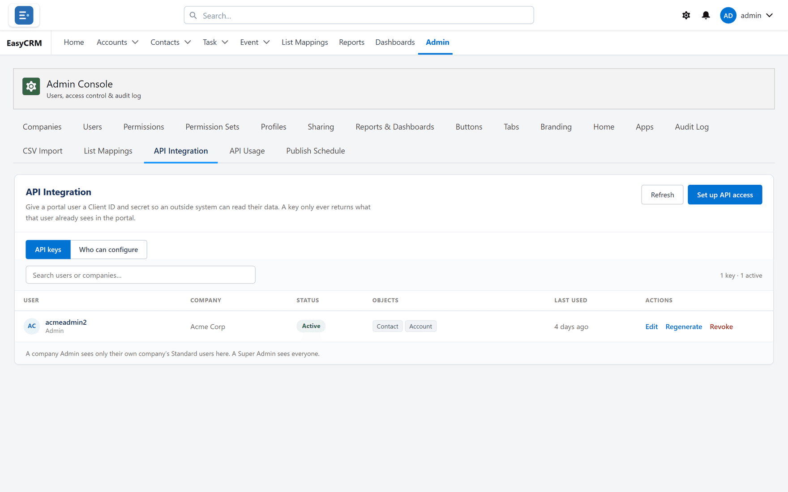
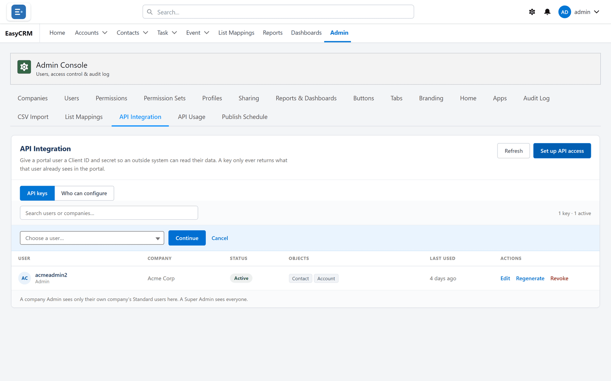
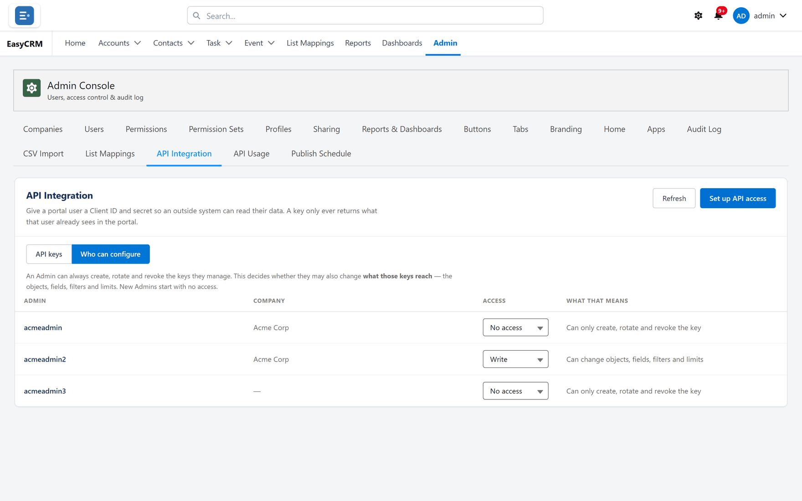
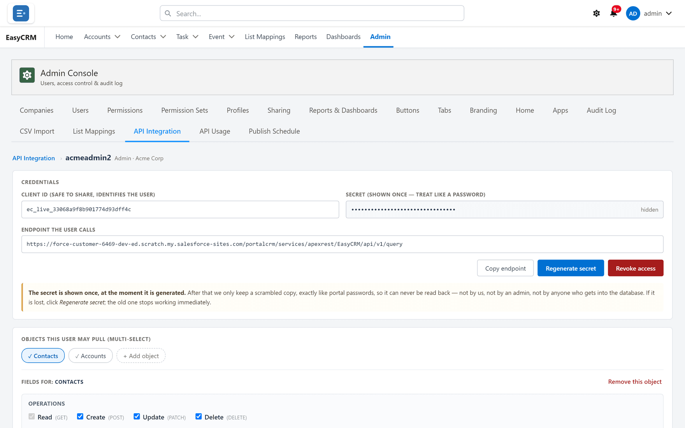

# API Integration

**What it is.** A way to let another system read your portal data automatically.

**What it does.** You create a key, choose exactly what it may read, and give it to whoever is
building the other system.

**Why it is safe.** Keys can only **read**. Nothing can be changed or deleted through them, so
the worst a leaked key can do is show somebody data — not alter it.

## Opening it

**Where:** In the portal → **Admin** → **API Integration**

1. Click **Admin** in the top menu.
2. Click **API Integration** in the row of tabs.

Everybody who currently holds a key is listed.

## Creating a key

**Where:** In the portal → **Admin** → **API Integration** → **Set up API access**

1. Click **Admin**, then **API Integration**.
2. Click **Set up API access**.

   

3. Choose the person the key belongs to. The key sees what that person can see, so choose
   somebody whose access matches what the other system should get.
4. Choose which kinds of record it may read, and which fields.
5. Add filters if it should only see some records.
6. Click **Save**.

## Copy the secret now

When the key is created, the **Secret** is shown **once**.

Copy it immediately and give it to whoever needs it, through something secure. If it is lost,
you cannot look it up — you have to **Regenerate**, which produces a new secret and stops the
old one working.

## Giving a key less, not more

Two habits worth keeping:

- Attach the key to somebody with **only** the access the other system needs. A key on a Super
  Admin can read everything.
- Choose fields deliberately. If the other system needs names and emails, do not give it
  everything else as well.

## Managing an existing key

| Button | What it does |
|---|---|
| **Edit** | Change which records and fields the key may read. |
| **Regenerate** | Issue a new secret. The old one stops working at once. |
| **Revoke** | Switch the key off completely. |

**Regenerate** when a secret may have been seen by the wrong person. **Revoke** when the other
system is being retired.

Either one breaks the other system immediately, so tell whoever runs it first.

## Documentation for developers

The technical documentation — endpoints, paging, filters — is on its own site at
[docs.outboundoperators.com](https://docs.outboundoperators.com).

Send that link to whoever is building the integration. They do not need portal access to read
it.

## The whole screen, control by control

### The list

| Control | What it does |
|---|---|
| **API keys** | Everyone who holds a key, one per row. |
| **Company** / **Objects** / **Last used** | Who the key belongs to, what it reaches, when it was last called. |
| **No one has API access yet** | No keys exist. |
| **Refresh** | Re-reads the list. |

### Credentials

| Control | What it does |
|---|---|
| **Credentials** | The Client ID, the Secret and the endpoint. |
| **Copy** | Copies a value. |
| **Copy endpoint** | Copies the full address the caller uses — the real one, not a guess. |
| **Endpoint the user calls** | The address itself. |
| **Regenerate** / **Regenerate secret** | Issues a new Secret and stops the old one immediately. |
| **Revoke** / **Revoke access** | Switches the key off. |

:::caution The Secret is shown once
It cannot be looked back up. If it is lost, **Regenerate** — which also stops whatever was using
the old one.
:::

### What a key can reach

| Control | What it does |
|---|---|
| **Add object** / **Objects this user may pull (multi-select)** | Which objects the key may read. |
| **Remove this object** | Takes one back out of the grant. |
| **Fields for:** / **Available** / **Readable** / **Writable fields** | Which fields come back, and which may be written. |
| **Lookup fields** | How a lookup is returned — the name, the id, or both. |
| **Hidden** | Fields deliberately excluded. |
| **Filters — which rows come back** / **Field** / **Operator** / **Filter logic** | A filter that always applies, whatever the caller sends. |
| **Direction** | The order rows arrive in. |

### Operations and caller permissions

| Control | What it does |
|---|---|
| **Operations** / **Read** / **Create** / **Edit** / **Delete** | Which verbs this key may use. |
| **Ticking an operation lets the API…** | The explanation shown beside those boxes. |
| **Allow the caller to add their own filters** | They may narrow the result. They can never widen it. |
| **Allow the caller to choose their own sort** | They may reorder. This changes order only, never which rows. |
| **Reads per hour** / **Writes per hour** | Separate ceilings. Writes get the lower one. |
| **Always on — this is not a choice** | Every call is written to the audit log; it cannot be switched off. |
| **Who can configure** | Which Admins may change a key's scope — see the note below. |

**Delete cannot be undone.** Revoking is the reversible action; deleting is not.

### Editing an existing key

**Edit** on a row opens everything that key reaches — its objects, fields, filters, operations
and limits — in one panel.

Changes take effect on the key's **next call**. There is no need to reissue the secret, and doing
so would break whatever is already using it.
