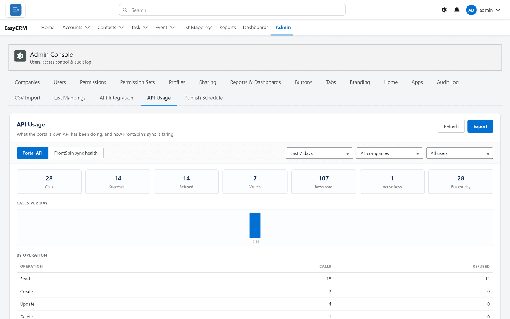

# API Usage

**What it is.** How much each API key is being used, and what it asked for.

**What it does.** It counts requests over a period, broken down by company and by user.

**Why it helps.** It answers three questions quickly: is the key working, which system is
busiest, and is anything being used far more than expected.

## Opening it

**Where:** In the portal → **Admin** → **API Usage**

1. Click **Admin** in the top menu.
2. Click **API Usage** in the row of tabs.

## Choosing what to look at

Across the top:

| Control | What it does |
|---|---|
| **Last 7 days** | The period. Change it to look further back. |
| **All companies** | Narrow to one company. |
| **All users** | Narrow to one person's key. |
| **Previous** / **Next** | Move through the periods. |
| **Refresh** | Fetch the latest figures. |

The two halves — **Portal API** and **FrontSpin sync health** — are separate: one is your own
API keys, the other is a specific integration's health.

**FrontSpin sync health** belongs to the FrontSpin integration, which is not part of EasyCRM. It
is documented in [Sync health](../../frontspin/portal/sync-health.md). In an org without that
integration the view is empty, which is expected rather than a fault.

## Taking the figures away

Click **Export** to download them as a spreadsheet, for a report or a conversation about
costs.

## Reading it

| What you see | What it usually means |
|---|---|
| Zero requests from a key you expect to be busy | The other system is not calling, or is failing before it reaches you. |
| A sudden rise | A change at the other end — often a loop. |
| Steady, predictable volume | Working normally. |

A key with no traffic at all for a long time is usually one nobody needs any more. Consider
revoking it under [API Integration](./api-integration.md).

## The whole screen, control by control

The tab has two halves: **Portal API** and **FrontSpin sync health**. The switch at the top
chooses which you are looking at.

### Portal API

| Control | What it does |
|---|---|
| **Range** | The period being reported. |
| **By company** / **By user** | Narrows to one. |
| **Calls** / **Failures** / **Rows** | Totals for the period. |
| **By operation** | Reads, creates, updates and deletes separately — a zero is shown as a zero rather than left out. |
| **Calls per day** | The same totals over time. |
| **Every call** | One row per call. |
| **Time** / **User** / **Company** / **Kind** / **Object** / **Result** / **Rows** | What each row shows. |
| **Refused** | The call was rejected. **Code** and **Message** say why. |
| **Previous** / **Next** | Pages through the list. |
| **Export** | Downloads the rows. |
| **Refresh** | Re-reads everything. |
| **No API calls in this period** | Nothing was called — widen the range before concluding something is broken. |

Successful calls are kept for **7 days**; refusals for **12 months**. An empty list over a long
range therefore means refusals, not successes, are missing.

### FrontSpin sync health

| Control | What it does |
|---|---|
| **FrontSpin records** / **Lists** / **Last synced** | What has gone across, and when. |
| **Reached FrontSpin** / **Synced OK by tenant** | What arrived successfully. |
| **Failures by tenant** / **Why it failed** / **What FrontSpin actually said** | The failures, with FrontSpin's own wording rather than a summary. |
| **Retries** / **State** | Whether it is being retried. |
| **FrontSpin is not set up in this org** | The integration is not configured; this half has nothing to show. |
