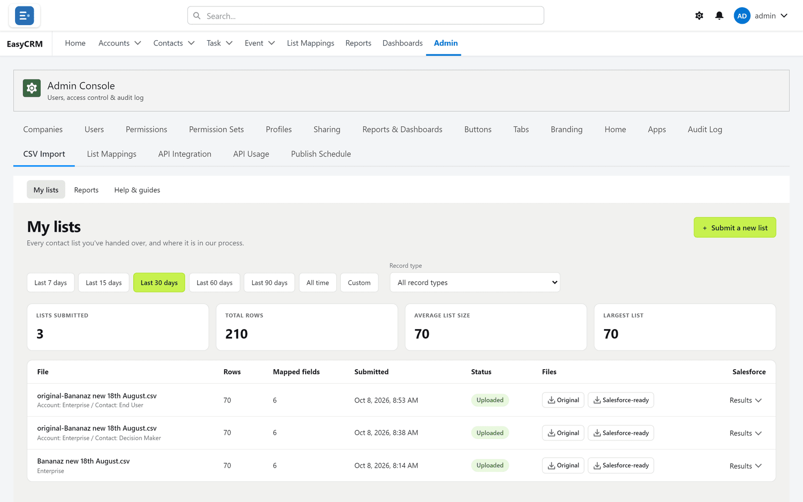
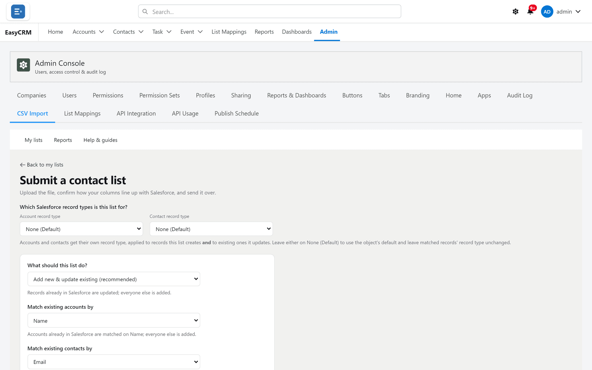
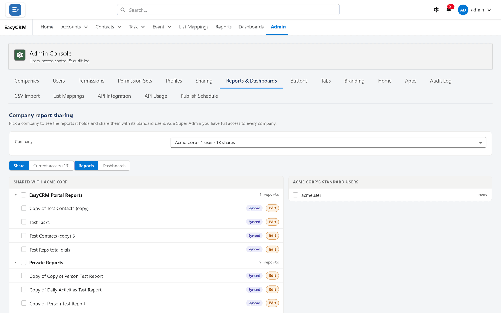

# CSV Import

**What it is.** Loading many records at once from a spreadsheet.

**When to use it.** Moving in from another system, or adding a bought list. For one or two
records, just use **New** on the list instead.

**Why it helps.** Hundreds of records in one go, instead of one form at a time.

## Opening it

**Where:** In the portal → **Admin** → **CSV Import**

1. Click **Admin** in the top menu.
2. Click **CSV Import** in the row of tabs.

## Preparing your spreadsheet

Before you start:

1. Put the **field names in the first row**. One row per record after that.
2. Remove blank rows and any summary rows at the bottom.
3. Save it as **CSV** — in Excel, **File → Save As → CSV (Comma delimited)**.

Dates should be in a consistent format throughout. Mixed formats are the most common cause of
a failed import.

## Importing

**Where:** In the portal → **Admin** → **CSV Import** → choose a file → match columns → **Import**

1. Click **Admin**, then **CSV Import**.
2. Click **Choose file** and pick your CSV.
3. The screen shows your columns alongside the portal's fields.
4. For each column, choose which field it belongs in. Columns whose names match are matched
   for you.
5. Leave anything you do not want to import unmatched.
6. Click **Import**.

A summary tells you how many records were created, and lists anything that failed with the
reason.

## Try ten before you try ten thousand

Copy your spreadsheet, delete all but ten rows, and import that first.

If the ten land correctly, import the rest. If something is wrong, you have ten records to
tidy up instead of ten thousand.

## If rows fail

The summary names the row and the reason. The usual causes:

| Reason | Fix |
|---|---|
| A required field is empty | Fill it in the spreadsheet. |
| A date is not a valid date | Use one consistent format. |
| A value is not an allowed option | Match it to one of the options exactly. |

Fix those rows in a fresh CSV and import just those.

## Records already in the portal

Import **adds** records. It does not look for matches and update them. Importing the same file
twice gives you two copies of everything.

## The whole screen, control by control

### Step 1 — the file

| Control | What it does |
|---|---|
| **Drop in your CSV or Excel file** | Drag a file onto this area, or click **Choose a file**. |
| **File format** | Shows what was recognised once a file is read. |
| **Continue to mapping** | Moves to step 2. Stays disabled until a file has been read. |

### Step 2 — Map your columns

| Control | What it does |
|---|---|
| **Choose a field…** | For each column in your file, the EasyCRM field it should fill. |
| **Example value** | A real value from your file, so you can tell which column you are looking at. |
| **Match existing accounts by** | The field used to decide whether an account already exists. A match **updates**; no match **creates**. |
| **Match existing contacts by** | The same decision for contacts. |
| **Account record type** / **Contact record type** | The record type given to anything newly created. |
| **Columns you don't want** | Columns deliberately left unmapped. Nothing here is imported. |
| **Forgot a field?** | Re-opens the picker when you have left something unmapped by accident. |
| **No matching fields** | Nothing in the file could be matched automatically — map them by hand. |
| **Continue to preview** | Moves to step 3. |

### Step 3 — Data preview

| Control | What it does |
|---|---|
| **Check the data before importing** | The prompt to actually read the preview rather than click past it. |
| **Data preview** | The first rows exactly as they will be imported, after mapping. |
| **Back to mapping** | Returns to step 2 with your mapping intact. |

:::caution The preview is the last point of return
Once the import runs it is not undone from this screen. Mis-mapped columns have to be corrected
record by record afterwards, so the minute spent reading the preview is the cheapest minute in
the process.
:::

### After it runs

| Tile | What it counts |
|---|---|
| **ACCOUNTS CREATED** | Accounts that did not match and were made new. |
| **ACCOUNTS UPDATED** | Accounts that matched and were filled in. |
| **CONTACTS CREATED** | Contacts that did not match and were made new. |
| **CONTACTS UPDATED** | Contacts that matched and were filled in. |
| **FIELDS MAPPED** | How many columns were actually used. |

A high **CREATED** count where you expected **UPDATED** almost always means the matching field
was wrong — the import did not find the existing records and made second copies of them.

### My lists

Every import is kept, so you can see what was loaded and when.

| Control | What it does |
|---|---|
| **My lists** | The history of imports you have run. |
| **LISTS SUBMITTED**, **LARGEST LIST**, **AVERAGE LIST SIZE** | Totals across that history. |
| **BLANK TITLE** | An import saved without a name. Name them and this stops appearing. |
| **No lists yet** | Nothing has been imported yet. |
| **Group** / **New group name** | Files the import under a group, for keeping related loads together. |
| **Job titles** | The titles seen in the file, as a quick sanity check on who is in it. |
| **Anything we should know? (optional)** | A free note stored with the import. |

### Job titles and personas

A contact list is more useful when the job titles are grouped, so you can see who you are actually
loading rather than four hundred variations of the same role.

| Control | What it does |
|---|---|
| **Title groups** | Buckets the job titles in your file into named groups. |
| **Persona split** | How the file divides across those groups. |
| **Search titles** | Finds a title in a long list. |
| **UNGROUPED TITLES** | Titles that matched no group. A high number means the groups need widening. |
| **This match is correct** | Confirms a title has been grouped correctly. |

### Submitting a list

| Control | What it does |
|---|---|
| **Submit a contact list** / **Submit list** | Sends the finished list on, rather than only importing it. |
| **Salesforce upload** | Pushes the records into Salesforce. |
| **Mapped fields** | The columns that were actually used, as a last check before submitting. |

### Two more result tiles

| Tile | What it counts |
|---|---|
| **ROWS PROCESSED** | Every row read from the file, including ones that created nothing. |
| **UNIQUE ACCOUNTS** | Distinct accounts seen, which is usually fewer than the row count. |

**ROWS PROCESSED** higher than created-plus-updated is normal — it means rows were skipped,
usually duplicates within the file itself.

### The other two views

Besides **My lists**, the tab carries two more.

| View | What it shows |
|---|---|
| **Reports** | What has been imported over time, with the range picker — **Last 7 days**, **Last 15 days** and so on. |
| **Help & guides** | The written instructions, in the product. |

