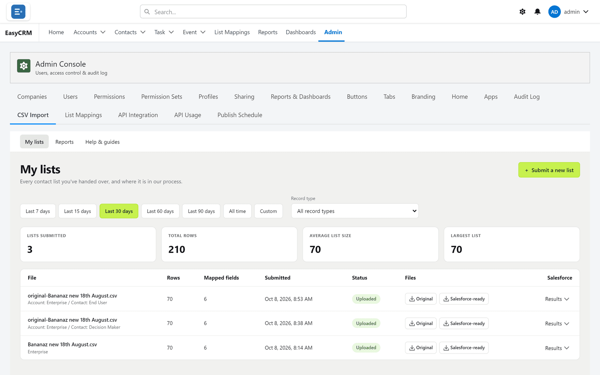
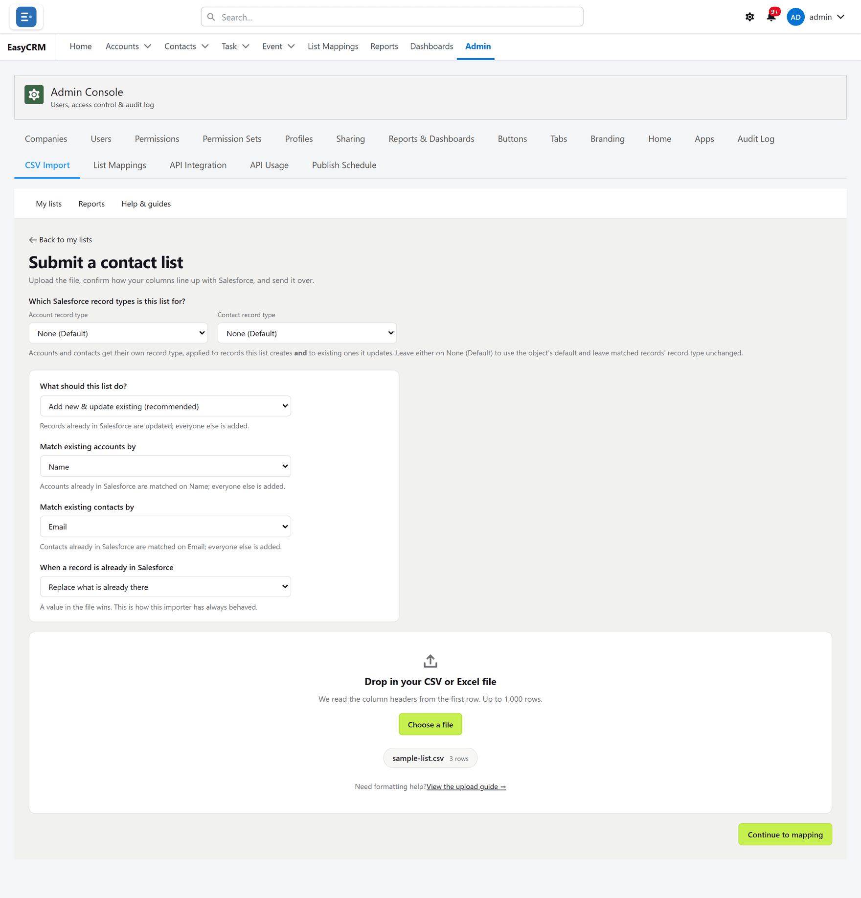
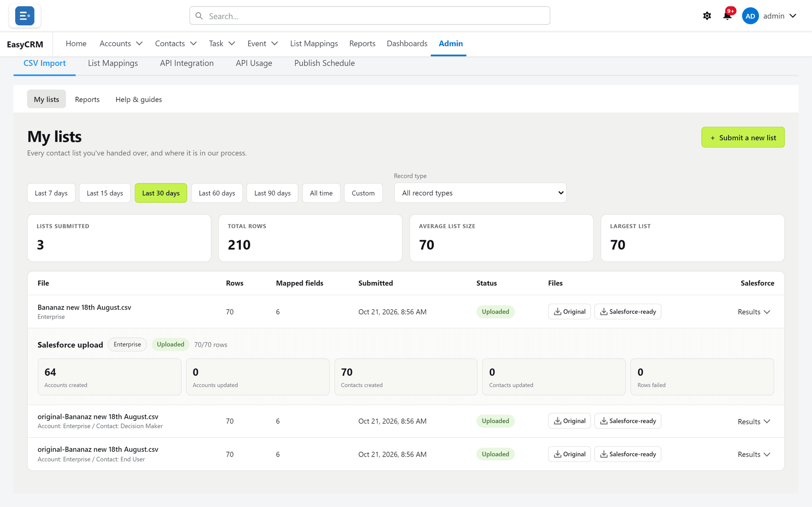
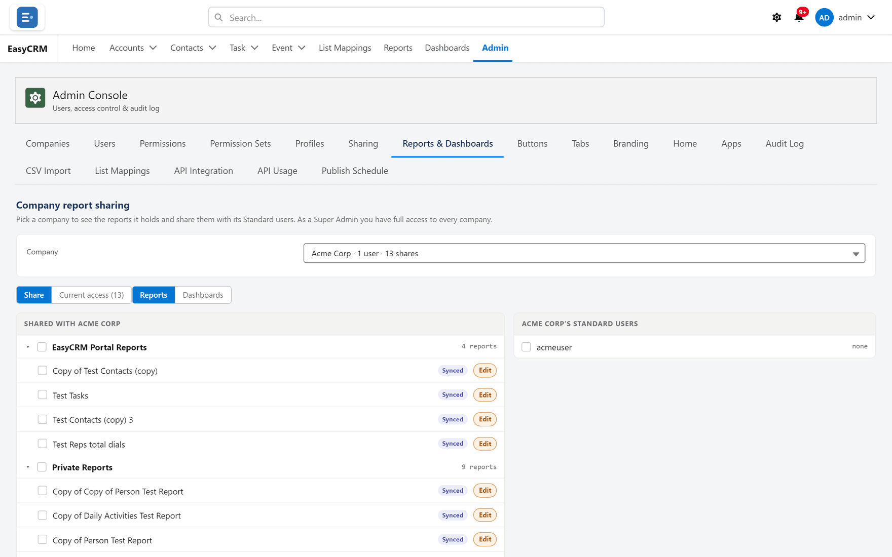

# CSV Import

**What it is.** Loading a list of companies and the people at them from a spreadsheet, as
**Accounts** and **Contacts** in Salesforce.

**When to use it.** Adding a bought list, moving in from another system, or updating many existing
records at once. For one or two records, just use **New** on the list instead.

**Why it helps.** Up to a thousand rows in one go, instead of one form at a time — with a check of
every column before anything is written, and a way to fix the rows that did not make it.

## Opening it

**Where:** In the portal → **Admin** → **CSV Import**

1. Click **Admin** in the top menu.
2. Click **CSV Import** in the row of tabs.

It opens on **My lists**. Across the top are three views: **My lists**, **Reports** and
**Help & guides**.

## Preparing your spreadsheet

Before you start:

1. Put the **column headings in the first row**. One row per person after that.
2. Remove any summary rows at the bottom. Blank rows are skipped for you.
3. Keep it to **1,000 rows** or fewer — split anything larger.
4. Save it as **.csv**, **.xlsx** or **.xlsm**.

Every row that creates a contact must name its **company**: a new contact is only ever created
under an account named in the same row.

Dates should be in a consistent format throughout. Mixed formats are a common cause of failed rows.

## Submitting a list

**Where:** In the portal → **Admin** → **CSV Import** → **My lists** → **+ Submit a new list**

### 1 · Say what the list is for

The **Submit a contact list** page opens.

1. Under **Which Salesforce record types is this list for?**, choose an **Account record type** and
   a **Contact record type**, or leave either on **None (Default)**.

   A chosen type is given to the records the list **creates and** to existing records it
   **updates** — a matched record is re-typed. **None (Default)** gives new records the object's
   default and leaves a matched record's type as it is.

2. Under **What should this list do?**, choose one:

   | Option | What happens |
   |---|---|
   | **Add new & update existing (recommended)** | Records already in Salesforce are updated; everyone else is added. |
   | **Update existing only — never add anything new** | Only records that match are updated. Rows with no match are skipped, and nothing new is created. |
   | **Add new only — never touch existing records** | Every row is added as a new record. Nothing already in Salesforce is changed. |
   | **Always add the contact — match accounts only** | Accounts are matched and updated, but every row creates a **new** contact — for a second contact under an existing account, for example on a different contact record type. |

3. Where the option matches records, **Match existing accounts by** (**Name** or **None**) and
   **Match existing contacts by** (**Email** or **None**) appear, already set for you.

4. Where it matches records, **When a record is already in Salesforce** appears:

   | Option | What happens to a matched record |
   |---|---|
   | **Replace what is already there** (default) | A value in the file wins. |
   | **Only fill in blanks** | Existing values are left alone; empty fields are filled in from the file. |

   An empty cell in the file never clears a value either way.

5. Drag the file onto **Drop in your CSV or Excel file**, or click **Choose a file**. Its name and
   row count appear.
6. Click **Continue to mapping**.

### 2 · Map your columns

**Map your columns** lists every column in the file: **Your column**, an **Example value** from
it, and the **Salesforce field** it fills.

1. Columns with familiar headings — *Company*, *First Name*, *Email*, *Title* and so on — are
   matched for you and marked **Matched**.
2. For each column marked **Needs a field**, click **Search or select a field…** and choose one.
   Fields are listed as **Account: …** and **Contact: …**, and only fields you may edit are
   offered.
3. Set anything you do not want to **Don't import this column**. It is marked **Not imported**.
4. If a column's values do not look like the field — **Check this: these values don't look like
   email addresses**, for example — check it and tick **This match is correct**. **Continue to
   preview** stays greyed out until every such column is confirmed.
5. **Forgot a field?** adds a field that is not in the file, with one value for every row: click
   **+ Add a field**, choose it, and type the **Value for every row**.
6. Click **Continue to preview**.

The rules checked here:

- **Account Name is required when mapping any Account field.**
- **Contact Last Name is required (it is a mandatory Salesforce field).**
- Each field can be mapped only once.

### 3 · Check the data

**Check the data before importing** shows what will be written: **UNIQUE ACCOUNTS**, **CONTACTS**
and **FIELDS MAPPED**, then the first ten rows under **Data preview**, each column headed with the
field it fills. Nothing has been created yet.

1. Read the preview. **Back to mapping** returns with your mapping intact.
2. Optionally add a note under **Anything we should know? (optional)**. It is kept with the list.
3. Tick **I confirm these *N* rows should go to *record type* in Salesforce.**
4. Click **Submit list**.

:::caution The preview is the last point of return
Once the list is submitted it is not undone from this screen. Mis-mapped columns have to be
corrected record by record afterwards, so the minute spent reading the preview is the cheapest
minute in the process.
:::

## While it imports

Submitting hands the list to a background job and opens a progress page, **Importing your list**.

<!-- SHOT: admin/csv-import-progress.png | Admin → CSV Import, a list just submitted: progress page "Importing your list" with the steps Received → Importing → Finished, the bar part-filled and "312 of 800 rows" under it -->

- The steps **Received**, **Importing** and **Finished** light up as it goes, with a bar and
  ***X* of *Y* rows** under it.
- **You can close this tab or carry on working.** The import keeps going without you, and the
  result waits under **My lists**.
- When it ends, an e-mail titled **Your import has finished** is sent to the address on your portal
  user, with the counts — and, if rows failed, a reminder to fix them from **My lists**.

The title then reads **Import finished** or, with rows to look at, **Import finished, with some
rows to look at** (the last step reads **Finished with issues**). If the page loses touch with the
import it reads **We lost track of this import** — the import is still running; check **My lists**
in a moment.

**Go to My lists** leaves the page. **Fix the rows that failed** appears when any did.

## The result

| Counter | What it counts |
|---|---|
| **Accounts created** | Accounts that did not match and were made new. |
| **Accounts updated** | Accounts that matched and were updated. |
| **Contacts created** | Contacts that did not match and were made new. |
| **Contacts updated** | Contacts that matched and were updated. |
| **Rows failed** | Problems that stopped a row — each with its reason listed below the counters. |
| **Repeats in the file** | Shown when above 0. Every repeated company name and every repeated e-mail within the file. |
| **Nothing here to update** | Shown when above 0. Under **Update existing only**, rows with no record to update. |

**Repeats in the file** counts a company once for each extra row it appears on. A list with three
people at one company counts **2** here — and that is normal: the company is created or updated
once, and all three contacts are added under it. A repeated e-mail address, though, is imported
only once.

A value that cannot be used for its field — a date that is not a date — is listed with the
reasons too, but does not fail the row: the row is saved without that value. The list's status
still reads **Issue**, so look at the reasons whenever it does.

A high **created** count where you expected **updated** almost always means nothing matched — see
[How matching works](#how-matching-works).

<!-- SHOT: admin/csv-import-finished-issues.png | Progress page after a list with failures: "Import finished, with some rows to look at", the counter tiles including Rows failed 3 and Repeats in the file 2, the reasons listed, and the buttons Go to My lists and Fix the rows that failed -->

## Fixing rows that failed

**Where:** In the portal → **Admin** → **CSV Import** → **My lists** → the list's **Results** → **Fix the rows that failed**

The same button is on the progress page when an import finishes with failures.

**Fix the rows that did not import** shows each failed row with its **Row** number, every column
from the file as an editable box, and **Why it did not import**.

<!-- SHOT: admin/csv-import-fix-rows.png | "Fix the rows that did not import" screen with three failed rows, one cell being corrected, the "Why it did not import" column filled, and the Download these rows / Import these rows again buttons -->

1. Correct the values in the boxes.
2. Click **Remove** on any row you do not want to send again.
3. Click **Import these rows again**.

The corrected rows go in as a new list, **Retry of *file***, with the note **Corrected rows from an
earlier list.**, using exactly the original list's settings — mapping, record types, what the list
does, and replace or fill. A progress page follows, as for any list.

**Download these rows** saves them as `failed-rows-file.csv`, with the reason beside each, to fix
in a spreadsheet instead.

A list imported before the importer recorded its mapping cannot be sent again from here. The screen
says **This list was imported before the importer started recording how its columns were mapped,
so these rows cannot be re-sent automatically. Download them and submit them as a new list.**

## My lists

Every list you have submitted is kept here, with the lists of the users you manage.

| Control | What it does |
|---|---|
| **+ Submit a new list** | Starts a new list. |
| **Last 7 days** … **Last 90 days**, **All time**, **Custom** | The period shown. **Custom** adds **From** and **To** dates. |
| **Record type** | Shows only lists for one record type. |
| **LISTS SUBMITTED**, **TOTAL ROWS**, **AVERAGE LIST SIZE**, **LARGEST LIST** | Totals for the period. |
| **File**, **Rows**, **Mapped fields**, **Submitted** | One row per list. |
| **Status** | **Received**, **Uploading**, **Uploaded**, or **Issue** when rows failed. |
| **Original** / **Salesforce-ready** | Download the file you uploaded, or the mapped version that was sent. |
| **Results** | Opens the list's result: the counters, any note, and any failure reasons. |

Under **Results**, click a counter to see the rows behind it — for example **Contacts created —
rows from this list**, up to 200 rows. **Close** hides them again. **Fix the rows that failed**
appears when any did.

With nothing submitted yet, it reads **No lists yet**.

## Reports

**Reports** shows what your lists added, for any period, with the same **Record type** filter and
period buttons. It has two views:

**Summary** — **LISTS SUBMITTED**, **TOTAL ROWS**, **AVERAGE LIST SIZE**, **LARGEST LIST**,
**ROWS PROCESSED**, **ACCOUNTS CREATED**, **ACCOUNTS UPDATED**, **CONTACTS CREATED** and
**CONTACTS UPDATED** for the period.

**Job titles** — who your lists are reaching, under **Persona split**:

| Control | What it does |
|---|---|
| **UNGROUPED TITLES** | Titles not yet in a group. A high number means the groups need widening. |
| **BLANK TITLE** | Contacts with no job title. |
| **Title groups** / **New group name** / **+ Save group** | Tick titles in the table, name the group (for example *CISO*) and save it. Groups are kept and reused next time. |
| **Search titles** | Finds a title in a long list. |
| **Download CSV** | Saves the table as `job-titles.csv`. |
| **Group**, **Title**, **Contacts**, **Share** | Each title, its group, how many contacts hold it, and their share. |

## Help & guides

The short version of this page, in the product: **File format**, **Required fields**,
**Matching** and **Columns you don't want**.

## How matching works

- **Accounts match on Name, contacts on Email**, ignoring capitals.
- **Only records you own are matched.** An account or contact owned by somebody else — even
  somebody at your company — is never found, so a row for it creates a new record (or, under
  **Update existing only**, is skipped).
- **What you create, you own**, so your company sees it.
- **A new contact needs an account in the same row.** A row with no company name cannot add a
  contact, only update one that matches.
- Accounts are handled before contacts, so a row's contact is placed under the account the same row
  created or matched.

## Try ten before you try a thousand

Copy your spreadsheet, delete all but ten rows, and submit that first.

If the ten land correctly, submit the rest. If something is wrong, you have ten records to tidy
up instead of a thousand.

## What goes wrong

| Symptom | Cause |
|---|---|
| **Contact row *N* (*email*): skipped - no Account in this import to link it to.** | The row has no company name, or its account failed. A new contact needs an account in the same row. |
| Everything was created again instead of updated | Nothing matched: those records are owned by somebody else, or the list was set to **Add new only**. |
| Existing contacts were re-typed | A **Contact record type** was chosen; it applies to matched records too. Use **None (Default)** to leave them. |
| A second contact was wanted, but the existing one was updated | Use **Always add the contact — match accounts only**. |
| Values already in Salesforce were overwritten | **Replace what is already there** was chosen. Use **Only fill in blanks**. |
| **This importer handles up to 1000 rows at a time; the file has *N*. Please split it into smaller files.** | More than 1,000 rows. |
| **Please upload a .csv, .xlsx or .xlsm file.** | Another file type. |
| **The file has headers but no data rows.** | Only the heading row has anything in it. |
| A column cannot be mapped to the field you want | You cannot edit that field, or it cannot be imported. |
| No completion e-mail | Your portal user has no e-mail address, or the org cannot send e-mail. The result is still under **My lists**. |
| A downloaded **Original** or **Salesforce-ready** file is shorter than the list | Each stored copy keeps at most 131,072 characters — a few hundred rows of a typical list. The import itself is not affected. |
| An Admin cannot see records they imported | On a [Field Scoped](../sharing/field-scoped.md) object, the importer does not check the importing Admin's values: rows are saved with whatever the file holds in the scope field, and records outside the Admin's values are then hidden from them. |

## How it is audited

Each import is written to the [Audit Log](../operations/audit-log.md) as **CSV Import**, with
`N created, M updated` and **Success**, or **Partial** when some rows failed.

## Where this fits

Not to be confused with [List Mappings](./list-mappings.md), which links a report to a FrontSpin
calling list. This is a file you upload; that is a standing link to a dialler.
