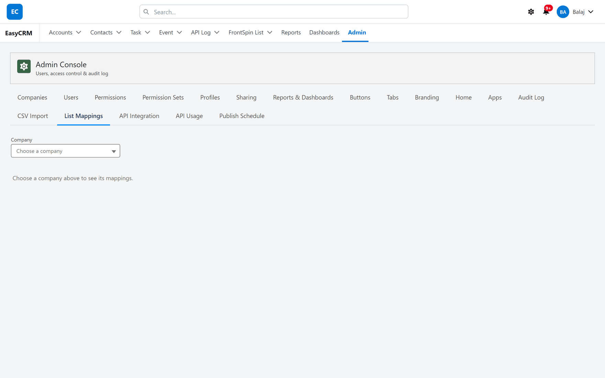
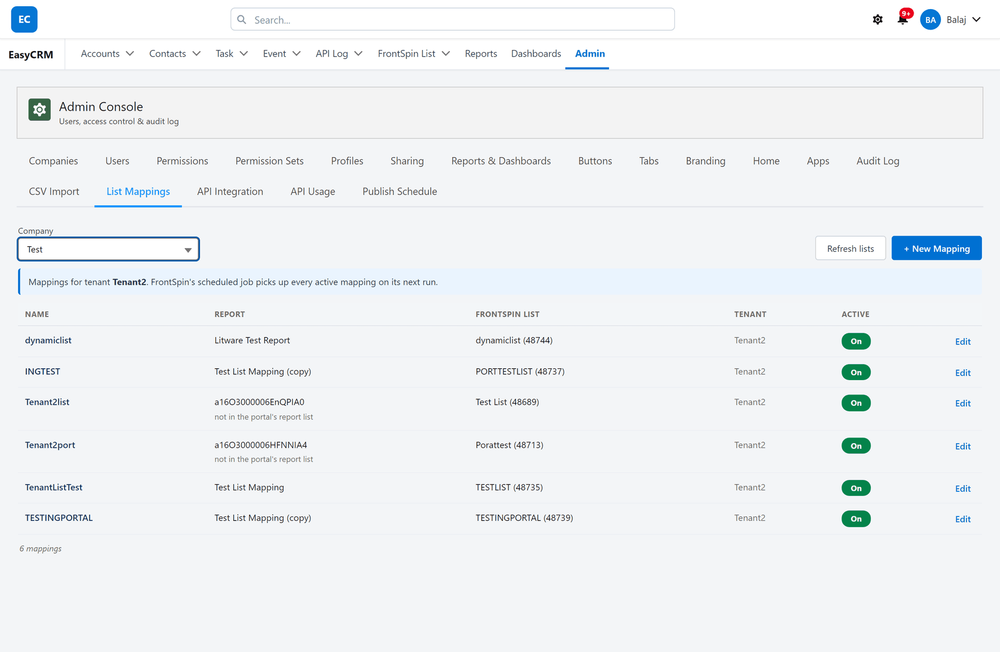

# List Mappings

**What it is.** Which Salesforce report fills which FrontSpin calling list, for a company.

**What it does.** You say once that a report belongs to a calling list, and from then on everybody
that report returns is added to that list on FrontSpin's schedule, without anybody exporting a
spreadsheet. With the **Sync** buttons switched on, you can also push a list straight away.

**Why it helps.** Otherwise a calling list is only ever as fresh as the last manual export.

## This tab belongs to the FrontSpin integration

FrontSpin is a sales dialler. The integration between it and your org is **not part of EasyCRM** —
it is installed separately, for customers who use FrontSpin.

**In an org without it, this tab says so** and does nothing else:

> FrontSpin is not set up in this org, so there is nothing to manage here.

That message is expected, not a fault.

## Opening it

**Where:** In the portal → **Admin** → **List Mappings** → **Choose a company**

1. Click **Admin** in the top menu.
2. Click **List Mappings** in the row of tabs.
3. A **Super Admin** chooses a **Company** first — mappings belong to one. An **Admin** is taken
   straight to their own company and never sees the picker.

4. Its mappings appear, under a line naming the FrontSpin tenant you are editing.

In an org **without** FrontSpin the same tab says so and stops there — see
[the boundary](../../frontspin/index.md#an-important-boundary).

## Before you add anything

Mappings can be stored in Salesforce Setup **or** here, and only one of those is live at a time.
Adding one to the wrong side looks completely correct and has no effect.

The full detail, and the switch that decides, is in the FrontSpin section:
[Setup, or the portal](../../frontspin/lists/where-mappings-live.md).

## Syncing a list now

By default a mapping is only pushed to FrontSpin by its scheduled job. A Super Admin can add
buttons to push it immediately.

**Where:** In the portal → **Admin** → **Users** → **FrontSpin sync buttons** → **Show the Sync buttons on List Mappings**

1. A Super Admin ticks **Show the Sync buttons on List Mappings**. It applies to every company.
   The message **The Sync buttons now appear on the List Mappings tab.** confirms it.
2. On **List Mappings**, each active mapping now has a **Sync** button, and **Sync all** sits above
   the table.
3. Click **Sync** on a row, or **Sync all** for every active mapping of this company — at most
   **45** per click.
4. A **Sync started** box appears, and a progress panel at the top of the page follows each mapping
   to the end.

Unticking it again shows **The Sync buttons are hidden again, and the sync action is refused.** The
scheduled job keeps running either way.

The full detail — the progress panel and every message — is in the FrontSpin section:
[List Mappings](../../frontspin/portal/list-mappings.md#syncing-now).

The panel on the Users tab describes the schedule as running every fifteen minutes. That schedule
belongs to the FrontSpin integration, not to EasyCRM; how often it actually runs is covered in
[Report to List](../../frontspin/lists/report-to-list.md).

## The full documentation

This tab is covered properly in the FrontSpin section:

| Page | Covers |
|---|---|
| [List Mappings](../../frontspin/portal/list-mappings.md) | This tab, in detail |
| [Report to List](../../frontspin/lists/report-to-list.md) | What a mapping actually does |
| [Lists](../../frontspin/lists/index.md) | Why somebody cannot be removed from a list |
| [Setup, or the portal](../../frontspin/lists/where-mappings-live.md) | Which source is live |

## The one thing to know before using it

**Nothing can remove somebody from a FrontSpin calling list.** FrontSpin's interface has no
removal of any kind, so narrowing the report stops *adding* people but never takes anybody off.

Check what a report returns before you map it — and before you click **Sync**, which adds them at
once.

## Where this fits

Not to be confused with [CSV Import](./csv-import.md), which is loading a spreadsheet by hand.
They are unrelated — one is a file you upload, this is a standing link to a dialler.
