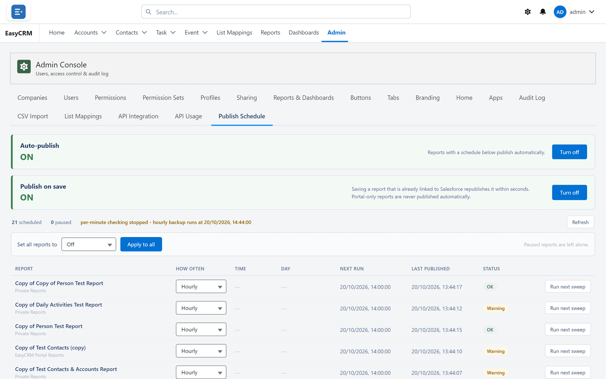

# Publish Schedule

**What it is.** Copying portal reports into Salesforce automatically, on a timetable.

**What it does.** It re-creates a portal report as a Salesforce report, and keeps it updated.

**Why it helps.** People who work in Salesforce see the same numbers as people in the portal,
without anybody rebuilding the report twice or exporting it by hand.

:::note Super Admin only
Only a **Super Admin** can open this tab, and only a Super Admin can switch automatic publishing
on or off. A company Admin will not see it at all.
:::

This is the unattended version of a job you can also do by hand from Salesforce — see
[Publishing a portal report to Salesforce](../salesforce/publish-reports.md). Everything that page
says about fidelity applies here too, because a scheduled publish uses exactly the same machinery.

## Opening it

**Where:** In the portal → **Admin** → **Publish Schedule**

1. Click **Admin** in the top menu.
2. Click **Publish Schedule** in the row of tabs.

## It starts switched off

Automatic publishing is **off** until somebody turns it on. That is deliberate: it writes into
Salesforce on a timer, and that should be a decision rather than a default.

1. Click **Turn on** at the top.
2. Set the schedule for each report.

## Publishing the moment a report is saved

Separate from the timetable, and off by default, there is a second switch: **Publish on save**.

| Setting | What happens when somebody saves a report in the portal |
|---|---|
| **OFF** *(default)* | Nothing. Reports publish on their schedule only. |
| **ON** | A report that is **already linked to Salesforce** republishes within seconds. |

Only a **Super Admin** can switch it.

:::note It never creates anything new
Publish on save only refreshes a report that has already been published once. A portal-only report
is never published automatically by it — somebody has to publish it the first time, by hand or on a
schedule, before this switch has anything to act on.
:::

A save normally reaches Salesforce in **one to four seconds**.

### Why it is not instant, exactly

The portal runs as the site's guest user, and a Guest User licence can never hold API access. A
publish attempted as the guest comes back refused. So saving a report does not call Salesforce
directly — it raises an internal request, and a subscriber in Salesforce does the work as a proper
licensed user a moment later.

That is also why the delay is a second or two rather than instant, and why this needs one piece of
Salesforce setup before it works at all.

### The setup step in Salesforce, which is easy to miss

Without it the subscriber runs as **Automated Process**, which has no API access either, and every
publish fails with a permissions error that does not obviously point here.

1. In Salesforce, create a **Platform Event Subscriber Configuration** for
   `Portal_Publish_Request__e`, naming a user who has API access and can edit reports.
2. **Restart the subscriber**: go to the `PortalPublishRequestTrigger` trigger, deactivate it, save,
   then reactivate it and save again.

:::caution Step 2 is not optional
Creating the configuration alone does not take effect. The subscriber keeps running as the old user
until the trigger is restarted — so it looks correctly configured and still fails.
:::

If publish-on-save is switched on and nothing happens, check these two before anything else.

## What the list shows you

| Column | What it means |
|---|---|
| **Report** | The portal report this row is about. |
| **How often** | Its frequency — **Off**, **Hourly**, **Daily** or **Weekly**. |
| **Next run** | When the scheduler will next pick it up. Blank when the frequency is Off, or the report is paused. |
| **Last published** | When it last published successfully. |
| **Status** | The outcome of the last attempt, including the reason when one failed. |

## Scheduling a report

1. Find the report in the list.
2. Choose how often it should publish under **How often**.
3. Click **Apply** on that row.

**Apply to all** sets the same frequency for every report at once, which is quicker when you want
them all on the same rhythm.

## Choosing a frequency

Match it to how fast the data changes and who is waiting for it.

| Frequency | Suits |
|---|---|
| **Hourly** | Numbers people watch during the day. |
| **Daily** | Most reports. |
| **Weekly** | Summaries nobody reads more often than that. |
| **Off** | Leave it out of the schedule entirely. |

More often is not better. Each publish does real work, and a report nobody looks at before Monday
does not need rebuilding every hour.

## Publishing now, without waiting

**Run next sweep** makes the scheduler do its next pass immediately instead of waiting for the top
of the hour. Use it to check a change you have just made, rather than waiting to find out whether
it worked.

It runs the whole sweep, not one row — every report that is currently due.

## Checking it worked

Click **Refresh**. Each report shows when it last published and whether it succeeded, and
**Status** carries the reason when one did not.

If a report keeps failing, open
[Publish Portal Reports](../salesforce/publish-reports.md) in Salesforce and publish it by hand.
That screen shows the full message, which is usually about a formula column or a join Salesforce
cannot reproduce exactly.

## Paused reports

A schedule can end up **paused** rather than off. The usual cause is the portal report being
deleted — see below.

- A paused report is **skipped** by every sweep. It is not retried, and it does not count as a
  failure.
- **Resume** on that row puts it back into the schedule.
- **Apply to all** leaves paused reports alone, so setting everything to Daily will not silently
  restart something that was paused for a reason.

## If a report is deleted

Its schedule **pauses**. It does not quietly create a new report in Salesforce to replace the one
somebody deleted.

That is on purpose: deleting a report is usually deliberate, and silently re-creating it would
undo the decision. Rebuild the report and press **Resume**, or leave it paused.

## Turning it off again

Click **Turn off** at the top. Schedules are kept but stop running, so you can turn it back on
without setting everything up again.
