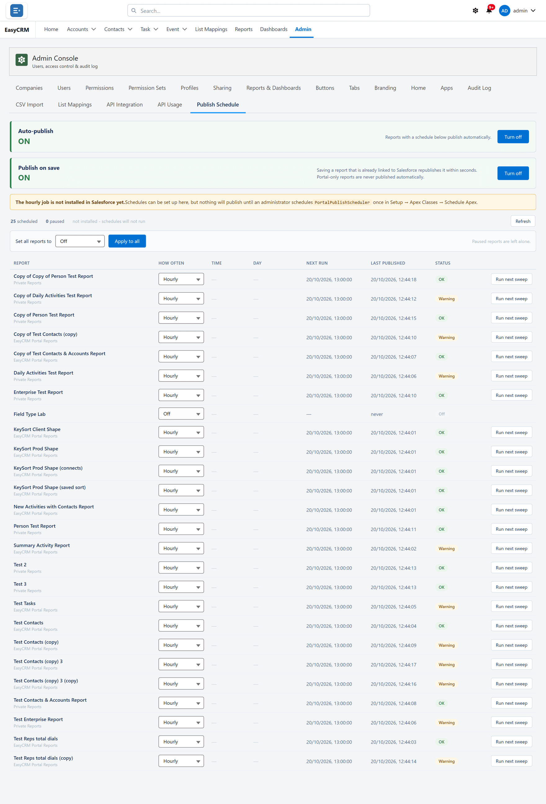
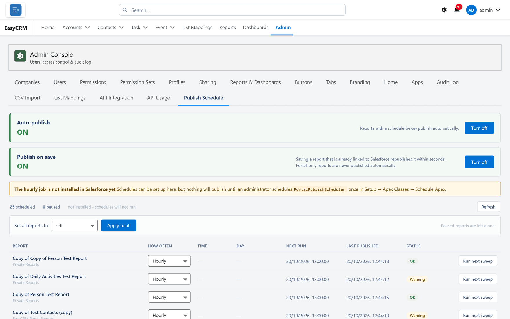
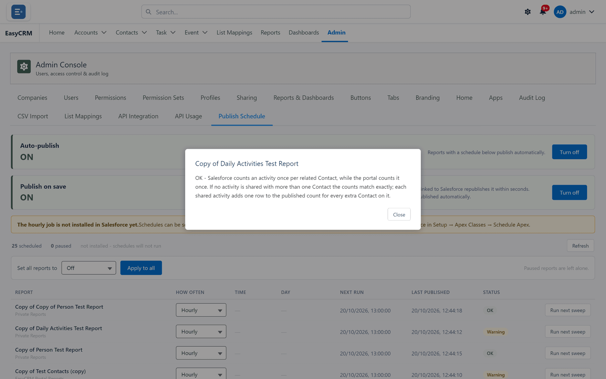

# Publish Schedule

**What it is.** Copying portal reports into Salesforce automatically — on a timetable, or the
moment a report is saved.

**What it does.** It publishes a portal report as a Salesforce report, and keeps that Salesforce
report up to date.

**Why it helps.** People who work in Salesforce see the same numbers as people in the portal,
without anybody rebuilding the report twice or exporting it by hand.

:::note Super Admin only
Only a **Super Admin** sees this tab. It cannot be given to a company's Admins.
:::

This is the unattended version of a job you can also do by hand from Salesforce — see
[Publishing a portal report to Salesforce](../salesforce/publish-reports.md). Everything that page
says applies here too, because a scheduled publish uses exactly the same machinery — including
this:

:::caution Reports synced from Salesforce are published over their originals
A report that was brought into the portal from Salesforce is linked to that Salesforce report.
Scheduling it, or saving it with **Publish on save** on, **overwrites the original Salesforce
report** with the portal's version.
:::

The same tab also holds the opposite direction —
[Auto-sync of new Salesforce reports](./report-auto-sync.md), which brings reports made in
Salesforce into the portal by themselves.

## Opening it

**Where:** In the portal → **Admin** → **Publish Schedule**

1. Click **Admin** in the top menu.
2. Click **Publish Schedule** in the row of tabs.


<!-- SHOT-RETAKE: admin/publish-schedule.png | The tab now has more above the report table: the Auto-sync new Salesforce reports card, then the settings block (Check for due reports with its countdown and Check now, the two tick boxes, New reports get, New Salesforce reports go to, Estimated load). Capture the whole tab with Auto-publish ON and a few reports scheduled, the table showing a Run now button -->

## What must be in place before anything publishes

1. **Auto-publish** is **ON** — the switch at the top of this screen.
2. **Salesforce runs the automatic check as a licensed user.** The portal itself runs as the
   site's guest user, which can never publish, so a one-off Salesforce step names the user that
   publishing runs as — see [The setup step in Salesforce](#the-setup-step-in-salesforce).
   The optional [hourly backup job](#the-optional-hourly-backup-job) also starts the check, as its
   own user, but only at its next hourly run — and **Check now**, **Run now** and **Publish on save**
   still need that setup step.

Schedules can be set up before either is done; they just do not run.

### Auto-publish

The **Auto-publish** card at the top reads **OFF** or **ON**.

| State | What happens |
|---|---|
| **OFF** *(default)* | *Nothing publishes automatically while this is off. Publishing by hand is unaffected.* |
| **ON** | *Reports with a schedule below publish automatically.* |

Click **Turn on** or **Turn off**. The message confirms it — **Auto-publish is ON. Reports with a
schedule will publish from the next sweep.** or **Auto-publish is OFF. Nothing will publish
automatically.** Turning it off keeps every schedule, so you can turn it back on without setting
anything up again.

That is deliberate: it writes into Salesforce on a timer, and that should be a decision rather
than a default.

### The setup step in Salesforce

Everything automatic on this tab runs in Salesforce through one event subscriber, the
**Portal Publish Request** trigger: the automatic check that publishes scheduled reports (started
when you turn **Auto-publish** on, and by **Check now**, **Run now** or a new check interval),
**Publish on save**, the list of Salesforce folders under
[New Salesforce reports go to](#new-salesforce-reports-go-to), and
[auto-sync](./report-auto-sync.md). Out of the box that subscriber runs as **Automated
Process**, which cannot publish, so a Salesforce administrator does this once:

1. In Salesforce, create a **Platform Event Subscriber Configuration** for
   `Portal_Publish_Request__e`, naming a user who has API access and can edit reports. Give that
   user the **Portal Admin Access** permission set too: it includes the page publishing uses to
   get its Salesforce session.
2. **Restart the subscriber**: go to the `PortalPublishRequestTrigger` trigger, deactivate it, save,
   then reactivate it and save again.

:::caution Step 2 is not optional
Creating the configuration alone does not take effect. The subscriber keeps running as the old user
until the trigger is restarted — so it looks correctly configured and still fails.
:::

:::caution Name a service user, not a person
Publishing runs as that user. Use a dedicated Salesforce admin account — not a person who may
leave or lose their rights, which would stop publishing without anyone noticing.
:::

Without this step the screen keeps saying **starting the automatic check - press Refresh in a
minute**, and a save with **Publish on save** on reads *Auto-publish on save skipped: no
Salesforce session…* or a permissions error that does not obviously point here. Check this step
before anything else.

### The optional hourly backup job

The automatic check is a chain of short jobs in Salesforce, and such a chain can stop — when
Salesforce runs out of capacity for background jobs, for example. Opening this tab starts it
again. The hourly job is a safety net on top: once an hour it publishes whatever is due and
restarts the automatic check (and auto-sync) if they have stopped.

A Salesforce administrator installs it once. The simplest way is one line of Apex, run from the
Developer Console (**Debug** → **Open Execute Anonymous Window**):

```apex
System.schedule('EasyCRM Portal Auto-Publish', '0 5 * * * ?', new PortalPublishScheduler());
```

That runs the job at five past every hour. If you use **Schedule Apex** in Setup instead, keep
**Auto-Publish** in the job's name — that is how this screen recognises the job. Schedule it as
the same service user as above: the job runs as whoever scheduled it.

Press **Refresh** on this screen afterwards. The message says what it found:
**Refreshed. Publishing is checking every minute.**, **Refreshed. Hourly job installed; next
sweep** *time*, or **Refreshed. The hourly job is still not installed in Salesforce.**

:::note If Salesforce refuses the line
In an org where the package is installed with its namespace, Salesforce may refuse to schedule
the class from your org. If it does, contact support rather than working around it.
:::

When **Auto-publish** is on, nothing is checking and the hourly job is not installed either, a
warning banner says so:

*Automatic publishing is not checking right now. A start has been requested; press Refresh in a
minute. If this message stays, ask a Salesforce administrator to check that the
`Portal Publish Request` event subscriber runs as a licensed admin user - publishing runs as
that user. The optional hourly backup job (`PortalPublishScheduler`) is not installed either.*


<!-- SHOT-RETAKE: admin/publish-schedule-not-installed.png | The old "The hourly job is not installed in Salesforce yet" banner no longer exists. Capture the new warning banner "Automatic publishing is not checking right now. …" — it shows only with Auto-publish ON, the automatic check stopped (for example no Platform Event Subscriber Configuration) and no hourly job installed -->

## How often it checks

Publishing looks for due reports at a set interval. A report publishes at the first check on or
after its time.

**Where:** **Admin** → **Publish Schedule** → **Check for due reports**

1. Choose an interval: **Every minute** *(default)*, **Every 2 minutes**, **Every 5 minutes**,
   **Every 10 minutes**, **Every 15 minutes**, **Every 30 minutes**, **Every 1 hour**,
   **Every 2 hours**, **Every 4 hours**, **Every 6 hours**, **Every 12 hours**, **Every 1 day** —
   or **Custom…**, type any whole number of minutes from 1 to 1,440 and click **Apply**.
2. The message confirms it, for example **Publishing now checks for due reports every 15
   minutes. The next check happens right away, then on the new interval.**

A longer interval means fewer checks, and reports publish up to that much later than their
time. Beside the setting, a countdown reads **Next check in** *m:ss* **(at** *time***)**, or
**Checking now…**; **Auto-publish is off - nothing is checked.** while the switch is off; and
**Not checking right now - see the message below.** when the automatic check has stopped.

**Check now** looks for due reports straight away instead of waiting:

| Message | Means |
|---|---|
| **Checking now - the run appears below in a few seconds.** | Due reports are being published. |
| **Nothing is due right now. Use Run now on a report to publish it straight away.** | No report's time has come. |
| **A run is already going - it is shown below.** | A previous check is still publishing. |
| **Could not ask Salesforce to check now. Try again in a moment.** | The request did not reach Salesforce. |

:::note There is no run panel on this screen
The **Check now** and **Run now** messages mention a run shown "below" or "above". This version
of the screen does not show that panel. Click **Refresh** after a few seconds and read **Last
published** and **Status** on the report's row instead.
:::

### Is it running?

The line above the table counts **scheduled** and **paused** reports, then says what is
driving publishing right now:

| Engine status | Meaning |
|---|---|
| **checking every minute (last sign of life** *N*s **ago)** — or **every** *N* **minutes** | Everything is working. |
| **starting the automatic check - press Refresh in a minute** | It has just been switched on, or opening the tab found it stopped and asked Salesforce to start it. If this never changes, see [The setup step in Salesforce](#the-setup-step-in-salesforce). |
| **automatic checking stopped - hourly backup runs at** *time* | Reports still publish, at the next hourly run. |
| **not running - schedules will not run** | Nothing is checking, and there is no hourly job to cover. |
| **idle - auto-publish is off** | Nothing publishes. Turn **Auto-publish** on. |

**Refresh** re-reads everything — useful straight after any change in Salesforce.

### Estimated load

Each publish costs Salesforce API calls — roughly 3 to 7. Under the settings, **Estimated load**
works out the cost of the schedules on screen: for example *About 48 publishes a day, roughly
144–336 Salesforce API calls (1–2% of the org's daily allowance of 15,000; 2,310 used so far
today).* It is shown as a warning above 20% of the allowance and as an error above 50%, where it
adds *This is more than half the allowance - choose longer intervals or turn on skipping.* With
**Only publish reports that are not in Salesforce yet** on, it counts only the reports still to
be created instead.

## Scheduling a report

**Where:** **Admin** → **Publish Schedule** → the report's row

1. Find the report. Its folder is shown under its name.
2. Choose **How often**: **Off**, **Every minute**, **Every 5 minutes**, **Every 10 minutes**,
   **Every 15 minutes**, **Every 30 minutes**, **Hourly**, **Daily** or **Weekly**.
3. For **Daily** or **Weekly**, set the **Time**. For **Weekly**, choose the **Day** too.
4. Check **Next run**.

There is no Apply button: each change saves as soon as you make it. A **Daily** or **Weekly**
schedule with no time is kept but never runs, and the screen warns you:
**Set a time for this report — until then it will not publish.**

Times are in your **Salesforce org's time zone** (the default time zone in Salesforce's Company
Information). **Next run** shows exactly when the report will next publish, in your own time
zone — so if the time you chose lands somewhere unexpected, you see it now rather than at 2am.

### What the list shows you

| Column | What it means |
|---|---|
| **Report** | The portal report, with its folder underneath. |
| **How often** | The schedule. |
| **Time** | For Daily and Weekly. A dash otherwise. |
| **Day** | For Weekly. A dash otherwise. |
| **Next run** | When it will next publish. A dash when there is no schedule, no time, or the report is paused; **Updated on save** for a report the schedule leaves to Publish on save (see [Only publish reports that are not in Salesforce yet](#only-publish-reports-that-are-not-in-salesforce-yet)). |
| **Last published** | When it last published successfully — on schedule, on save or by hand — or **never**. |
| **Status** | See below. Click it to read the full result of the last attempt. |
| Buttons | **Run now** on a scheduled report; **Resume** on a paused one. |

### Status

| Status | Meaning |
|---|---|
| **Off** | No schedule. |
| **Waiting** | Scheduled, and not published yet. |
| **OK** | The last publish worked. |
| **Warning** | It published, but with a note — usually that the Salesforce count cannot match the portal's exactly. |
| **Failed** | The last attempt failed. |
| **Paused** | The Salesforce report was deleted. See [Paused reports](#paused-reports). |
| **In Salesforce** | **Only publish reports that are not in Salesforce yet** is on, and this one is already there. The schedule leaves it to **Publish on save**. |

Click a status to open the last result in full, with the report's name as its title. **Close**
puts it away.



### Choosing a frequency

Match it to how fast the data changes and who is waiting for it.

| Frequency | Suits |
|---|---|
| **Every minute** … **Every 30 minutes** | Numbers watched closely during the day. Runs fall on round clock times — every 15 minutes is :00, :15, :30 and :45. |
| **Hourly** | Numbers people watch during the day. Publishes at the top of each hour. |
| **Daily** | Most reports. |
| **Weekly** | Summaries nobody reads more often than that. |
| **Off** | Leave it out of the schedule entirely. |

More often is not better. Each publish does real work and costs API calls, and a report nobody
looks at before Monday does not need rebuilding every hour. A report is never published more
often than the check runs: a report set to **Every minute** with checks **Every 15 minutes**
publishes every 15 minutes. **Estimated load** shows what your choices cost.

## Setting every report at once

The bar above the table reads **Set all reports to** [How often] **at** [time] **on** [day].

1. Choose the frequency, and the time and day where they apply.
2. Click **Apply to all**.
3. Confirm in **Apply to every report** — for example *Set all 30 reports to daily at 02:00?*, or
   *Turn off auto-publish for all 30 reports?* — with **Apply**.

**Paused reports are left alone**, so setting everything to Daily does not silently restart
something that was paused for a reason. The message says how many were updated and how many
paused reports were skipped.

<!-- SHOT: admin/publish-schedule-apply-all.png | Publish Schedule with the bar set to Weekly at 02:00 on Monday and the "Apply to every report" confirmation open -->

## Publishing sooner

**Run now**, on a scheduled report's row, publishes **that one report** straight away: it brings
the report forward and asks Salesforce to check at once, so it normally publishes within seconds.
It does not touch any other report, and it publishes even when
[Skip reports that have not changed](#skip-reports-that-have-not-changed) is on.

The message reads **Publishing it now - follow it in the run panel above.** (there is no run
panel on this screen yet — click **Refresh** after a few seconds). **Run now** needs
**Auto-publish** on; otherwise the message is **Turn Auto-publish on first - nothing publishes
while it is off.**

The button is only on reports that have a schedule, and not on a report marked **In
Salesforce**. To publish a report that has no schedule, or to see the full message while you
watch, use [Publish Portal Reports](../salesforce/publish-reports.md) in Salesforce.

## When a publish fails

A failed report is tried again **60 minutes** later — or at its next run, when that comes sooner
for a report published every few minutes — up to **3 attempts** in all. After that it goes back
to its normal schedule, so a report that is genuinely broken reports once a cycle rather than
every hour.

The **Status** column shows **Failed**; click it for the reason. It is usually about a formula
column or a join Salesforce cannot reproduce exactly — publishing it by hand from
[Publish Portal Reports](../salesforce/publish-reports.md) shows the same message.

If Salesforce stops a run part-way through (a Salesforce limit), the report it was on reads
*Failed: the run stopped while publishing this report (a Salesforce limit). It will be tried again
at its next run. If a new Salesforce report was being created, check for a duplicate named "…".*

### The digest email

After a run in which anything **failed**, was **paused** or published **with a warning**, every
active Super Admin with an email address receives one summary email, titled
**Portal auto-publish: N failed, M with warnings**. A run where everything published cleanly
sends nothing. Like every portal email, it needs Salesforce email deliverability to be on.

## Paused reports

A schedule **pauses** when the **Salesforce report it publishes to has been deleted**. Automatic
publishing never re-creates a deleted report: deleting it is usually deliberate, and a robot
re-creating reports — after a sandbox refresh, say — would undo that by the dozen.

The status reads **Paused**, and its result says:
*Paused: the Salesforce report was deleted. Nothing was re-created. Use Publish now to re-create
it, then resume the schedule.*

- A paused report is **skipped** by every check. It is not retried.
- **Apply to all** leaves it alone.

To start it again:

1. In Salesforce, open **Publish Portal Reports** and click **Publish** on that report. Publishing
   by hand does re-create a deleted report.
2. Back here, click **Resume** on its row. The message reads **Resumed.**

Resuming without step 1 only pauses it again at its next run. Choosing a new frequency for it
also clears the pause.

<!-- SHOT: admin/publish-schedule-paused.png | Publish Schedule with one row showing the Paused status and the Resume button -->

## Publishing the moment a report is saved

**Publish on save** is a second card, shown only while **Auto-publish** is **ON**. Both must be on
for it to do anything.

| Setting | What happens when somebody saves a report in the portal |
|---|---|
| **OFF** *(default)* | *Reports publish on their schedule only. Saving one in the portal does not update Salesforce.* |
| **ON** | *Saving a report that is already linked to Salesforce republishes it within seconds. Portal-only reports are never published automatically.* |

"Linked to Salesforce" means published at least once — or synced from Salesforce in the first
place. A paused report is not published on save.

A save normally reaches Salesforce in **one to four seconds**.

The result is kept as the report's last result, so click its **Status** to read it — for example
**Auto-published on save.**, or *Auto-publish on save stopped: the Salesforce report was deleted.
Nothing was re-created. Publish it by hand to link this report again.* The status colour itself
follows scheduled runs, so read the text.

### Why it is not instant, exactly

The portal runs as the site's guest user, and a Guest User licence can never hold API access. A
publish attempted as the guest comes back refused. So saving a report does not call Salesforce
directly — it raises an internal request, and the subscriber in Salesforce does the work as a
proper licensed user a moment later.

That is also why the delay is a second or two rather than instant, and why it needs
[The setup step in Salesforce](#the-setup-step-in-salesforce) before it works at all.

## Settings for the whole schedule

Under **Check for due reports** are four more settings. Each saves as soon as you change it and
applies to every report.

<!-- SHOT: admin/publish-schedule-settings.png | Publish Schedule, the settings block under the Auto-sync card: Check for due reports with its countdown and Check now, both tick boxes, New reports get set to Daily at 09:00, New Salesforce reports go to set to "That folder - or, if Salesforce has none, this folder:" with a folder chosen, and the Estimated load line -->

### Skip reports that have not changed

**Skip reports that have not changed since they were last published** — off by default.
*Saves Salesforce API calls. Off: every scheduled run re-sends its reports, as before.*

On, a scheduled run sends a report only when something has changed since the schedule last
published it — its name, object, chart, folder or design in the portal, or the Salesforce report
itself in Salesforce. A skipped report keeps its last result and status; its next run simply
moves on. **Run now** and **Resume** always publish.

The messages: **Unchanged reports are now skipped - only reports whose design changed are sent to
Salesforce.** / **Every scheduled run re-sends its reports, changed or not (the original
behaviour).**

### Only publish reports that are not in Salesforce yet

**Only publish reports that are not in Salesforce yet** — off by default.
*New portal reports get their Salesforce report on schedule; reports already there are kept up to
date by Publish on save. Off: every scheduled report is published, as before.*

On, the schedule creates each new report's Salesforce report once, when it comes due, and then
leaves it alone. Those rows read **In Salesforce**, with **Updated on save** as their next run.

:::caution Turn Publish on save on with it
With this on and **Publish on save** off, nothing keeps the reports already in Salesforce up to
date. The screen warns you: *Publish on save is off - with "only reports not in Salesforce yet"
on, reports already in Salesforce are not kept up to date by anything. Turn Publish on save on
above.*
:::

### New reports get

The schedule a report **created in the portal** starts with — by **New**, **Save As** or
**Clone** — so it publishes at its next slot without anybody scheduling it by hand.

1. Choose the frequency from the same list as a report's **How often**. **Off** *(default)*
   means new reports start with no schedule.
2. For **Weekly**, choose the day after **on**; for **Daily** and **Weekly**, the time after
   **at** (it starts at 09:00).
3. Tick **Include reports saved in Private Reports** if personal reports should be scheduled
   too. Unticked, a report saved in **Private Reports** (or in no folder) starts with no schedule.

*Reports created in the portal from now on (new, Save As, Clone) start with this schedule, so they
publish at their next slot without being scheduled by hand. Existing reports keep theirs - use
"Set all reports to" for them. Reports imported from Salesforce are not affected.*

The message confirms it — for example **Reports created in the portal from now on start with:
Daily at 09:00.** — or **New reports start with no schedule (Off), as before.**

### New Salesforce reports go to

Where publishing **creates** a report in Salesforce. It applies to publishing by hand from
Salesforce too, not only to the schedule.

| Choice | A new report goes to |
|---|---|
| **The folder with the same name as the portal folder (as today)** *(default)* | *As today: a report goes to the Salesforce folder named like its portal folder; with no such folder, to the publishing user's private folder.* |
| **That folder - or, if Salesforce has none, this folder:** | *A report goes to the Salesforce folder named like its portal folder; when Salesforce has no such folder, to this one.* |
| **Always this folder:** | *Every report publishing creates goes into this folder. Reports already in Salesforce stay where they are.* |

For the last two, pick the folder from the second list. It offers only folders that exist in
Salesforce, read by the publishing user — the line under it says when, for example
**12 Salesforce folder(s), read just now.** The list is read again when this tab opens and it is
more than an hour old; **Refresh list** reads it now (**Reading the folder list from Salesforce -
it updates in a few seconds.**). The message confirms the choice, for example **New Salesforce
reports go to always "Shared Reports".**

A report that is already in Salesforce is never moved into the chosen folder. If the chosen
folder is later deleted in Salesforce, a publish says so — *Salesforce has no report folder named
"…" any more, so this report went to …* — and falls back to the default rule.

## Turning it off again

Click **Turn off** on the **Auto-publish** card. Schedules are kept but stop running, and
**Publish on save** stops with it.

## What is recorded

Every change on this screen — a schedule, **Apply to all**, **Run now**, **Resume**, **Check now**,
the check interval, either switch, both tick boxes, **New reports get** and **New Salesforce
reports go to** — is written to the [Audit Log](../operations/audit-log.md) under
**Report: Publish schedule**, and so is any attempt that was refused. Each automatic publish is
logged under **Report: Publish to Salesforce** with the username **System**.

## What goes wrong

| Symptom | Cause |
|---|---|
| Nothing ever publishes | **Auto-publish** is off, or Salesforce is not running the automatic check. The engine status says which. |
| **starting the automatic check - press Refresh in a minute** never changes | The Portal Publish Request subscriber does not run as a licensed user. See [The setup step in Salesforce](#the-setup-step-in-salesforce). |
| *Set a time for this report — until then it will not publish.* | A Daily or Weekly schedule has no time. |
| A report publishes hours away from the time you set | Times are in the Salesforce org's time zone. Check **Next run**. |
| A report shows **Paused** | Its Salesforce report was deleted. Publish it by hand, then **Resume**. |
| A report keeps failing | Click **Failed** to read why, or publish it by hand to see the same message. |
| *Skipped: could not obtain a Salesforce session for unattended publishing. Check that the scheduling user is active and can run Apex.* | The user publishing runs as is inactive or lacks access. Name a working service user in the subscriber setup (and reschedule the hourly job as that user, if you use it). |
| **automatic checking stopped - hourly backup runs at** … | Reports still publish, hourly. Opening this tab, or the hourly job, starts the automatic check again. |
| A report scheduled every minute publishes less often | Checks run less often than that. Shorten **Check for due reports**. |
| A scheduled report's **Last published** does not move | **Skip reports that have not changed** is on and nothing changed, or the report reads **In Salesforce**. |
| **Turn Auto-publish on first - nothing publishes while it is off.** | **Run now** needs **Auto-publish** on. |
| Saving a report does not update Salesforce | **Publish on save** is off, **Auto-publish** is off, the report has never been published, or the subscriber setup step was missed. |
| A Salesforce report someone maintains by hand was overwritten | It was synced into the portal and then scheduled or saved with **Publish on save** on. |
| **New Salesforce reports go to** offers no folders | The list is read by the publishing user. Click **Refresh list**; if it stays empty, check the subscriber setup. |
| No digest email arrived | Everything published cleanly, or no active Super Admin has an email address, or email deliverability is off. |

## Related

- [Publishing a portal report to Salesforce](../salesforce/publish-reports.md) — publishing by
  hand, and every message explained.
- [Auto-sync of new Salesforce reports](./report-auto-sync.md) — the other card on this tab.
- [The EasyCRM app in Salesforce](../salesforce/index.md) — where the manual screens live.
