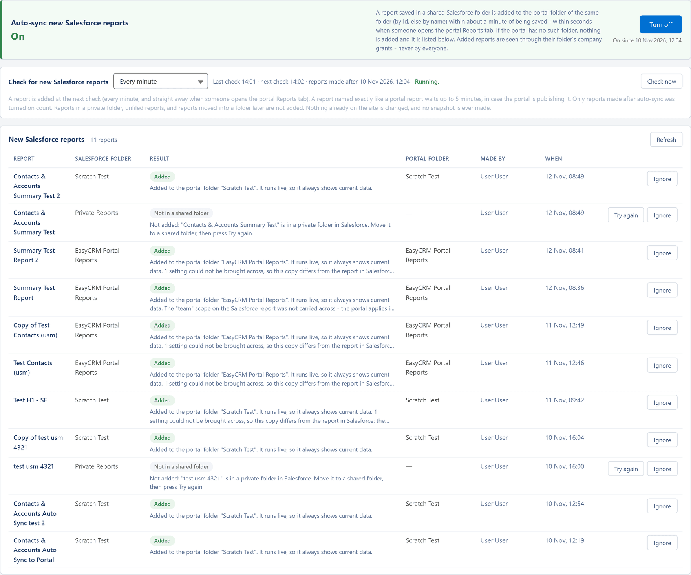
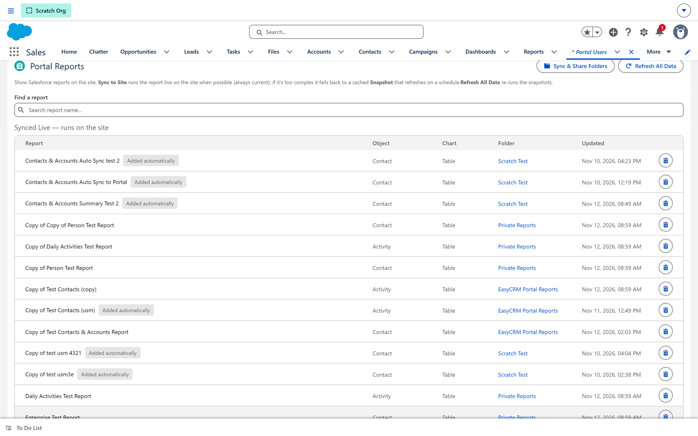

# Auto-sync of new Salesforce reports

**What it is.** A switch that brings new Salesforce reports into the portal by themselves.

**What it does.** When somebody saves a new report in a shared Salesforce folder, the portal
adds it to the portal folder of the same name, within about a minute — within seconds when
somebody opens the portal's **Reports** tab. The added report runs live, exactly as if you had
brought it in with **Sync to Site**.

**Why it helps.** Without it, every new Salesforce report waits until a Salesforce
administrator syncs it by hand. With it, a team that builds its reports in Salesforce finds them
in the portal straight away, in the folder they expect.

:::note Super Admin only
The auto-sync section sits on the **Publish Schedule** tab, which only a **Super Admin** sees.
It decides what reaches the portal from Salesforce for every company at once.
:::

## Opening it

**Where:** In the portal → **Admin** → **Publish Schedule** → **Auto-sync new Salesforce reports**

1. Click **Admin** in the top menu.
2. Click **Publish Schedule** in the row of tabs.
3. The **Auto-sync new Salesforce reports** card is below **Auto-publish** (and below **Publish on
   save**, when that card is shown).

## Before it can work

Auto-sync does its work in Salesforce, as the licensed user that publishing runs as — the portal
itself runs as the site's guest user, which cannot read Salesforce reports. So it needs the same
one-off Salesforce setup as publishing: the **Portal Publish Request** event subscriber must run
as a licensed admin user. See
[The setup step in Salesforce](./publish-schedule.md#the-setup-step-in-salesforce).
(The optional hourly publishing job also starts auto-sync, as its own user, once an hour — but
**Check now**, **Try again** and the quick checks from the Reports tab go through the
subscriber.)

It finds only the reports **that user** can see in Salesforce. A report in a folder that user
has no access to is never found.

## Turning it on

**Where:** **Admin** → **Publish Schedule** → **Auto-sync new Salesforce reports**

The card reads **Off** or **On**.

| State | What it says |
|---|---|
| **Off** *(default)* | *New reports made in Salesforce are not added to the portal by themselves. Sync to Site works as before.* |
| **On** | *A report saved in a shared Salesforce folder is added to the portal folder of the same folder (by Id, else by name) within about a minute of being saved - within seconds when someone opens the portal Reports tab. If the portal has no such folder, nothing is added and it is listed below. Added reports are seen through their folder's company grants - never by everyone.* |

1. Click **Turn on**. The message reads **Auto-sync is on. Reports saved in Salesforce from now
   on are added to the portal folder of the same folder within about a minute.**
2. Beside the button, **On since** *date and time* shows when it started counting.

**Only reports made after that moment count.** Reports that already existed are left alone —
bring those in with **Sync to Site** or the **Sync & Share Folders** wizard, as before.

**Turn off** stops it: **Auto-sync is off. Nothing already added was changed.** Turning it on
again starts counting afresh from that moment, so a report made while it was off is never picked
up by itself.

## How often it looks

Salesforce has no event that fires when a report is saved, so auto-sync **looks** for new
reports. How often is its own setting, separate from publishing.

**Check for new Salesforce reports** offers **Every minute** *(default)*, **Every 5 minutes**,
**Every 15 minutes**, **Every 30 minutes**, **Every hour**, **Every day** and **Custom…**.

- **Custom…** opens a box for any whole number of minutes from 1 to 1,440; then click **Apply**.
  Anything else is refused with **Enter a whole number of minutes from 1 to 1,440 (one day).**
- The change applies at once. The message reads, for example, **Auto-sync now checks for new
  Salesforce reports every 5 minutes.**

Two things make it quicker than the setting:

- **Opening the portal's Reports tab** — by anybody signed in — asks for a check straight away,
  and the Reports list reloads by itself when a report arrives. These extra checks run at most
  once every 15 seconds for the whole portal.
- **Check now** asks for one immediately: **Checking for new Salesforce reports now - new ones
  show in the list below within a few seconds.** It is greyed out while auto-sync is off.

The line beside the setting says what is happening:

| It reads | Meaning |
|---|---|
| **Last check** *time* **· next check** *time* **· reports made after** *date* | When it last looked, when it looks next, and where it started counting. |
| **Running.** | Its automatic check is alive. |
| **Starting…** | It has just been turned on and has not checked in yet. |
| **It had stopped - it is being started again.** | Opening the tab found it stopped and asked Salesforce to start it. |
| **Off - nothing is checked.** | The switch is off. |

If **Starting…** or **It had stopped** never turns into **Running.**, the subscriber setup above
is missing. The optional hourly publishing job, when it is installed, also restarts auto-sync
every hour.

## Where a report lands

| In Salesforce, the report is in | It goes to |
|---|---|
| A shared folder with a portal folder of the same name | That portal folder. Names match whatever their capitals. |
| A shared folder renamed in Salesforce since auto-sync last matched it by name | The same portal folder as before — auto-sync remembers the folder by its Salesforce Id. |
| A shared folder with no portal folder of that name | Nowhere. It is listed as **No portal folder**. |
| A private folder, or the unfiled **Public Reports** | Nowhere. It is listed as **Not in a shared folder**. |

"A portal folder" means a folder in the list a Super Admin sees on the **Reports** tab. Auto-sync
**never creates a folder**. To give a Salesforce folder its portal folder, either:

- make it in the portal, with exactly the Salesforce folder's name — see
  [Making a folder](../../use/reports/folders.md#making-a-folder); or
- open **Sync & Share Folders** on the **Portal Users** tab in Salesforce. Opening the wizard
  copies every Salesforce report folder you can see into the portal's folder list (the messages
  call this "Sync Folders"). You can close it again without sharing anything.

Then click **Try again** on the report's row.

## Who sees an added report

An added report is **not** shared with everybody. Its folder decides:

- **Super Admins** — always.
- **The Admins of a company that holds a grant on the whole folder** — a **Folder** row on the
  **Already shared** list of the Sync & Share Folders wizard. A grant on single reports in that
  folder does not reach a new one.
- **Standard users** — only once an Admin passes the report on under
  [Reports & Dashboards](./report-folders.md).

To show a new report to a company that holds only single-report grants, share it with the
**Sync & Share Folders** wizard as usual — it already shows as on the site.

This is deliberately narrower than **Sync to Site**, which makes a report readable by every Admin
of every company — see
[Who can see a synced report](../salesforce/portal-users.md#who-can-see-a-synced-report).

## The list of new Salesforce reports

**New Salesforce reports** lists every new report auto-sync has seen — the newest 100 — with a
count such as **12 reports · 2 waiting**. It refreshes itself every 20 seconds while auto-sync
is on; **Refresh** does it now.

| Column | What it shows |
|---|---|
| **Report** | The Salesforce report's name. |
| **Salesforce folder** | Where it is in Salesforce. |
| **Result** | What happened (below), and its message. Click a message to read it in full. |
| **Portal folder** | Where it went, or would go. |
| **Made by** | Who saved it in Salesforce. |
| **When** | When that result was reached. |
| Buttons | **Try again** and **Ignore**. |

With nothing to show it reads *No new Salesforce reports yet. Reports saved in a shared
Salesforce folder after auto-sync was turned on are listed here.*

Reports the portal already holds, and reports the portal itself published into Salesforce, are
skipped without being listed.

### Results

| Result | Message | What to do |
|---|---|---|
| **Waiting** | *Waiting to be added to the portal folder "…".* | Nothing. It is added at the next check. |
| **Added** | *Added to the portal folder "…". It runs live, so it always shows current data.* — followed by anything that did not come across, in the words a sync uses (see [What a report sync brings across](../salesforce/what-syncs.md#the-messages)) | Nothing. |
| **No portal folder** | *Not added: the portal has no folder "…". Create the folder in the portal (Reports > New Folder) or run Sync Folders, then press Try again.* | Give it a portal folder (see above), then **Try again**. |
| **Name already used** | *Not added: the portal folder "…" already has a report called "…". Rename one of them, then press Try again.* | Rename one, then **Try again**. |
| **Folder unclear** | *Not added: the portal has more than one folder called "…" (…), so it cannot tell which one to use. Nothing was added.* — or *Not added: Salesforce has 2 folders called "…", so the portal cannot tell which one this is. Nothing was added.* | Rename the duplicate folder, then **Try again** — or bring the report in by hand. |
| **Not in a shared folder** | *Not added: "…" is in a private folder in Salesforce. Move it to a shared folder, then press Try again.* — or the same for a report *in the unfiled Public Reports* | Move it to a shared folder in Salesforce, then **Try again**. |
| **Already on the site** | *Already on the site (brought in by hand), so nothing was added.* | Nothing. Somebody synced it first. |
| **Deleted in Salesforce** | *Not added: the report was deleted in Salesforce (or the publishing user can no longer see it).* | Nothing — or check that user's folder access. |
| **Cannot run live** | *Not added: this report uses features the portal cannot run live, so it was left out (no snapshot is made). It can still be brought in by hand with Sync to Site.* | Use **Sync to Site** if a snapshot will do. |
| **Failed** | *Not added: it could not be read from Salesforce after 3 tries (…). Press Try again, or bring it in by hand with Sync to Site.* — or *Not added: it was tried 3 times without success. …* | **Try again**, or sync it by hand. |

An add that does not work is tried again at a later check — **3 tries** in all. Meanwhile the
message reads, for example, *Try 1 of 3 did not work (…); it is tried again at a later check.*

A report named exactly like a portal report waits up to **5 minutes** before it is looked at,
in case it is the portal publishing that report into Salesforce at that moment.

### Try again and Ignore

- **Try again** — on every result except **Added**, **Waiting**, **Already on the site** and
  **Deleted in Salesforce** — looks at the report again straight away, in its current folder:
  **It will be tried again now.** It needs auto-sync on; otherwise **Turn auto-sync on first.**
- **Ignore** stops listing the report, and it is never tried again: **Ignored: it is no longer
  listed or tried. Nothing in Salesforce or on the site changed.** Nothing brings an ignored
  report back to the list — sync it by hand instead.

## What it never does

- Change, move or delete a report or folder already in the portal.
- Create a portal folder.
- Make a snapshot.
- Share a report with everybody.
- Pick up a report made before it was turned on, or a report **moved** into a shared folder
  later. (Moving a listed report and clicking **Try again** does work.)
- Change anything in Salesforce. It only reads.

## Where else it shows

| Where | What you see |
|---|---|
| The portal's **Reports** tab | The added report, in its folder, for whoever may see it. |
| The bell, for a Super Admin | *Added "…" to the portal folder "…"*, or *"…" was not added: the portal has no folder "…"*, from **From Salesforce** and the maker's name. An added one opens the report. See [Your notifications](../../use/start/the-screen.md#your-notifications). |
| Salesforce → **Portal Users** → **Synced Live — runs on the site** | An **Added automatically** badge beside the report's name. |
| The [Audit Log](../operations/audit-log.md) | Each report added, under **Report: Import from Salesforce**, by **System**, beginning `Auto-sync of new Salesforce reports. Added to the portal folder "…"`. The switch, the interval and **Check now** are under **Report: Publish schedule**; **Try again** and **Ignore** under **Report: Import from Salesforce**, by the Super Admin who clicked them. |

## What goes wrong

| Symptom | Cause |
|---|---|
| Nothing is ever added, and the line never reads **Running.** | The Portal Publish Request subscriber does not run as a licensed user. See [Before it can work](#before-it-can-work). |
| *The check could not be started. The Portal Publish Request subscriber must run as a licensed admin.* after **Check now** | Salesforce could not be asked to check. |
| An older Salesforce report never appears | Only reports made after auto-sync was turned on count. Sync it by hand. |
| A report made while auto-sync was off never appears | Turning it on again starts counting from that moment. Sync it by hand. |
| A report moved into a shared folder never appears | Moved reports are not picked up. Sync it by hand. |
| **No portal folder** | The portal has no folder of that name. Make one, or open **Sync & Share Folders**, then **Try again**. |
| A company's Admins cannot see an added report | Their company holds no grant on the whole folder. Share the report with the Sync & Share Folders wizard. |
| Standard users cannot see an added report | Company grants reach Admins only. An Admin re-shares it under [Reports & Dashboards](./report-folders.md). |
| A report shows **Waiting** for several minutes | It is named like a portal report and waits up to 5 minutes, or an earlier try has not finished. |
| A report you expected is not in the list | It was already on the site, it was published from the portal, it was ignored, or the publishing user cannot see its folder. |
| **Turn auto-sync on first.** | **Try again** and **Check now** need the switch on. |

## Where this fits

- [Publish Schedule](./publish-schedule.md) — the same tab, and the Salesforce setup both share.
- [Portal Users and Portal Reports](../salesforce/portal-users.md) — bringing reports in by hand,
  and sharing them with companies.
- [What a report sync brings across](../salesforce/what-syncs.md) — what an added report keeps,
  and what it cannot.
- [Reports and Dashboards](./report-folders.md) — passing reports on to Standard users.
