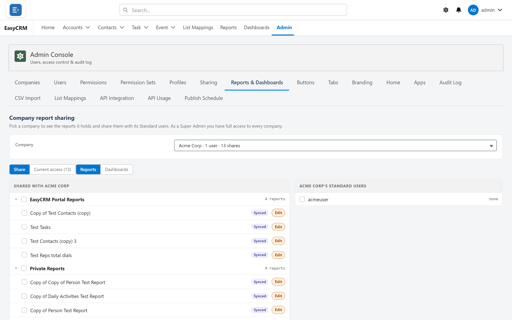

# Reports and Dashboards

**What it is.** Who can see which reports and dashboards.

**What it does.** You share a report, a dashboard or a whole folder with a company, or with
chosen people inside it.

**Why it helps.** One company's reports stay out of another's sight, and you set it once rather
than report by report.

:::note Getting reports into the portal is a separate job
This screen shares what is already in the portal. Bringing a Salesforce report **into** the portal
happens in Salesforce — see [Portal Users](../salesforce/portal-users.md).
:::

## Opening it

**Where:** In the portal → **Admin** → **Reports & Dashboards**

1. Click **Admin** in the top menu.
2. Click **Reports & Dashboards** in the row of tabs.

## Sharing something

**Where:** In the portal → **Admin** → **Reports & Dashboards** → **Share**

1. Find the report, dashboard or folder in the list.
2. Click **Share**.
3. Choose the company.
4. Choose the access:

| Access | Lets them |
|---|---|
| **Read** | Open it and run it. |
| **Edit** | Open it and change it. |

5. Click **Save**.

Give **Read** unless somebody has asked to change the report. **Edit** means they can change it
for everybody it is shared with.

Before it saves, **About to share** and **Will share** show exactly what is going to happen, and
**Already shared** lists anything in your selection that a company has already — so re-sharing a
folder does not create duplicates or alarm you with a bigger number than you expected.

## Sharing with particular people

Sometimes a whole company is too broad.

1. Click **Share** on the item.
2. Choose the people instead of the company.
3. Click **Share with selected users**.

## Seeing who has access now

Each item shows **Current access** with a count. Click it to see exactly which companies and
people, and what level each has.

**Existing company grants** is the same information gathered in one place — every grant any
company holds, on one list, which is the quickest way to answer "what can this customer see?"

## Taking access away

1. Open **Current access** for the item, or find the grant under **Existing company grants**.
2. Remove the company or person.

They lose it immediately. Anything they built on top of it stays theirs.

## Folders versus single reports

Sharing a **folder** shares everything in it, including anything added later. Sharing a single
**report** shares only that one.

Use folders for a set that belongs together — it is less work and less likely to be forgotten
when somebody adds the next report.

## Related

- [Publishing a portal report to Salesforce](../salesforce/publish-reports.md) — the opposite
  direction: a report built in the portal, pushed out to Salesforce.
- [Publish Schedule](./publish-schedule.md) — doing that automatically, on a timetable.
- [Sharing a report](../../use/reports/sharing.md) — what an ordinary portal user can share for
  themselves, within the ceiling you set here.

