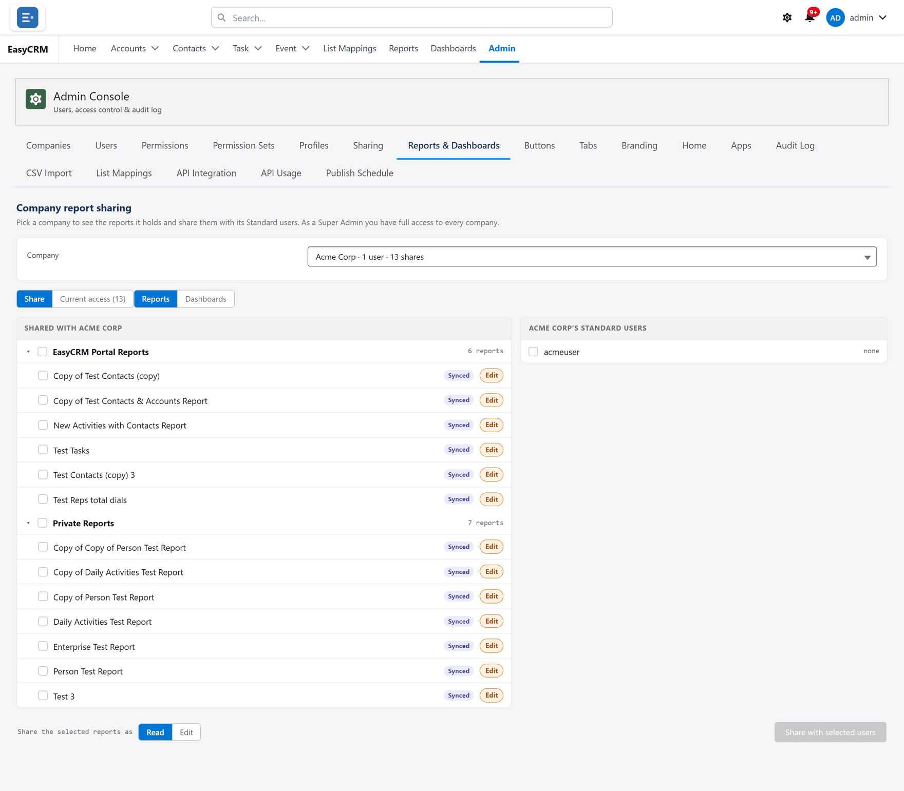
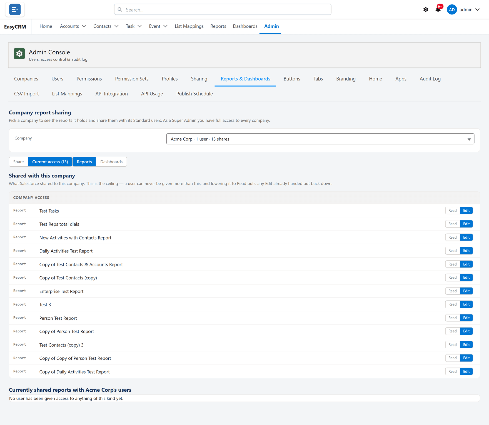

# Reports and Dashboards

**What it is.** The screen where reports and dashboards a company holds are passed on to that
company's **Standard users**.

**What it does.** You tick reports (or dashboards) on one side and Standard users on the other,
and share them at **Read** or **Edit**. You can also see, change and revoke what has already been
passed on.

**Why it is needed.** Sharing with a company — done in Salesforce, with the **Sync & Share
Folders** wizard — reaches only that company's **Admins**. A Standard user who belongs to a
company sees only the reports they own and the ones shared with them here. This screen is the
second half of the job.

:::note Getting reports to a company is a separate job
This screen passes on what a company already holds. Bringing a Salesforce report **into** the
portal, and sharing it with a company, happens in Salesforce — see
[Portal Users and Portal Reports](../salesforce/portal-users.md).
:::

## Who uses it

| Role | What they see |
|---|---|
| **Admin** (with this tab) | Their own company: what it holds, and the Standard users they look after — the ones they manage plus every Standard user at their company. |
| **Super Admin** | Any company, chosen from a **Company** list, with all of that company's Standard users. Also the company's own access, which only a Super Admin can change. |

## Opening it

**Where:** In the portal → **Admin** → **Reports & Dashboards**

1. Click **Admin** in the top menu.
2. Click **Reports & Dashboards** in the row of tabs.

The heading reads **Reports shared with your company** for an Admin, and
**Company report sharing** for a Super Admin (or the same with "dashboard" once you switch to
**Dashboards**).

## Sharing with Standard users

**Where:** **Admin** → **Reports & Dashboards** → **Share**

1. **Super Admin only:** choose the company from **Company**. Each entry shows how many Standard
   users it has and how many shares it holds.
2. Make sure **Share** is selected at the top, then choose **Reports** or **Dashboards**.
3. In the left box — **Shared with your company** (or **Shared with** *company*) — tick what to
   share.
   - Items are grouped by folder. Tick a folder to tick every item in it; click **▾** to fold a
     folder away.
   - Each item is tagged **Built here** (made in the portal) or **Synced** (from Salesforce), and
     shows the company's level on it — **Read** or **Edit**. That level is the most you can pass
     on.
4. In the right box — **Your Standard users** (or the company's **Standard users**) — click each
   person to tick them. Each shows how many items they already have (**2 shared**), **none**, or
   **inactive**. Inactive users are greyed and cannot be ticked.
5. Under **Share the selected reports as**, choose **Read** or **Edit**.
6. Click **Share with selected users**. It stays greyed until at least one item and one person
   are ticked.

The toast confirms it — for example **3 re-shares written (capped at your company’s level).**
"Capped" means exactly that: choosing **Edit** on an item your company holds at **Read** gives
those people **Read**.

Give **Read** unless somebody has asked to change the report. **Edit** means they can change it
for everybody it is shared with.

### What appears in the left box

- Everything shared with the company from Salesforce — single reports and dashboards, and whole
  folders where a folder grant exists.
- Reports or dashboards built in the portal and saved with **My company** visibility.
- For an Admin, reports they built in the portal themselves; for a Super Admin, reports built by
  any of the company's users. These can be shared at up to **Edit**.

## Seeing and changing who has access

**Where:** **Admin** → **Reports & Dashboards** → **Current access**

The button carries a count, such as **Current access (7)**. **Reports** and **Dashboards** switch
between the two kinds here too.

**Currently shared reports with your users** (or with the company's users) lists every re-share,
one row per item and person:

| Control | What it does |
|---|---|
| **Read** / **Edit** | Changes that person's level in place. Asking for more than the company holds keeps it at the company's level, and says so: **Kept at Read — capped at the company’s level.** |
| **Revoke** | Removes that person's access immediately. There is no confirmation. |

If nothing has been passed on yet it says *No user has been given access to anything of this kind
yet.* Revoking takes away access only; anything the person built from it, such as their own copy,
stays theirs.

### The company's own access — Super Admins only

Above the re-shares, a Super Admin also sees **Shared with this company**: *What Salesforce shared
to this company. This is the ceiling — a user can never be given more than this, and lowering it
to Read pulls any Edit already handed out back down.*

The **Company access** box lists each item or folder with **Read** and **Edit**. Changing it here
is the same as changing it in the Salesforce wizard; to remove it altogether, use **Revoke** on
the wizard's **Already shared** tab.

## Folders versus single reports

Re-shares are made **report by report**. Ticking a folder here ticks the reports in it **today**;
a report added to that folder later is not passed on until you share it too.

A company's own grant can be on a whole folder, and then it does cover reports added later — for
the company's Admins. Their Standard users still need each new report shared with them here.

That includes reports [auto-sync](./report-auto-sync.md) adds from Salesforce. Such a report is
not shared with everybody: a company's Admins see it only through a grant on its whole folder,
and Standard users only once it is shared with them here.

## What is recorded

Every re-share, level change and revoke — and any refused attempt — is written to the
[Audit Log](../operations/audit-log.md), naming each person and the level they now have.

## What goes wrong

| Symptom | Cause |
|---|---|
| The left box is empty | The company holds nothing yet. A Super Admin shares to it from the Salesforce **Sync & Share Folders** wizard first. The screen says so: *This company holds no shared reports yet …* or *Nothing to share yet …* |
| A Standard user still cannot see a report shared to their company | A company grant reaches Admins only. Share it with them here. |
| You chose **Edit** but they only have **Read** | The company holds that item at **Read**. Only a Super Admin can raise it. |
| A person cannot be ticked | They are inactive. |
| A person you expect is not listed | They are not a Standard user at the company, or — for an Admin — not one you look after. |
| A new report in a shared folder is missing for Standard users | Re-shares are per report. Share the new one. |
| **Shared with this company** is not shown | It is for Super Admins only. |

## Related

- [Portal Users and Portal Reports](../salesforce/portal-users.md) — bringing Salesforce reports in
  and sharing them with companies.
- [Publishing a portal report to Salesforce](../salesforce/publish-reports.md) — the opposite
  direction: a report built in the portal, pushed out to Salesforce.
- [Publish Schedule](./publish-schedule.md) — doing that automatically, on a timetable.
- [Auto-sync of new Salesforce reports](./report-auto-sync.md) — new Salesforce reports added to
  their portal folder by themselves.
- [Sharing a report](../../use/reports/sharing.md) — what a report's author can and cannot do
  without you. Worth reading: the **Shared** tick box they can reach does nothing for Standard
  users once companies are in use, so those requests have to come to this screen.

