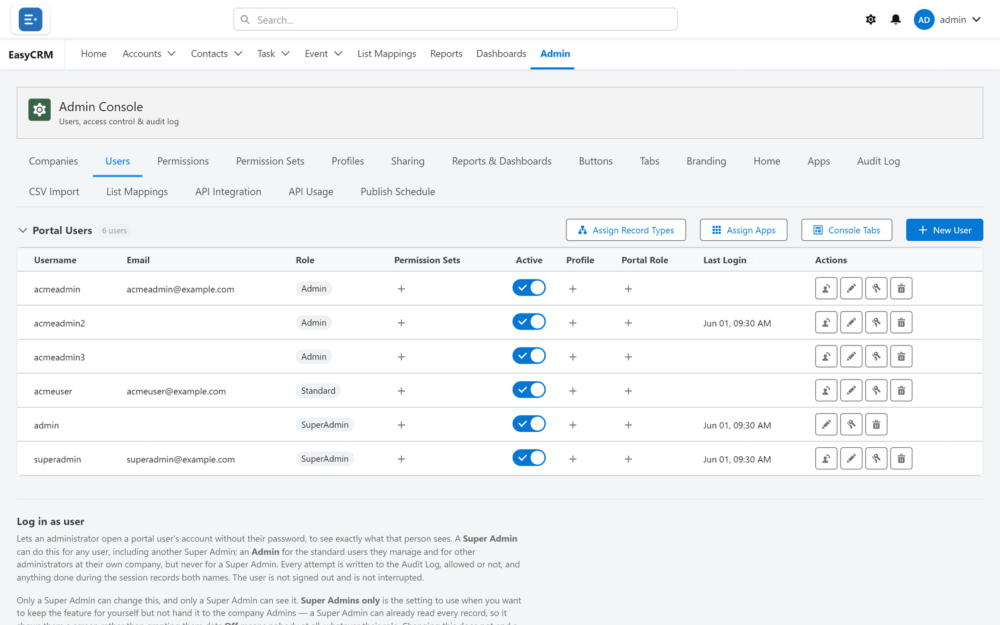

# The Admin Console

**What it is.** The single place everything about running the portal is managed.

**Who sees it.** Only Admins and Super Admins. For everybody else the **Admin** tab does not
appear at all.

## Opening it

**Where:** In the portal → **Admin** in the top menu

1. Click **Admin** in the row of tabs across the top of the screen.
2. The **Admin Console** opens.

Under the heading is a row of tabs — eighteen of them for a Super Admin, wrapping onto a second
line. Each one is a separate area. Click a tab to open it.

The tab you are on is kept in the browser's address. Reloading the page reopens it, the browser's
**Back** and **Forward** move between the tabs you opened, and a saved link opens that tab — as
long as you may see it; otherwise the console opens on your first tab.

## What each tab is for

| Tab | What you do there | Who |
|---|---|---|
| [Companies](./companies/index.md) | Set up the companies whose people use the portal. | Super Admin only |
| [Users](./users/index.md) | Add people, set their role, reset passwords. | |
| [Permissions](./access/permissions.md) | Decide what each person may do with records. | |
| [Permission Sets](./access/permission-sets.md) | Bundle extra access and hand it to individuals. | |
| [Profiles](./access/profiles.md) | Set the starting access for a kind of person. | |
| [Sharing](./sharing/index.md) | Decide who can see whose records. | |
| [Reports & Dashboards](./data/report-folders.md) | Re-share reports and dashboards within a company. | |
| [Buttons](./appearance/buttons.md) | Add your own buttons to record pages. | |
| [Tabs](./appearance/tabs.md) | Choose which tabs appear, and in what order. | |
| [Branding](./appearance/branding.md) | Set the portal name, logo and colours. | |
| [Home](./appearance/home.md) | Choose what everybody sees on the home page. | |
| [Apps](./appearance/apps.md) | Group tabs into apps. | Super Admin only |
| [Audit Log](./operations/audit-log.md) | See who did what. | |
| [CSV Import](./data/csv-import.md) | Load accounts and contacts from a spreadsheet. | |
| [List Mappings](./data/list-mappings.md) | Link a report to a FrontSpin calling list, and sync it. | |
| [API Integration](./data/api-integration.md) | Let another system read — or, if you allow it, change — your data. | |
| [API Usage](./data/api-usage.md) | See how much the API is being used. | |
| [Publish Schedule](./data/publish-schedule.md) | Send reports to Salesforce on a timetable, and let new Salesforce reports [come in by themselves](./data/report-auto-sync.md). | Super Admin only |

## Who sees which tabs

A **Super Admin** sees all eighteen.

An **Admin** never sees **Companies**, **Apps** or **Publish Schedule**. Of the other fifteen, they
see the ones allowed in two places — and only tabs allowed in **both**:

| Where | Sets |
|---|---|
| [Companies](./companies/index.md) → **Edit** → **Admin Tabs** | Which tabs every Admin at that company may see. |
| [Users](./users/index.md) → **Console Tabs** | Which of those one particular Admin sees. |

Both are set by a Super Admin, and in both, ticking nothing means "every tab allowed". An Admin
left with no tabs at all sees **You don't have access to any admin sections. Contact your
administrator.**

Hiding a tab is tidiness, not a lock: every screen still checks the Admin's role on the server.

## More areas that are not tabs here

- [Page layouts](./layouts/index.md) — reached from a record, not from this console.
- [The sign-in page](./appearance/login-design.md) — reached from **Branding**.
- Super Admin settings under the user list on **Users**: **Log in as user**, **Report speed**,
  [Long text filters on large reports](./operations/long-text-filters.md), **FrontSpin sync
  buttons** and **Page layout editor** — see
  [What an Admin can see](./users/what-admins-can-see.md#the-settings-beside-it).
- Settings changed in Salesforce rather than here — see [In Salesforce](./salesforce/index.md).

## Where to start on a new portal

1. [Companies](./companies/index.md) — create the company first, and its Admin.
2. [Users](./users/index.md) — add people, then put them in their company.
3. [Permissions](./access/permissions.md) — decide what each person may do.
4. [Sharing](./sharing/index.md) — decide which records they may do it to.
5. [Tabs](./appearance/tabs.md) and [Branding](./appearance/branding.md) — make it look right.

Steps 3 and 4 are the pair people most often get half-right. Both are needed.
