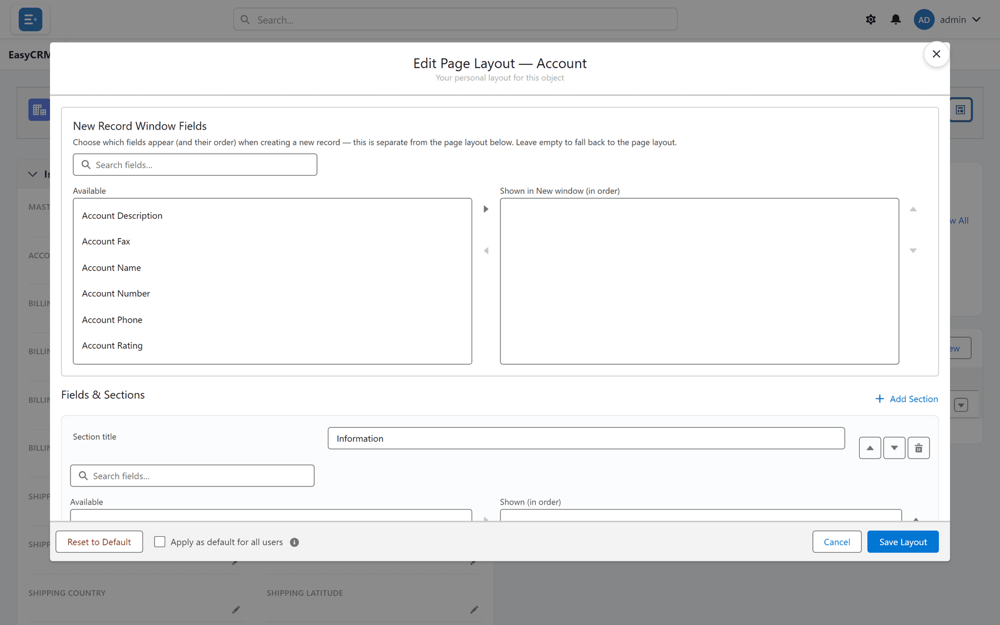
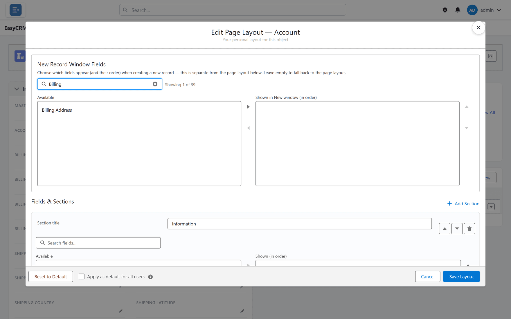

# Choosing fields

## What you are deciding

Which fields appear on a record page, in what order — for everybody who sees that kind of
record when you save it as the default, or just for you.

## Opening the editor

**Where:** In the portal → **Accounts** → any record's name → **Edit Page Layout**

It is reached from a record, not the Admin Console. Any record of that kind will do — the
layout applies to all of them.

This page describes the classic editor. With the [layout builder](./layout-builder.md) turned
on, the same button opens the builder instead — see
[In the layout builder](#in-the-layout-builder) below.

## Moving fields

Two lists sit side by side:

- **Available** — fields not on the page
- **Shown (in order)** — the fields on the page, top to bottom

| To | Do |
|---|---|
| Add a field | Click it on the left, then **Move selection to Shown (in order)** |
| Remove one | Click it on the right, then **Move selection to Available** |
| Reorder | Click it on the right, then **Move selection up** / **down** |

### Adding a field, step by step

1. Click **Accounts** — or whichever object you are changing — in the top menu.
2. Click any record's **name**. Any one will do; the layout applies to all of them.
3. Click **Edit Page Layout**.
4. Find the field in the **Available** list on the left. If the list is long, click
   **Search fields…** and type part of the name.
5. Click the field to select it. Hold **Ctrl** (**Cmd** on a Mac) to pick several at once.
6. Click **Move selection to Shown (in order)**.
7. With the field still selected on the right, click **Move selection up** or **down** until it
   sits where you want it to read.
8. Click **Save Layout**.

People with the record already open see the change after they reload.

## Finding a field among hundreds

Click **Search fields…** and type part of the name.

Fields you have already chosen stay on the right while you search, so searching can never lose
your work.

## How many fields to show

Fewer than you think. A layout is a reading surface, and every field you add makes the ones
that matter harder to find.

| Guide | Why |
|---|---|
| Lead with identity | Name, owner, status — what tells you which record this is |
| Then what people act on | The handful that change regularly |
| Then everything else, in a section | Collapsed, available, out of the way |
| Leave off what nobody reads | It is still on the record; it is just not displayed |

## Removing a field never deletes data

The value stays on the record and remains available to [reports](../../use/reports/index.md)
and the [API](../data/api-integration.md). It is only hidden from this page.

That makes removing fields low-risk and reversible — the opposite of deleting one.

## In the layout builder

With the [layout builder](./layout-builder.md) on, fields are dragged rather than moved between
lists, and a few things become possible that the classic editor cannot do:

| You can | How |
|---|---|
| Put a field exactly where it should read | Drag it from **Fields** to the spot in a section; a marker shows where it lands. |
| Place one field in more than one spot | Drag it in again. The tick beside it in **Fields** says how many times it is on the page. |
| Leave a gap to line fields up | Drag in **Blank Space**. |
| Show fields of a related record — a contact's account phone, say | Click the arrow beside a lookup in **Fields**, then drag. Read-only on the page. See [Fields from related records](./layout-builder.md#fields-from-related-records). |
| Show up to six fields under the record's name | Select the header and choose **Fields in the header**. See [The header](./layout-builder.md#the-header). |

The classic editor shows each field once, at its first place, and none of the rest — but saving
there keeps them. See [Moving between the two editors](./layout-builder.md#moving-between-the-two-editors).

## What goes wrong

| Symptom | Cause |
|---|---|
| A field is missing from **Available** | It does not exist on that object, or you lack permission for it. |
| Your change did not appear | **Save Layout** was not clicked, it was saved for you only, or people need to reload. |
| Somebody still cannot edit a field | Layout shows a field; **Editable Fields** permission decides if they may change it. |
| A field's name differs from its name in Object Manager | The layout keeps the label from the Salesforce page layout it was synced from, or the label Salesforce's own page shows for a lookup (**Account Name** for **Account ID**). See [Field names in the editor](./index.md#field-names-in-the-editor). |
| A field from a related record is missing for some people | They may not read that object, a lookup on the way, the field, or the related record itself. |

The third row is the common confusion: putting a field on a layout does **not** grant edit
access. See [Permissions](../access/permissions.md).

## Where this fits

Fields are one of four things a layout controls, alongside
[sections](./sections.md), [related lists](./related-lists.md) and the
[new-record window](./new-record-window.md). The [layout builder](./layout-builder.md) adds
where on the page each one sits.
