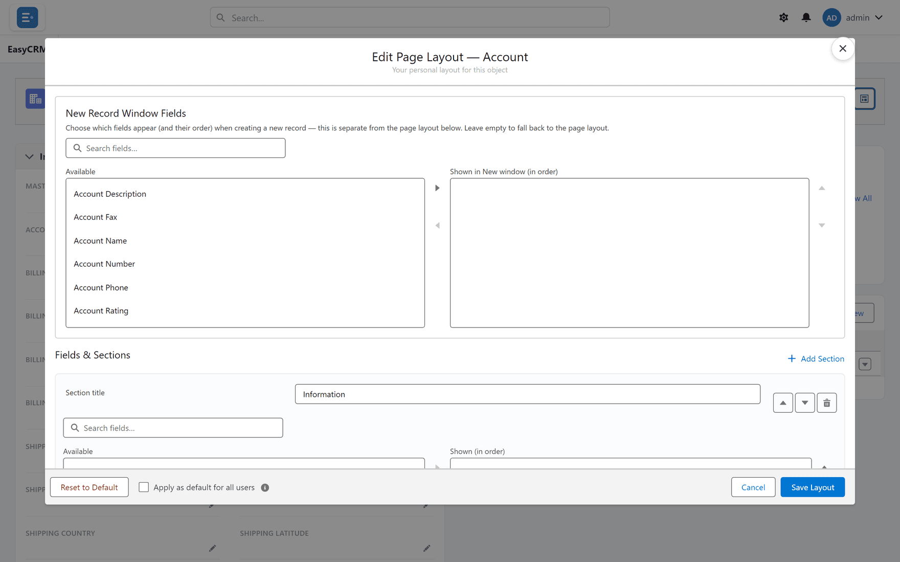
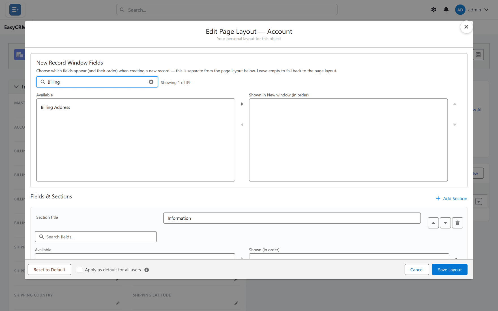
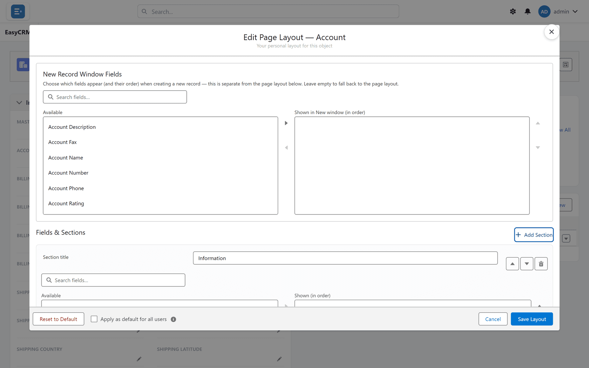
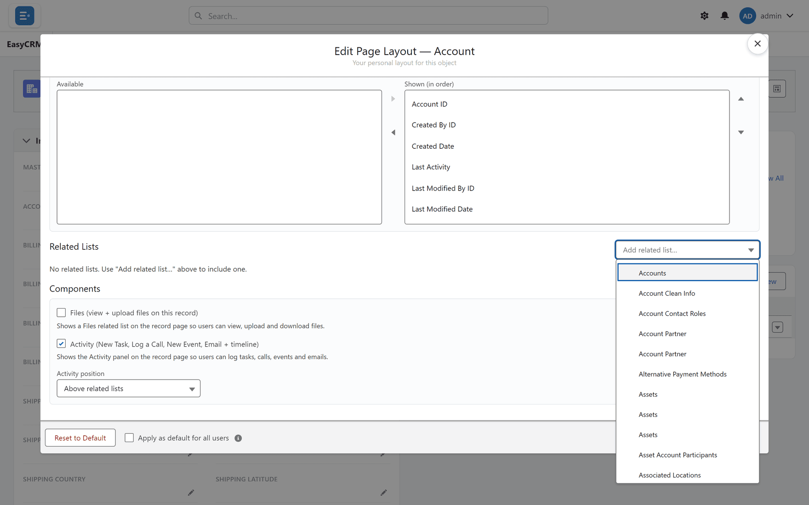

# Page layouts

**What it is.** The editor that decides what a record page looks like for everybody.

**What it does.** You choose which fields appear, in what order, grouped into sections, and
which related lists show underneath.

**Why it helps.** Most records have far more fields than anybody needs. A layout shows the ten
that matter and hides the rest, so the page is readable.

## In this section

| Page | Covers |
|---|---|
| [Choosing fields](./fields.md) | Which fields appear, and in what order |
| [Sections](./sections.md) | Grouping fields under headings |
| [Related lists](./related-lists.md) | The tables at the bottom of a record |
| [The new-record window](./new-record-window.md) | What the **New** form asks for |

## Opening the editor

It is **not** in the Admin Console. You reach it from a record.

**Where:** In the portal → **Accounts** → any record's name → **Edit Page Layout**

1. Click **Accounts** (or whichever tab) in the top menu.
2. Click any record's **name** to open it. It does not matter which — the layout applies to
   all of them.
3. Click the small button at the far right of the record's button row, next to **Change
   Owner**. Its tooltip reads **Edit Page Layout**.
4. The editor opens.

**What you change here applies to everybody** who sees that kind of record, not just you.

## Choosing which fields appear

The editor shows two lists side by side.

- **Available** on the left — fields not currently on the page.
- **Shown (in order)** on the right — the fields on the page, top to bottom.

1. To add a field: click it on the left, then click **Move selection to Shown (in order)**.
2. To remove one: click it on the right, then click **Move selection to Available**.
3. To reorder: click a field on the right, then **Move selection up** or **Move selection
   down**.

Removing a field from a layout **never deletes data**. The value stays on the record; it is
just not displayed.

## Finding a field quickly

There can be hundreds of fields.

1. Click the **Search fields…** box above the list.
2. Type part of the field name.

The list narrows as you type. Fields you have already chosen stay on the right — searching
can never lose your work.

## Sections

A section is a heading with fields grouped under it, such as "Billing" or "System
Information".

**Where:** In the portal → the layout editor → **Add Section**

1. Click **Add Section**.
2. Type a name for it.

   

3. Move fields into it.

Use **Move section up** and **Move section down** to reorder sections, and **Remove section**
to delete one. Removing a section does not delete its fields or any data.

## Related lists

These are the tables at the bottom of a record — the contacts at this account, for example.

**Where:** In the portal → the layout editor → **Related Lists** → **Add related list…**

1. Scroll to the **Related Lists** part of the editor.
2. Click the **Add related list…** box.
3. Choose which records it should show.

**Above related lists** controls where the activity panel sits relative to them.

## The New Record window

The record page and the **New** window can show different fields.

Set the New window separately, under **New Record Window Fields**. Keep it short — usually
just what is required — so creating a record is quick.

## Saving, and starting again

| Button | What it does |
|---|---|
| **Save Layout** | Keeps your changes, for everybody. |
| **Cancel** | Leaves without changing anything. |
| **Reset to Default** | Puts the layout back to how it started. |

**Reset to Default** loses your field arrangement but touches no record data.

## The whole editor, control by control

| Control | What it does |
|---|---|
| **Fields & Sections** | The record page itself. |
| **Add Section** / **Section title** | Groups fields under a heading. |
| **Available** / **Shown (in order)** | Which fields appear, and in what order. |
| **Components** | Non-field blocks on the page. |
| **Activity position** / **Files position** | Where activities and files sit relative to the fields. |

### Related lists

| Control | What it does |
|---|---|
| **Related Lists** | Lists of connected records on the page. |
| **Available columns** / **Shown columns (in order)** | Which columns each list shows. |
| **Rows to show** | How many rows before it needs expanding. |

### The New Record window

| Control | What it does |
|---|---|
| **New Record Window Fields** / **New record fields** | The fields on the create form. |
| **Shown in New window (in order)** | Their order. |

Keep this short. Every field here is one more thing somebody must pass to create a record, and
anything not required is better filled in afterwards on the record itself.

### Saving

| Control | What it does |
|---|---|
| **Save Layout** | Saves your changes. |
| **Apply as default for all users** | Makes this the layout everyone gets. |
| **Your personal layout for this object** | Indicates you are editing only your own view. |
| **Reset to Default** | Discards your personal layout. |

:::note Personal, or everybody's
Without **Apply as default for all users**, you are changing only what **you** see. That is the
usual reason a colleague reports that a layout change "did not work".
:::
