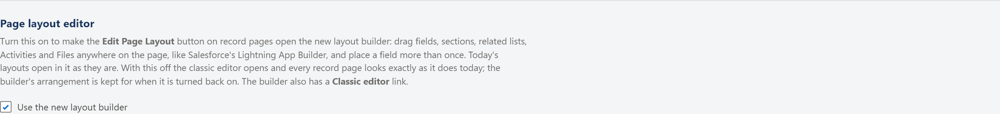
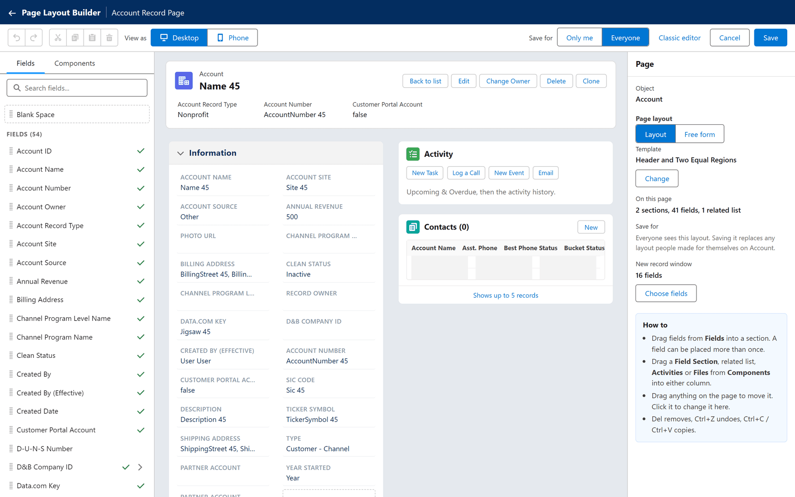
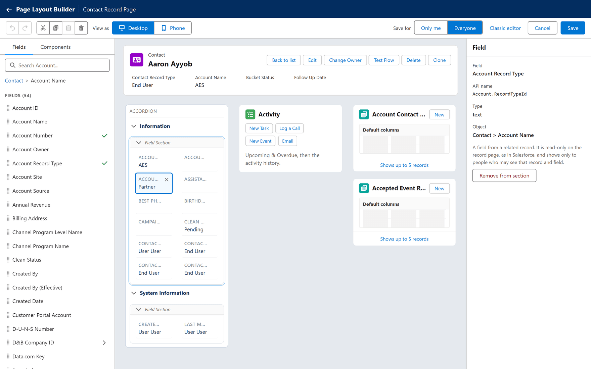
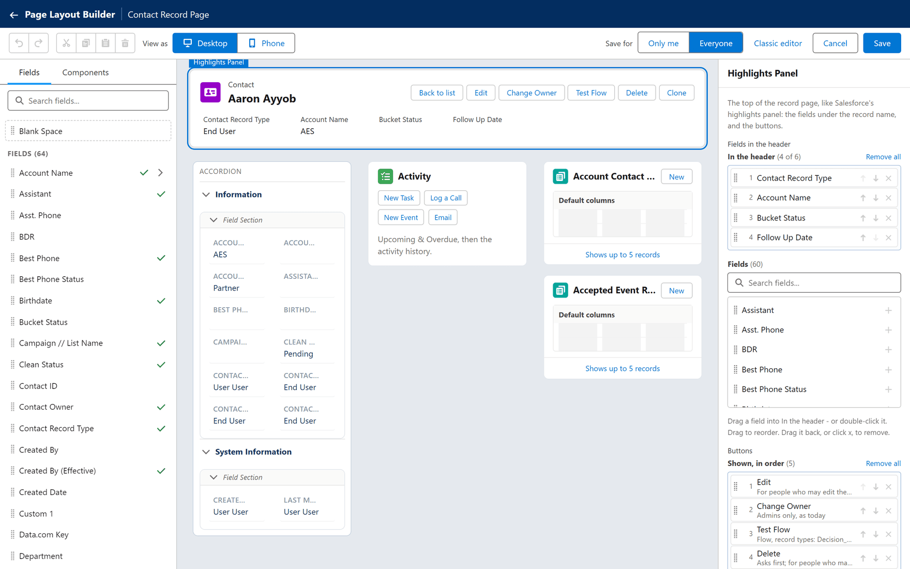
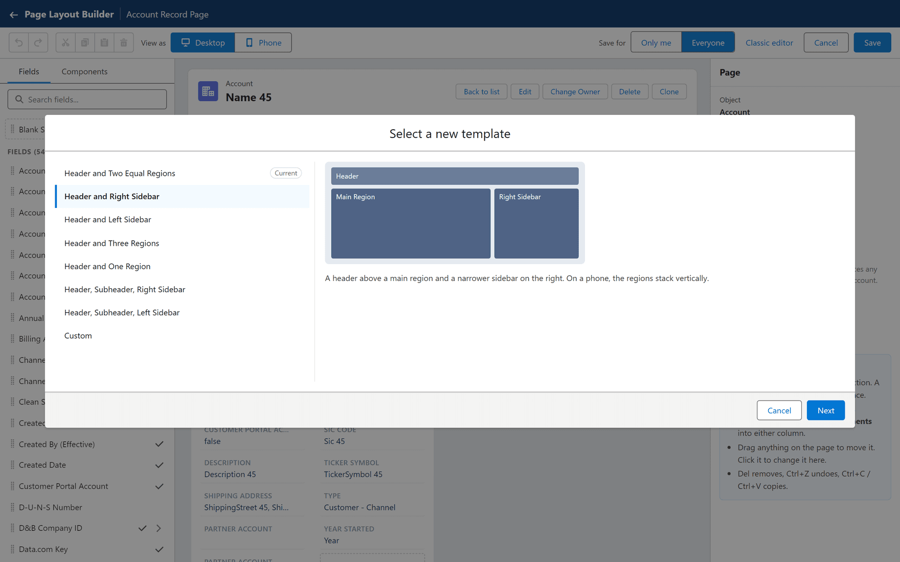

# The layout builder

**What it is.** A second editor for record pages, laid out like Salesforce's Lightning App
Builder: fields and components on the left, the record page in the middle, and the settings of
whatever you select on the right.

**What it does.** You drag fields, sections, related lists, the activity panel and Files to any
place on the page — any column, a tab, an accordion section — and you can place one field in more
than one spot. You also choose a page template, the fields shown under the record's name, and
the buttons at the top.

**Why it helps.** The [classic editor](./index.md) decides *what* is on a record page. The
builder also decides *where*. A busy record can keep its history in one tab and its details in
another, instead of one long scroll.

Both editors work on the same layouts. Saving in one never throws away the other's work — see
[Moving between the two editors](#moving-between-the-two-editors).

## Turning it on

The builder is off until a Super Admin turns it on. It is one switch for every company.

**Where:** In the portal → **Admin** → **Users** → **Page layout editor** → **Use the new layout builder**

1. As a Super Admin, click **Admin**, then **Users**.
2. Scroll below the list of users to the panel headed **Page layout editor**. Only a Super Admin
   sees it.
3. Tick **Use the new layout builder**.

The panel reads:

> Turn this on to make the **Edit Page Layout** button on record pages open the new layout
> builder: drag fields, sections, related lists, Activities and Files anywhere on the page, like
> Salesforce's Lightning App Builder, and place a field more than once. Today's layouts open in it
> as they are. With this off the classic editor opens and every record page looks exactly as it
> does today; the builder's arrangement is kept for when it is turned back on. The builder also
> has a **Classic editor** link.

Ticking it says **The layout button on record pages now opens the new layout builder.**;
unticking it says **The layout button on record pages opens the classic editor again.** Each
change is written to the [Audit Log](../operations/audit-log.md) as **Change Permission** —
`New layout editor turned on for every company` (or `turned off`).

### What the switch changes

| | Switch off (the default) | Switch on |
|---|---|---|
| **Edit Page Layout** opens | The classic editor | The layout builder |
| A record page whose layout was saved in the builder | Drawn the classic way | Drawn as the builder arranged it |
| Any other record page | Drawn the classic way | Drawn the classic way — it looks the same either way |

**Turning it off deletes nothing.** A page saved in the builder is then drawn from the same
layout the classic way: sections on the left; Activity, related lists and Files on the right;
each field once, in the first place it was put; no fields from related records; the usual header,
with no fields under the name and no **Delete** or **Clone**; and whatever sat in tabs or an
accordion, in reading order as ordinary sections and lists. Turn it back on and the builder's
arrangement returns.

## Opening it

**Where:** In the portal → **Accounts** (or any tab) → a record's name → **Edit Page Layout**

1. Open any record of the kind whose page you want to change. Its values fill the preview, so a
   record with most fields filled in is easiest to work with.
2. Click the small layout button at the far right of the record's button row. Its tooltip reads
   **Edit Page Layout**.
3. The builder fills the window. Its title bar reads **Page Layout Builder** and the page's name —
   **Account Record Page**, for example.

The button appears for people with **Edit Layout** on that kind of record — see
[Permissions](../access/permissions.md).

The builder opens on your own layout for that kind of record if you have one, otherwise on the
one everybody sees:

| That layout | The builder starts from |
|---|---|
| Saved in the builder before | That arrangement — brought up to date with anything the classic editor changed since. |
| Made in the classic editor | The page exactly as it looks today: the sections down the left; Activity, the related lists and Files down the right, in the page's order. Sections with the same title are merged, as the page always showed them. |
| None at all | An **Information** section with every field except the system ones, a **System Information** section with those, and Activity on the right where the object has activities. No related lists. |

Nothing is stored until you click **Save**.

## The screen

| Part | What it holds |
|---|---|
| The toolbar | **Undo**, **Redo**, **Cut**, **Copy**, **Paste** and **Delete**; **View as** **Desktop** or **Phone**; **Save for** (admins only); **Classic editor**, **Cancel** and **Save**. |
| The left panel | Two tabs, **Fields** and **Components**, with a search box over them. |
| The middle | The record page, previewed with the values of the record you opened the builder from. |
| The right panel | The settings of whatever you selected — or of the page itself when nothing is selected. Click an empty part of the page to get back to them. |

**View as** **Phone** shows the page as a phone draws it: everything in one column.

| Key | Does |
|---|---|
| **Del** or **Backspace** | Removes what is selected. |
| **Ctrl+Z** / **Ctrl+Y** | Undo / redo, up to 50 steps. |
| **Ctrl+C**, **Ctrl+X**, **Ctrl+V** | Copy, cut and paste. |
| **Esc** | Clears the selection, or answers **Cancel** to a question the builder is asking. |

Keys typed into a box — a search, a label — belong to that box, never to the page.

## Placing fields

The **Fields** tab lists every field of the object, A to Z, under **Fields** and a count, with
**Blank Space** at the top. A tick beside a field means it is on the page already; hover over it
for **On the page**, or **On the page 2 times**. The search box matches a field's name or its API
name.

1. Drag a field from the list into a section, to the exact spot you want. A marker shows where it
   will land before you let go.
2. Or select a section — or a field in it — and click the field in the list. It goes under the
   selected field, in the same column, or at the end of the section.

- **A field can be placed more than once** — the phone number at the top and again in a contact
  section, for example.
- **Blank Space** is an empty cell, for lining fields up.
- **A field dropped outside a section** — beside the sections, straight into a tab, or into an
  empty column — gets a section of its own with no heading, so it shows on the page on its own.

### Where a dragged field lands

| Dropped on | Result |
|---|---|
| The middle of a field, with a field taken from the page | The two swap places; nothing else moves. |
| The middle of a field, with a field from the list | It goes above that field. |
| The middle of a **Blank Space** | It takes that place. |
| The top or bottom edge of a field | Above or below it. Only that column moves down. |
| Empty space in a column | That very row. A **Blank Space** keeps any gap above it. |

In a two-column section a field never jumps to the other column: taking one out, or moving one,
closes up its own column only.

Select a field on the page to see its **Field** name, **API name** and **Type**, and **Remove from
section**. Select a **Blank Space** for **Remove**.

## Fields from related records

A record page can show fields of the records it points to — on a contact, its account's phone or
industry — as Salesforce's own record pages can.

**Where:** In the builder → **Fields** → the arrow beside a lookup field

1. In the **Fields** tab, find a lookup, such as **Account Name** on a contact. An arrow sits at
   its right; its tooltip reads **Show the fields of Account Name**.
2. Click the arrow. The list now shows the account's fields. A trail above it reads **Contact >
   Account Name**, and the search box reads **Search Account...**.
3. Drag a field into a section, like any other.
4. A lookup in that list opens one level further — **Contact > Account Name > Parent Account**.
   Click an earlier step of the trail to go back.

Selected on the page, such a field shows **Object** — where it comes from, such as **Contact >
Account Name** — and the note **A field from a related record. It is read-only on the record
page, as in Salesforce, and shows only to people who may see that record and field.**

The rules are Salesforce's own:

- **Two lookups deep at most.**
- **A lookup to one kind of record only.** A lookup that can point at several kinds — a task's
  **Name** or **Related To** — has no arrow. Nor do lookups to users or record types, nor
  lookups to the portal's own objects.
- **Only what you may read is offered** — the object, the lookup and each field.
- **Read-only on the record page**, with a padlock while the page is being edited. Change the
  value on the related record itself.
- **Never in the header.** The header takes the record's own fields only.

On the record page, each person sees such a field only if they may read that object, every
lookup on the way, the field and the related record itself. Anybody else simply does not get the
field. Where there is no related record — a contact with no account — the field shows empty. A
page shows values for up to 50 of these fields.

## Placing components

The **Components** tab:

| Component | Is |
|---|---|
| **Field Section** | A heading with fields under it. A new one is called **New Section**, in two columns. |
| **Tabs** | A row of tabs, each holding components. A new one has two tabs, **Related** and **Details**. |
| **Accordion** | Sections that open and close, each holding components. A new one has **Related** and **Details**. |
| **Activities** | The activity panel. Offered only on objects that have activities. |
| **Files** | The record's files, with upload. |
| **Related Lists** | One entry for each list of linked records the object has, by its title. |

Drag a component into any column — between the components already there — or into a tab or an
accordion section. Clicking one in the list adds it at the end of the main column (the left one
on the standard page).

**Activities**, **Files** and each related list can be on the page once. Once placed they are
tagged **On page** in the list: clicking one selects it on the page, and dragging one moves it.

**Tabs and Accordion hold components, not other tabs or accordions.** Dropped on one, a Tabs or
Accordion goes between the components instead.

Click anything on the page to select it; drag it to move it. A selected component shows its type,
**Delete**, and — for a section, Tabs or Accordion — **Clone**, which places a copy under it. The
page scrolls when you drag near its top or bottom edge.

## Sections

Select a section to change:

| Setting | Does |
|---|---|
| **Label** | The heading. **Leave it empty to show the fields without a heading.** A section without a heading cannot be folded away on the record page. |
| **Columns** | **1 column** or **2 columns**. |
| **Fields** | How many fields it holds. |
| **Remove section** | Takes the section and its fields off the page. No data changes. |

A section with no fields is not drawn on the record page; the page settings warn **A section
without fields is not shown on the record page.**

## Tabs and accordions

Select a Tabs or Accordion by its head — the row of tabs, or the word **Accordion**.

| Setting | Tabs | Accordion |
|---|---|---|
| **Label** | The component's name. | — |
| **Default Tab** / **Default Expanded Section** | The tab shown first. | The section open first, or **None**. |
| **Allow Multiple Sections Open** | — | Lets several sections stay open at once. |
| The list of tabs or sections | Rename each one; **Move up** / **Move down**; the cross deletes it **and the components it contains** (**Undo** brings them back). | The same. |
| **Add Tab** / **Add Section** | Adds a tab called **Details**. | Adds a section called **Section**. |
| **Remove component** | Takes the whole thing off the page. | The same. |

Up to 25 tabs, or 25 sections, each — the same as Salesforce. On the page, click a tab to see what
it holds, and click an accordion section to open or close it.

<!-- SHOT: layout-builder/tabs.png | Layout builder switch on (off by default), nothing saved: builder with a Tabs component selected in the right-hand column (tabs "Related" and "Details", a related list inside Related), its properties showing Label, Default Tab, the two tabs and Add Tab -->

On the record page:

- A **Tabs** component opens on its **Default Tab**. The related lists in other tabs load when
  somebody chooses that tab.
- An **Accordion** opens its **Default Expanded Section**. Each person's open sections are then
  remembered in their browser, per kind of record. Only one stays open at a time unless **Allow
  Multiple Sections Open** is ticked.

Copying a Tabs or Accordion copies the sections in it but not its Activities, Files or related
lists, which can be on the page only once: **Copied the sections. Activities, Files and related
lists can be on the page once, so they were not copied.**

## Related lists, Activities and Files

Select a related list to change:

| Setting | Does |
|---|---|
| **Related list** | Its title, as the record page shows it. |
| **Object** | The API name of the records it lists. |
| **Columns** | Drag fields from **Available fields** into **Shown columns**, in order. With none chosen, the list shows its default columns. |
| **Records to show** | 1 to 50; a new list starts at 5. |
| **Remove related list** | Takes it off the page. |

A list's title is the one Salesforce gives it — **Outbound Lists**, not "Outbound List Members",
for a list through a junction object — when Salesforce passes it to the portal; otherwise the
plural name of the records it lists. Where two lists would have the same title (two lookups from
one object to this one), the builder adds the lookup's name in brackets. Lists through a junction
object have extra columns to offer — see
[Lists through a junction object](./related-lists.md#lists-through-a-junction-object).

Select **Activities** or **Files** for a line about what it is and **Remove Activities** or
**Remove Files**.

## The header

The top of the page — the record's name and its buttons — is Salesforce's highlights panel.

**Where:** In the builder → click the top of the page (it is labelled **Highlights Panel** when selected)

| Setting | Does |
|---|---|
| **Fields in the header** | Up to six fields shown under the record's name. Drag them from **Fields** into **In the header**, or drop a field straight onto the header on the page. |
| **Buttons** | Drag buttons between **Shown, in order** and **Not shown**. |
| **Buttons before the ▾ menu** | **All of them**, or 1 to 10; the rest go into a ▾ menu. |
| **Back to today's header** | Returns the header the record page has always had. |

The buttons on offer, and whether each starts shown:

| Button | Starts | Its note |
|---|---|---|
| **Edit** | Shown | **For people who may edit the record** |
| **Change Owner** | Shown | **Admins only, as today** |
| The object's own record-page buttons, from [Buttons](../appearance/buttons.md) | Shown | Their type, and who and which record types they are for |
| **Delete** | Not shown | **Asks first; for people who may delete the record** |
| **Clone** | Not shown | **A new record with this one's values; for people who may create** |

As the panel says, **A button still shows only to people who may use it. Buttons added later in
Admin Console › Buttons appear at the end.** **Back to list** and the layout button are always
there.

On the record page, **Delete** asks **Delete this record? This cannot be undone.**, then says
**Record deleted.** and goes back to the list. **Clone** opens a **Clone** window that starts
with the record's values — see
[Copying a record](../../use/records/creating.md#copying-a-record).

## Templates and free form

With nothing selected, the page settings show **Object**, **Page layout**, **Template**, **On
this page** (sections, fields and related lists) and, for admins, **Save for** and **New record
window**.

**Page layout** is **Layout** — the page follows a template — or **Free form**.

### Choosing a template

**Where:** In the builder → nothing selected → **Template** → **Change**

1. Click **Change**. A window titled **Select a new template** opens.
2. Click a template. A small drawing and a description show what it looks like.
3. Click **Next**.
4. Under **Map template regions**, choose where the components of each of today's regions go.
   You can still move them on the page afterwards.
5. Click **Done**. The page says, for example, **The page now uses "Header and Right Sidebar".**

| Template | Draws |
|---|---|
| **Header and Two Equal Regions** | Two columns of the same width — the record page as it has always been. The starting point. |
| **Header and Right Sidebar** | A wide main column and a narrower one on the right. |
| **Header and Left Sidebar** | A narrower column on the left and a wide main one. |
| **Header and Three Regions** | Three columns of the same width. |
| **Header and One Region** | One column, the full width. |
| **Header, Subheader, Right Sidebar** | A full-width row, then a main column and a narrower right one. |
| **Header, Subheader, Left Sidebar** | A full-width row, then a narrower left column and a main one. |
| **Custom** | One to three columns at the widths you set, with or without a full-width row above them. |

For **Custom**, choose **Columns** (**1**, **2** or **3**), each **Column width (%)**, and
**A full-width subheader above the columns** if you want one. Two or three columns must each be
between 10% and 90% wide and add up to 100%; **Next** stays greyed out until they do, under
**Each column is between 10% and 90% wide.** or **The widths add up to 90%; they must add up to
100%.**

Salesforce's templates without a header are not offered: the record's name and buttons live in
the header.

A region that the chosen template does not have — left over from an earlier template — sits in a
strip under the page marked **Not in this template - drag these into the page**. Until you move
them, the record page shows its components in its first column.

### Free form

**Free form** puts each component in its own box on a grid twelve columns wide, like the tiles
on a dashboard. As the settings say: **Drag a component by its bar to place it anywhere; select
it and drag an edge or a corner to resize it. On a phone the components stack, top to bottom.**

- A box dropped onto others pushes them down; gaps above close up.
- **Start again from the template** puts every box back where the template draws it.
- Boxes are arranged in the **Desktop** view only. Dropped in the **Phone** view: **Free form is
  arranged in the desktop view; the phone shows the boxes stacked.**
- Switching back to **Layout** keeps the boxes, for the next time you choose **Free form**.

On a screen narrower than about 1,024 pixels — a tablet held upright, say — every template and
free form stack into a single column, as the record page always has.

## Saving

| Control | Does |
|---|---|
| **Save for** **Only me** | Saves your own layout. **Only you see this layout. Everyone else keeps theirs.** |
| **Save for** **Everyone** | Saves the layout everybody sees. **Everyone sees this layout. Saving it replaces any layout people made for themselves on Account.** |
| **Save** | Saves, closes the builder and says **Layout updated.** on the record. |
| **Cancel**, or the back arrow | Leaves without saving. |

**Save for** is shown to Admins and Super Admins only, and starts on **Everyone** — or on **Only
me** if you have a layout of your own for that object. Everybody else always saves a layout of
their own.

**Everyone means everyone.** It deletes every personal layout on that kind of record — yours
included — so that nobody keeps an older arrangement of their own.

People who have the record open see the change once they reload it.

With unsaved changes, **Cancel**, the back arrow and **Classic editor** ask **Leave without
saving?** — **Your changes to this layout will be lost.** — with **Leave** and **Cancel**.

### Removing your own layout

When you have a layout of your own for this kind of record, the page settings show **Your own
layout** and **Remove my layout**. It asks **Remove your own layout?** — **You will see the layout
everyone else sees for Account. This cannot be undone.** — and **Remove** deletes it.

### The New window's fields

Admins set the fields the **New** window asks for here as well: **New record window** →
**Choose fields**. Drag fields from **Available fields** into **In the window**, laid out in the
window's own two columns, then click **Done**. With none chosen the window asks for the layout's
fields. The choice is saved when you click **Save**. See
[The new-record window](./new-record-window.md).

## Moving between the two editors

**Classic editor** in the toolbar leaves the builder and opens the classic editor on the same
layout. With the switch on, that link is the way to the classic editor.

Both editors save the same layout, so you can use either:

- **The classic editor keeps the builder's arrangement.** It cannot see it, but saving there
  never removes it.
- **Next time the builder reads the layout, it lines up with the classic editor's changes.** What
  was added there goes to its classic place — a new section after the last section of the main
  column, a new related list after the last related list of the second column (the left and
  right columns on the standard page). What was removed there disappears. Everything else stays
  where the builder put it.
- **The classic editor sees each field once**, in the first place the builder put it, and never
  sees Blank Spaces, fields from related records, the header, tabs or templates.
- **A section whose fields you change in the classic editor** takes the classic editor's list of
  fields: its Blank Spaces and second placements of a field are dropped, and any fields from
  related records stay at its end.

## Limits

| Limit | Value |
|---|---|
| Fields in the header | 6 |
| Tabs in a Tabs component, or sections in an accordion | 25 |
| Components on one page | 120 |
| Fields in one section | 300 |
| Fields from related records with values on one page | 50 |
| Lookups between the record and a field from a related record | 2 |
| Records shown in a related list | 1 to 50 |
| Undo steps | 50 |

## What goes wrong

| Message or symptom | What it means |
|---|---|
| **Edit Page Layout** opens the classic editor | The switch is off. A Super Admin turns it on under **Admin** → **Users**. |
| **Only a Super Admin can switch the layout editor.** | Only a Super Admin can change the switch. |
| **Could not open the layout builder.** | The layout could not be read. Close it and try again. **Save** stays greyed out until a layout has loaded, so nothing is saved over yours. |
| **You do not have permission to change the layout of Account.** | You lack **Edit Layout** on that object. See [Permissions](../access/permissions.md). |
| **These fields cannot be added to the page.** / **Could not open those fields.** | That lookup cannot be opened for you — it breaks a rule above, or you may not read it. |
| **Select a section first, or drag the field where you want it.** | You clicked a field with no section selected. |
| **Select a section to paste the field into.** | Select a section, or a field in one, before pasting a field. |
| **There can be only one of each related list on the page. Use Cut to move it.** (or **...only one Activities...**, **...only one Files...**) | You copied something that can be on the page once. Cut and paste moves it instead. |
| **That is already on the page - there can be only one.** | You pasted something that is on the page already. |
| **A Tabs component needs a tab. To remove it all, delete the component.** (or **A Accordion needs a section...**) | You tried to delete the last tab or section. |
| **Up to 25 - as in Salesforce.** | The Tabs or Accordion is full. |
| **The header holds up to 6 fields. Take one out first.** (or **Up to 6 - take one out first.**) | Remove a header field before adding another. |
| **The header shows the record's own fields. Put fields from related records in a section.** | Fields from related records cannot go in the header. |
| A field's name in red and struck through; **This field is no longer on the object. It will be left out when you save.** | The field was deleted in Salesforce. |
| **This related list is no longer on the object. It will be left out when you save.** | The list's lookup was deleted in Salesforce. |
| **This layout is too big to save. Remove some fields, sections or related lists and try again.** | The layout is too large to store. |
| **This layout has too many components to save.** | More than 120 components. |
| **A section has too many fields to save.** | More than 300 fields in one section. |
| **The layout could not be read. Reload the editor and try again.** | Close the builder and open it again. |
| **Could not save the layout.** / **Could not remove your layout.** | The save failed. Your changes are still in the builder; try again. |
| A related list shows a plural name such as **Outbound List Members**, not Salesforce's **Outbound Lists** | Salesforce did not pass the portal that list's own title, so it keeps the object's plural name. |
| A field from a related record is missing for some people | They may not read that object, a lookup on the way, the field, or that particular related record. |
| A change "did not work" for a colleague | You saved **Only me**, or they have a layout of their own saved after yours. |
| Every builder page looks classic again | The switch was turned off. Nothing is lost; turn it back on. |
| Blank Spaces disappeared from one section | That section's fields were changed in the classic editor — see above. |

## Where this fits

The builder is one of two ways to edit a layout; the [classic editor](./index.md) is the other.
The pages on [fields](./fields.md), [sections](./sections.md),
[related lists](./related-lists.md) and [the new-record window](./new-record-window.md) cover
what to put on a page in either. What people see on the result is described in
[Opening a record](../../use/records/opening-a-record.md).
