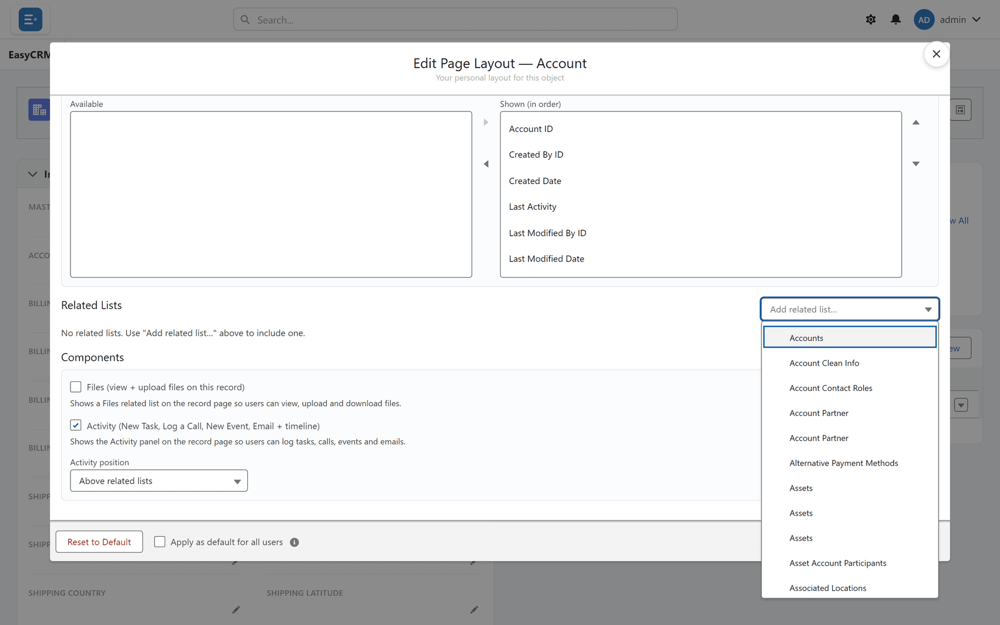

# Related lists

## What they are

The tables on a record showing other records linked to it — the contacts at an account, the
tasks on a contact. On the standard page they sit in the right-hand column.

## Why they matter

They are how somebody moves between connected records without searching. An account page with
no contacts list forces every user to go to Contacts and filter, every time.

## Adding one

**Where:** In the portal → the layout editor → **Related Lists** → **Add related list…**

1. Open the layout editor from any record.
2. Scroll to the **Related Lists** area.
3. Click the **Add related list…** box.

   

4. Choose which records it should show.
5. Under **Available columns** / **Shown columns (in order)**, pick its columns — or leave them
   empty for the default columns.
6. Set **Rows to show**, from 1 to 50.
7. Click **Save Layout**.

In the [layout builder](./layout-builder.md), drag the list from **Components** → **Related
Lists** to the place on the page it should go — any column, or a tab — then select it to set
**Columns** and **Records to show**. Each list can be on the page once.

## Where the activity panel sits

**Activity position** — **Above related lists** or **Below related lists** — controls whether
the calls-and-tasks panel appears before or after them. In the layout builder, drag **Activities**
where you want it instead.

Above is usually right: activity is what most people came for, and related records are
reference.

## A list's title

A list carries the title Salesforce gives it — its lookup's **Related List Label** — where
Salesforce passes that to the portal: **Campaign History** rather than "Campaign Members", for
example. Otherwise it takes the plural name of the records it lists.

The layout builder reads the titles from Salesforce when it opens, keeps them with the layout it
saves, and the record page asks Salesforce again when it opens. The classic editor shows the
titles a layout has kept, or the plural names.

## Lists through a junction object

Some records are linked through a third object in between — a **junction object**. A contact
belongs to many outbound lists through **Outbound List Member** records, for example, each of
which points at one contact and one outbound list. In Salesforce such a list on a contact is
called **Outbound Lists**.

Add it like any other related list — it is offered under the junction object. What it shows
follows Salesforce's own rules:

- **It lists the junction records**, one row per link — never the other object's records
  themselves. Its title is Salesforce's (**Outbound Lists**) when Salesforce passes it to the
  portal; see [A list's title](#a-lists-title).
- **When the junction is master-detail to both objects** — the kind Salesforce calls a
  many-to-many relationship — its columns can include the *other* record's fields, and every
  column carries its object's name. For a **Project Member** junction between contacts and
  projects, a contact's list could show **Project Member: Role** beside **Project: Status**.
  The other record's owner is offered as **Owner Name**; its record ID is not offered. The
  junction's own two master-detail fields are not offered either — the other record's fields
  stand in for them.
- **When either link is a plain lookup**, only the junction's own fields are offered, as in
  Salesforce. Its lookup column shows the other record's name.

<!-- SHOT: records/junction-related-list.png | A Contact record whose layout holds a related list through a junction object that is master-detail to both sides: the list titled with Salesforce's Related List Label, with columns of both the junction ("Junction object: Field") and the other object ("Other object: Field") (needs such a junction object and a linked record in the org) -->

On the record page, the other record's columns show only to people who may read that object, the
link to it and the field. In a row whose other record somebody may not open, those columns are
empty for them. The other record's name opens it, and the table sorts by those columns too.

## Which lists to include

| Include | Because |
|---|---|
| The obvious children | Contacts on an account, tasks on a contact |
| Anything people currently search for | That search is a missing related list |

| Leave off | Because |
|---|---|
| Lists that are always empty | They teach people to ignore the area |
| Everything available | The page becomes a directory |

## Permission still applies

A related list only shows records the reader is allowed to see. Two people on the same record
can legitimately see different numbers of related records — see
[Sharing](../sharing/index.md).

If somebody may not read that kind of record at all, the list is replaced by a padlock and
**You don’t have access to Contacts.** — and nothing from it is sent to their screen, not even a
count.

If somebody reports an empty related list, check their access before changing the layout.

## Pages with many lists

A record page reads its related lists in one go, up to a limit. When a page has more lists than
that leaves room for, the rest arrive a moment later, each on its own: the count shows **…** and a
spinner until it does. Lists in a tab that the page does not open on — in the layout builder —
load when somebody chooses that tab. If one cannot load, it says **Could not load the list.**;
its **Refresh** button tries again.

## What goes wrong

| Symptom | Cause |
|---|---|
| A padlock and **You don’t have access to …** for some users | They lack Read permission for that kind of record. |
| It is empty | Nothing is linked yet — not a fault. |
| It shows the wrong columns | Columns are set per related list in the editor. |
| A junction list offers no fields of the other object | One of the junction's two links is a plain lookup, not master-detail. Salesforce allows the other object's fields only in a many-to-many relationship. |
| A list shows the plural name, such as **Outbound List Members**, not Salesforce's title | Salesforce did not pass the portal that list's title. |
| Two lists with the same title in the builder, one with a name in brackets | Two lookups on one kind of record point to this one; the bracket names the lookup. |

## Where this fits

Related lists sit beside the [sections](./sections.md) on the same layout. What a *new* record
asks for is separate — see [The new-record window](./new-record-window.md).
