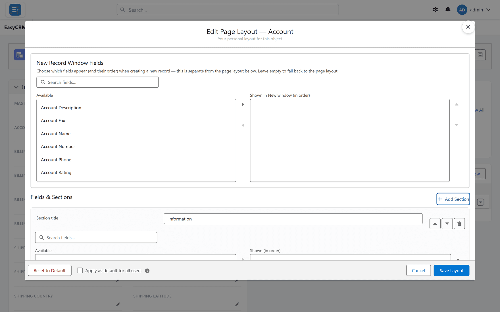

# Sections

## What a section is

A heading with fields grouped under it. Readers can fold a section away, so sections are how a
long record page stays readable.

## When to add one

When a layout passes about a dozen fields. Below that, grouping adds ceremony without helping;
above it, an ungrouped wall of fields is genuinely hard to read.

## Adding one

**Where:** In the portal → the layout editor → **Add Section**

1. Open the layout editor from any record.
2. Click **Add Section**.

   

3. Give it a name.
4. Move fields into it.

Use **Move section up** / **down** to reorder, and **Remove section** to delete one.

**Removing a section does not delete its fields or any data.**

In this editor a field sits in one section only: a field already placed in another section is
not offered in this one's **Available** list.

## Sections in the layout builder

With the [layout builder](./layout-builder.md) on, a section is a **Field Section** dragged from
**Components**, and it can do more:

| You can | How |
|---|---|
| Put it in any column, or in a tab or accordion section | Drag it there. |
| Show its fields without a heading | Leave **Label** empty. Such a section cannot be folded away. |
| Give it one column or two | **Columns** — **1 column** or **2 columns**. |
| Copy it, fields and all | Select it and click **Clone**. |
| Place a field that is in another section already | Drag it in. A field can be on the page more than once. |

A field dropped outside any section gets a new section of its own with no heading. A section left
with no fields is not shown on the record page.

**Tabs** and **Accordion** are the builder's other answer to a long page: put the system fields
in a tab of their own, or in an accordion section that starts closed. See
[Tabs and accordions](./layout-builder.md#tabs-and-accordions).

## Naming sections

Name them for what the reader is looking for, not for where the data came from.

| Good | Poor |
|---|---|
| Billing | Address Information 2 |
| Contract | Custom Fields |
| System information | Misc |

## A section order that works

1. **Information** — identity and the fields people act on
2. **Billing / Contract / whatever your business needs**
3. **System information** — created, modified, ids. Last, and usually collapsed

Putting system fields first is the most common layout mistake. Nobody opens a customer record
to find out when it was created.

## What goes wrong

| Symptom | Cause |
|---|---|
| A section is empty on some records | Its fields are empty for those records. |
| A section is missing for some people | They may read none of its fields, so there is nothing to show. |
| Sections are not in the order you set | **Save Layout** was not clicked, or it was saved for you only. |
| A field cannot be added to a section | It is in another section already. Take it out there first — or use the [layout builder](./layout-builder.md), which allows a field twice. |

## Where this fits

Sections organise the [fields](./fields.md) you chose. [Related lists](./related-lists.md) sit
beside them, in the other column.
