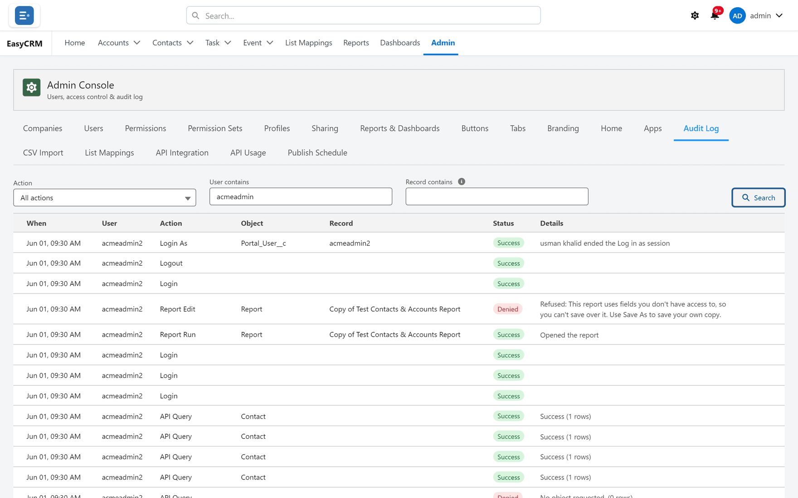
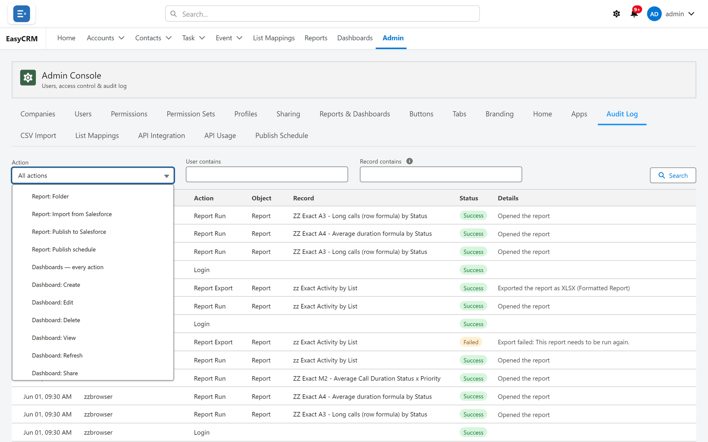
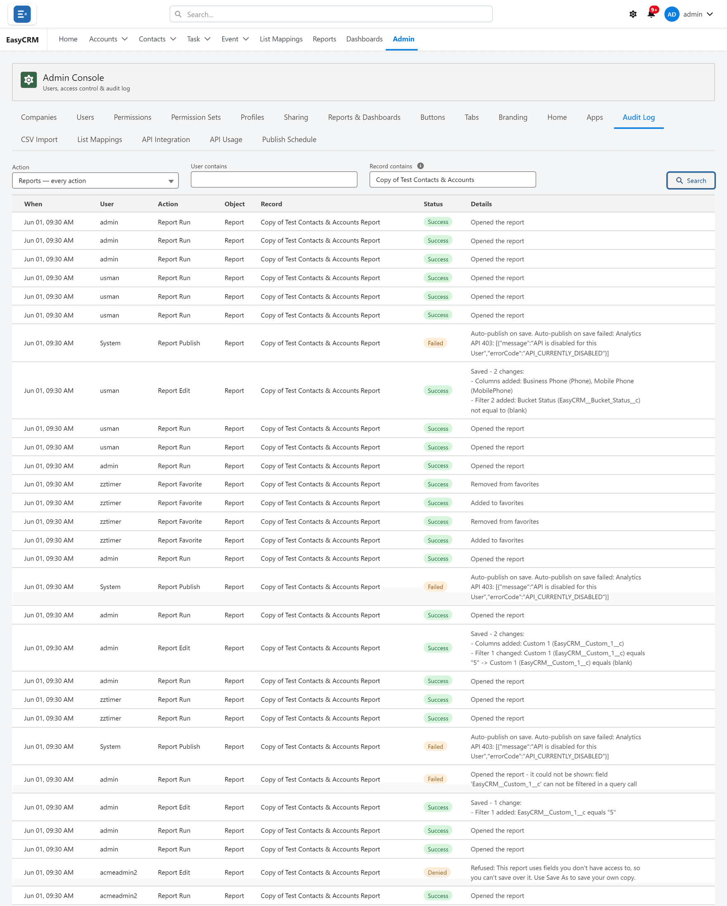

# Audit Log

## What it is

A record of who did what, and when. Nobody can edit, delete or switch it off from the portal —
not even a Super Admin.

That immutability is the whole point. A log an administrator can alter is not evidence.

## When you will use it

| Situation | What the log answers |
|---|---|
| "I didn't change that" | Who did, and when |
| A setting changed and nobody knows why | Which admin, which day |
| A report or dashboard changed or vanished | Exactly what changed — and, for a deleted one, its full definition |
| Somebody was refused | What they tried, and why it was refused |
| Reviewing support access | Who viewed the portal as somebody else |

## Who can see it

A **Super Admin**, and any **Admin** given the **Audit Log** tab.

:::caution The log is not divided by company
An Admin with the **Audit Log** tab sees **every** company's entries, not only their own
company's. Bear that in mind before you give the tab to a company's Admins under
[Companies](../companies/index.md) → **Edit** → **Admin Tabs**.
:::

## Opening it

**Where:** In the portal → **Admin** → **Audit Log**

1. Click **Admin** in the top menu.
2. Click **Audit Log** in the row of tabs.

The newest **300** entries are shown, newest first.

| Column | Shows |
|---|---|
| **When** | Date and time. |
| **User** | The portal username — or a Salesforce username for something done in Salesforce, or **System** for a background job. |
| **Action** | What kind of thing happened. |
| **Object** | What it happened to: a Salesforce object such as `Account`, or `Report`, `Dashboard`, `Report Folder`. |
| **Record** | The record's name, or its Id when it has none. |
| **Status** | **Success**, **Failed**, **Denied** (refused) or **Partial** (a CSV import with some rows that failed). |
| **Details** | What exactly happened. Lines are kept, and a long entry scrolls inside its own cell. |

With nothing to show, the tab reads **No audit entries.**

## Narrowing it

1. Choose an **Action**. **All actions** is the default.

   

2. Type part of a username into **User contains**.
3. Type part of a name, or an Id, into **Record contains** — a report, dashboard or record name, or
   its Id.
4. Click **Search**.

The boxes do nothing until you click **Search**, and all three work together. Only the newest 300
matching entries are shown, so to look further back, narrow the search.

### The Action list

| Option | Shows |
|---|---|
| **Login**, **Logout**, **Create**, **Edit**, **Delete**, **View**, **Change Permission**, **Reset Password**, **Login As**, **Other** | That one kind of action. |
| **Reports — every action** | Every report action at once. |
| **Report: Create**, **Report: Edit**, **Report: Delete**, **Report: Run / Open**, **Report: Export**, **Report: Share**, **Report: Favorite**, **Report: Folder**, **Report: Import from Salesforce**, **Report: Publish to Salesforce**, **Report: Publish schedule** | One kind of report action. |
| **Dashboards — every action** | Every dashboard action at once. |
| **Dashboard: Create**, **Dashboard: Edit**, **Dashboard: Delete**, **Dashboard: View**, **Dashboard: Refresh**, **Dashboard: Share**, **Dashboard: Favorite**, **Dashboard: Folder** | One kind of dashboard action. |

Some actions have no option of their own — **Change Owner**, **Transfer Owner**, **CSV Import**,
and the API's **API Query**, **API Create**, **API Update**, **API Delete** and **API Auth**. Leave
**Action** on **All actions** and narrow with **User contains** or **Record contains**.

## What is recorded

| Action | Kept |
|---|---|
| **Login** | Every successful sign-in, and each time somebody extends their session. A sign-in refused by the profile's login hours or IP ranges is kept as **Denied**, with the reason. |
| **Logout** | Signing out. |
| **Reset Password** | A password an admin reset, a person's own reset, and whether the e-mail went. |
| **Create**, **Edit**, **Delete** | Records created, edited and deleted in the portal or through the API — named, or by Id for a deletion. Companies, roles, public groups, and sharing and restriction rules use the same three actions. |
| **Change Owner**, **Transfer Owner** | Records given a new owner. |
| **View**, **Create**, **Edit**, **Delete** as **Denied** | An attempt refused because the person lacks that permission on the object — `Permission denied (edit)`. |
| **Change Permission** | Permissions, permission sets, profiles, sharing, field scope values, company settings, tabs, branding switches and API keys. |
| **Other** | Users created, updated, renamed and deleted, the e-mails sent with them, and branding and sign-in page changes. |
| **CSV Import** | Each import: `12 created, 30 updated`, **Success** or **Partial**. |
| **API Query**, **API Create**, **API Update**, **API Delete**, **API Auth** | Every API call, by the key's user. |
| **Login As** | Viewing the portal as somebody else — **every** attempt, allowed or refused. |
| Report and dashboard actions | See below. |

A wrong password is **not** written to the log. After repeated wrong passwords the account is
locked for a while, and its owner is e-mailed once when that happens.

## Reports and dashboards

Every report and dashboard action is logged with the exact change, worked out on the server — so it
records what really happened, not what was asked for.

| Action | Details look like |
|---|---|
| **Report Create** / **Dashboard Create** | `Created report "Accounts"`, then its full content. |
| **Report Edit** / **Dashboard Edit** | `Saved - 2 changes:` then one line per change — `Name: "Accounts" -> "Accounts 2"`, `Columns added: …`, `Filter 1 changed: … -> …`. An unchanged save reads `Saved - nothing changed`. Properties read `Properties saved - …`. |
| **Report Delete** / **Dashboard Delete** | What was deleted, its content, and `Definition at deletion (to restore it): …` — so a deleted report or dashboard can be put back from its log row. |
| **Report Run** | `Opened the report`, `Refreshed the report`, or `Ran the report with unsaved changes from the editor`. Opened from a dashboard, it adds `(opened from the dashboard "…")`. |
| **Report Export** | `Exported 1,250 rows as CSV (Details Only)` or `(Formatted Report)`. A failed export is `Export failed: …`, status **Failed**. |
| **Dashboard View** / **Dashboard Refresh** | `Opened the dashboard`, `Refreshed every widget`, or `Refreshed the widget "…"`. |
| **Report Share** / **Dashboard Share** | One line per person or company: `user jo@acme.com: now Read/Write`, `Read Only -> Read/Write`, or `Read/Write -> no access`. |
| **Report Favorite** / **Dashboard Favorite** | `Added to favorites` or `Removed from favorites`. |
| **Report Folder** / **Dashboard Folder** | `Created report folder "Q3"`, and folders matched to Salesforce. Sharing a folder is logged as **Report Share** or **Dashboard Share**, with **Report Folder** or **Dashboard Folder** as the object. |
| **Report Import** | A report synced from Salesforce, and what changed. |
| **Report Publish** | `Published to Salesforce - updated Salesforce report …`, or `Publish to Salesforce failed - nothing in Salesforce was changed by the portal: …`. |
| **Report Schedule** | Changes on the [Publish Schedule](../data/publish-schedule.md) tab: `Schedule: Off -> Daily at 02:00`, `Publish on save: off -> on`. |

### Refused attempts

An attempt the portal refuses — saving a report somebody may only read, deleting one they do not
own — is kept with status **Denied** and details beginning `Refused:`, for example
`Refused: You have read-only access to this report. Ask its owner or a Super Admin for edit
access, or use Save As to make your own copy.`

A refused entry is written separately from the action it refused, so it can appear a moment after
the attempt. Reload with **Search** if you do not see it yet.

### Done in Salesforce, or by the portal itself

Some report work happens in Salesforce rather than in the portal: syncing a report, refreshing or
removing a snapshot, publishing, the Sync & Share wizard. Those entries carry the **Salesforce
user's** username, and their details begin **In Salesforce (not the portal).**

Background jobs — scheduled publishing and publishing on save — are logged under the user
**System**, with the job's name first: `Scheduled auto-publish. …` or `Auto-publish on save. …` —
a failure reads, for example, `Auto-publish on save. Auto-publish on save failed: Analytics API 403: …`.

## Log in as user, in detail

Support impersonation is logged more carefully than anything else:

- Every **attempt** is recorded as **Login As**, including refused ones (**Denied**, `Refused: …`).
- Starting and ending the session are both recorded.
- Anything done during the session is recorded against the person's account, with
  `[Log in as: performed by admin-username]` added to its details.

So the log always answers "who really did this?", not just "whose account was it?". See
[Seeing the portal as somebody else](../users/login-as.md).

## How to use it when something looks wrong

1. Filter by the **kind** of action first — it cuts the volume fastest.
2. Then narrow to the person with **User contains**, or the report or record with **Record
   contains**.
3. Read the surrounding rows, not just the one you were looking for. Changes come in clusters,
   and the row before often explains the row you found.

## What it does not tell you

A record **Edit** row says that a record was saved, by whom and when — not which fields changed or
their old values. If you need to know who changed one field on one account, that is field history
in Salesforce, not this.

Reports and dashboards are the exception: their entries list every change.

## What goes wrong

| Symptom | Cause |
|---|---|
| An action you expected is missing | Only the newest 300 matching entries are shown. Narrow with **User contains** or **Record contains**. |
| A refused attempt is missing | It is written a moment after the attempt. Click **Search** again. |
| An action is not in the **Action** list | Not every action has an option. Use **All actions** with the other two boxes. |
| Repeated wrong passwords left no trace | Wrong passwords are not logged. Only sign-ins refused by login hours or IP ranges are. |
| Too many rows | Choose an **Action** before searching. |
| A company Admin can see other companies' entries | The log is not divided by company — see [Who can see it](#who-can-see-it). |
| You cannot delete an entry | Correct, and deliberate. |

## Where this fits

The audit log is the record of what the rest of the Admin Console did. It is the first place to
look when a setting changed and nobody owns up.
