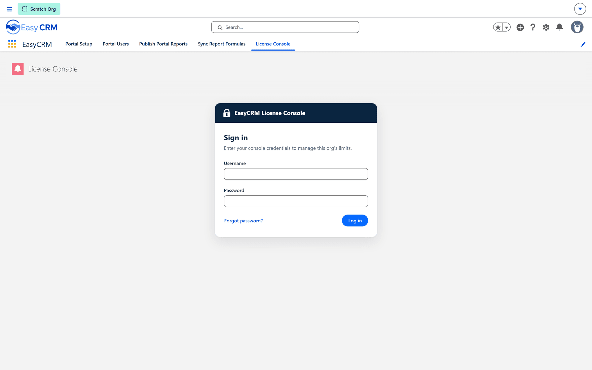

# Licence limits

**What it is.** The console that sets how many companies and users an installation may have.

**Where it lives.** In Salesforce, not in the portal. Most portal administrators never see it;
it is for whoever administers the package.

**Why it exists.** It keeps an installation within whatever was agreed, without anybody having
to count users by hand.

## What it limits

| Limit | Meaning |
|---|---|
| **Companies in use** | How many companies may exist. |
| **Admins** | How many Admin users each company may have. |
| **Standard** | How many Standard users each company may have. |

**Default limits** apply to every company. **Per-company overrides** raise or lower them for
one company in particular.

## Signing in to the console

The console has its own password, separate from the portal.

- **Set a new password** changes it.
- **Reset password** is for when it has been lost.

## What happens when a limit is reached

Creating a user beyond the limit is **refused**, with a message saying which limit was hit.

Nothing already created is affected. Existing users keep working exactly as before — the limit
stops new ones, it does not switch anybody off.

## When this is the explanation

If somebody reports that they cannot add a user, and the [permissions](../access/permissions.md) look
correct, this is the next thing to check.

The symptom is specific: everything else in [Users](../users/index.md) works, but **Save** on a new
user is refused.

## Raising a limit

Either set a per-company override, if the overall licence allows it, or arrange a larger
licence. The console shows what is currently in use against what is allowed, which is the
number to quote when asking.

## Opening it

**Where:** In Salesforce → **App Launcher** → **EasyCRM** → **License Console**

1. Sign in to **Salesforce**.
2. Open the **App Launcher** (the nine dots, top left) and choose **EasyCRM**.
3. Click the **License Console** tab.

## It has its own password

The console does not use your Salesforce login. It asks for **console credentials** of its own.

| Control | What it does |
|---|---|
| **Username** / **Password** | The console's own credentials, issued with your licence. |
| **Log in** | Opens the console. |
| **Forgot password?** | Starts a reset. |

That separation is deliberate: being a Salesforce administrator does not let you raise your own
licence limits. If you do not have these credentials, whoever bought the licence does.

:::note Reaching the tab is not the same as getting in
Seeing **License Console** in the app only means you can open the tab. The sign-in is what
decides whether you can change anything, so a colleague who can see the tab may still not be
able to help.
:::
