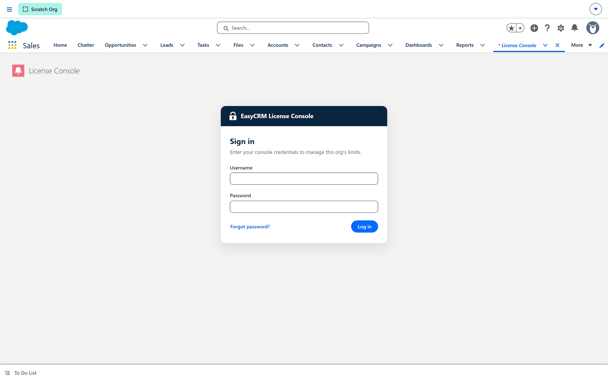

# Licence limits

**What it is.** The console that sets how many companies and users an installation may have.

**Where it lives.** In Salesforce, not in the portal. Most portal administrators never see it;
it is for whoever administers the package.

**Why it exists.** It keeps an installation within whatever was agreed, without anybody having
to count users by hand.

## What it limits

| Limit | Meaning |
|---|---|
| **Max companies** | How many active companies may exist. |
| **Max Super Admins** | How many active Super Admins the whole portal may have. Super Admins belong to no company, so this one limit covers them all. |
| **Admins / company** | How many active Admin users each company may have. |
| **Standard / company** | How many active Standard users each company may have. |

**Default limits** apply to every company. **Per-company overrides** raise or lower the Admin and
Standard limits for one company in particular. A blank field means **unlimited**; a blank
override means "use the default".

Only **active** companies and users count, and they are counted live each time — there is no
stored tally to drift. Users who belong to no company are counted together, against the default
limits.

## What happens when a limit is reached

Creating a user or company beyond the limit is **refused**, with a message saying which limit was
hit — for a user, *You have reached the maximum number of* (role) *users allowed for this company.
To increase this limit, please contact support at* (owner's address)*.* The user dialogs offer a
**Contact support** button that sends the request for you.

Nothing already created is affected. Existing users keep working exactly as before — the limit
stops new ones, it does not switch anybody off.

## When this is the explanation

If somebody reports that they cannot add a user, and the [permissions](../access/permissions.md) look
correct, this is the next thing to check.

The symptom is specific: everything else in [Users](../users/index.md) works, but **Save** on a new
user is refused with the message above.

## Opening it

**Where:** In Salesforce → **App Launcher** → **EasyCRM** → **License Console**

1. Sign in to **Salesforce**.
2. Open the **App Launcher** (the nine dots, top left) and choose **EasyCRM**.
3. Click the **License Console** tab.

## It has its own password

The console does not use your Salesforce login. The **Sign in** card asks for **console
credentials** of its own.

| Control | What it does |
|---|---|
| **Username** / **Password** | The console's own credentials, issued with your licence. |
| **Log in** | Opens the console. |
| **Forgot password?** | Starts a reset. |

That separation is deliberate: being a Salesforce administrator does not let you raise your own
licence limits. If you do not have these credentials, whoever bought the licence does.

:::note Reaching the tab is not the same as getting in
Seeing **License Console** in the app only means you can open the tab. The sign-in is what
decides whether you can change anything, so a colleague who can see the tab may still not be
able to help.
:::

### If the console password is lost

1. Click **Forgot password?**, enter the **Username** and click **Email reset code**. A one-time
   code is emailed to the **licence owner's** address — not to you.
2. On **Set a new password**, enter the **Reset code** and a **New password** of at least 8
   characters, then click **Set password**.
3. Sign in with the new password.

## Inside the console

<!-- SHOT: sf/license-console-limits.png | License Console signed in: the status chip, the "Companies in use" and "Owner contact" tiles, Default limits with Max companies, Max Super Admins, Admins / company and Standard / company, the Per-company overrides table, and Save limits -->

| Part | What it shows |
|---|---|
| Status, top right | **License active**, **Not configured** (no limits stored, so nothing is limited) or **Verification failed**. |
| **Companies in use** | Active companies against the maximum, such as **12 / 20** — **∞** when unlimited. |
| **Owner contact** | The address limit messages and support requests go to. |
| **Default limits** | **Max companies**, **Max Super Admins**, **Admins / company**, **Standard / company**. *Leave a field blank for “unlimited”.* |
| **Per-company overrides** | One row per company, with **Admins** and **Standard**. *Leave a cell blank to use the default above.* |
| **Log out** | Leaves the console. |

:::caution "Verification failed"
If the console shows *The stored license couldn't be verified for this org. Enforcement is in its
safest (most restrictive) state until you save valid limits below.*, no new company or user can
be created anywhere in the portal until the limits are saved again from this screen.
:::

## Changing a limit

**Where:** **License Console** → **Default limits** or **Per-company overrides**

1. Change the numbers you need. Leave a field blank for unlimited.
2. Click **Save limits**.
3. In **Confirm changes**, re-enter the console password. A confirmation is emailed to the
   owner.
4. Click **Confirm & Save**.

The new limits take a few seconds to apply — the toast says **Writing the new limits — active in
a few seconds.**, then **The limits are now active.**

A wrong password keeps the dialog open with **Incorrect password — your changes were not
saved.**

## Raising a limit

Either set a per-company override, if the overall licence allows it, or arrange a larger
licence. The console shows what is currently in use against what is allowed, which is the
number to quote when asking.

## What goes wrong

| Symptom | Cause |
|---|---|
| **Incorrect username or password.** | Wrong console credentials. They are not your Salesforce login. |
| **Your session has expired. Please sign in again.** | The console signed you out. Sign in again. |
| **This reset code is invalid or has expired.** | Request a new code with **Forgot password?**. |
| Nobody can create users or companies at all | The status reads **Verification failed**. Save the limits again. |
| A new Super Admin is refused although every company has room | **Max Super Admins** is a single limit for the whole portal. |
