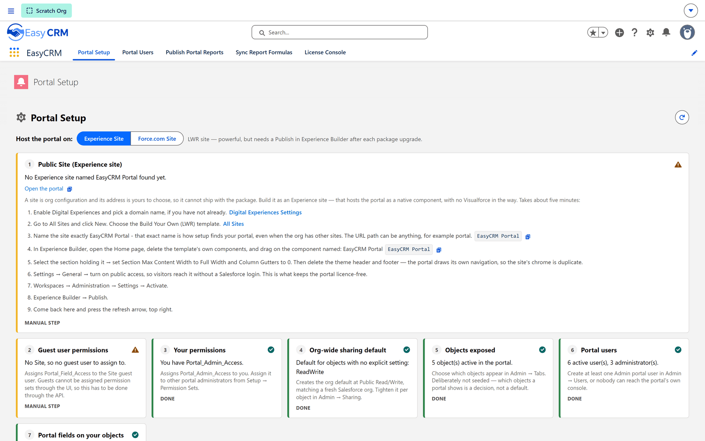

# Setup Assistant

**What it is.** A checklist that tells you whether the portal is correctly set up.

**What it does.** It checks the things the portal needs on the Salesforce side and reports
each one as done or needing attention.

**Why it helps.** When something does not work **at all** — nobody can sign in, no records
appear anywhere — this says which step was missed instead of leaving you to guess.

## Where it lives

The Setup Assistant is on the **Salesforce** side, not in the portal. Whoever installed the
package opens it there.

Most portal administrators never need it. It matters at installation, and when something
stops working in a way that affects everybody at once.

## What it checks

| Check | Why it matters |
|---|---|
| Permissions on the portal's own user | Without them the portal cannot read anything, for anybody. |
| Field access | New fields are invisible to the portal until access is granted. |
| The site is active | An inactive site serves nothing at all. |
| Email deliverability | Welcome and password-reset emails are dropped silently without it. |

## Reading it

**Completed** means that step is done.

**Needs attention** means it is not, and the item says what to do about it.

## When to run it

- Straight after installing, before adding any users.
- **After adding new fields** — field access is not granted automatically, and this is the
  single most common cause of "the field is there in Salesforce but not in the portal".
- When something stops working for everybody at once, to rule setup out before looking
  anywhere else.

## The difference between this and permissions

[Permissions](../access/permissions.md) control what one **person** may do.

The Setup Assistant checks what the **portal itself** is allowed to do. If the portal's own
access is wrong, nobody's permissions matter — the portal cannot read the data to show them.

That is why it is worth checking first when the problem affects everybody.

## Opening it

**Where:** In Salesforce → **App Launcher** → **EasyCRM** → **Portal Setup**

1. Sign in to **Salesforce**.
2. Open the **App Launcher** (the nine dots, top left) and choose **EasyCRM**.
3. Click the **Portal Setup** tab.

## Where the portal is hosted

**Host the portal on** is the first decision, and it sits above everything else because the rest
of the checklist depends on it.

| Choice | What it means |
|---|---|
| **Experience Site** | An LWR site. More capable, and the portal runs as a native component with no Visualforce in the way. **Needs a Publish in Experience Builder after every package upgrade** — miss that and the portal keeps serving the old version. |
| **Force.com Site** | The simpler host. Nothing to republish after an upgrade. |

## The seven checks

Each card is numbered and carries its own status.

| # | Check | What it is confirming |
|---|---|---|
| 1 | **Public Site** | A site exists to host the portal. The address is yours to choose, so it cannot ship with the package — this one is always set up by hand. |
| 2 | **Guest user permissions** | `Portal_Field_Access` is assigned to the site's guest user. |
| 3 | **Your permissions** | You hold `Portal_Admin_Access`. |
| 4 | **Org-wide sharing default** | A default exists for objects with no explicit setting. |
| 5 | **Objects exposed** | At least one object is switched on for the portal. |
| 6 | **Portal users** | At least one Admin portal user exists. |
| 7 | **Portal fields on your objects** | The package's own fields are present on your objects. |

### Reading the statuses

| Status | What to do |
|---|---|
| **DONE** (green tick) | Nothing. It is satisfied. |
| **MANUAL STEP** (amber warning) | Something only a person can do. The card lists the steps, with links straight into the Salesforce screens. |

**MANUAL STEP is not a failure.** Checks 1 and 2 are nearly always manual: a site's address is a
decision, and a guest user cannot be given a permission set through the UI at all — it has to go
through the API, which is why the package cannot do it for you.

### After you change something

Press the **refresh arrow**, top right. The checks do not re-run on their own, so a card will
keep showing its old status until you ask it to look again.

:::note Two checks that catch people out
**Objects exposed** is deliberately not seeded — which objects a portal shows is a decision, not
a default. And **Portal users** needs at least one *Admin*, because without one nobody can reach
the portal's own console.
:::
