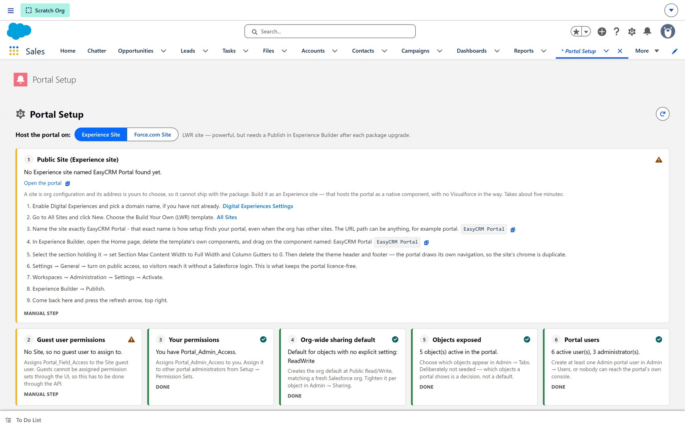

# Setup Assistant

**What it is.** A checklist that tells you whether the portal is correctly set up — and a button
that does most of the setup for you.

**What it does.** It checks the things the portal needs on the Salesforce side and reports
each one as done or needing attention. **Run auto-configure** then fixes everything Salesforce
lets it fix.

**Why it helps.** When something does not work **at all** — nobody can sign in, no records
appear anywhere — this says which step was missed instead of leaving you to guess.

## Where it lives

The Setup Assistant is on the **Salesforce** side, not in the portal. It is the **Portal Setup**
tab of the EasyCRM app.

Most portal administrators never need it. It matters at installation, and when something
stops working in a way that affects everybody at once.

**Who can use it:** a Salesforce user with **Modify All Data** or **Customize Application**. The
**Portal Admin Access** permission set alone is not enough — even to see the checks — because
setup assigns permission sets and writes org-wide settings.

## What it checks

| Check | Why it matters |
|---|---|
| The site exists and is active | An inactive site serves nothing at all. |
| Permissions on the portal's own user | Without them the portal cannot read anything, for anybody. |
| Your own permissions | You need **Portal Admin Access** to run the EasyCRM app. |
| An org-wide sharing default | Objects with no setting of their own need something to fall back on. |
| Objects and users | A portal with no objects or no Admin cannot be used or managed. |
| Field access | New fields are invisible to the portal until access is granted. |

:::note Email is not checked
Welcome and password-reset emails are silently dropped when Salesforce's email deliverability is
not set to **All email**. Setup cannot check or change that setting — look at it yourself in
Salesforce Setup → **Deliverability**.
:::

## When to run it

- Straight after installing, before adding any users.
- **After adding new fields or exposing a new object** — field access is not granted
  automatically, and this is the single most common cause of "the field is there in Salesforce
  but not in the portal".
- When something stops working for everybody at once, to rule setup out before looking
  anywhere else.

## The difference between this and permissions

[Permissions](../access/permissions.md) control what one **person** may do.

The Setup Assistant checks what the **portal itself** is allowed to do. If the portal's own
access is wrong, nobody's permissions matter — the portal cannot read the data to show them.

That is why it is worth checking first when the problem affects everybody.

## Opening it

**Where:** In Salesforce → **App Launcher** → **EasyCRM** → **Portal Setup**

1. Sign in to **Salesforce**.
2. Open the **App Launcher** (the nine dots, top left) and choose **EasyCRM**.
3. Click the **Portal Setup** tab.

When every check passes, a banner reads **You're all set.** *The portal is configured and ready
to use.*

## Where the portal is hosted

**Host the portal on** is the first decision, and it sits above everything else because the rest
of the checklist depends on it.

| Choice | What it means |
|---|---|
| **Experience Site** | An LWR site. More capable, and the portal runs as a native component with no Visualforce in the way. **Needs a Publish in Experience Builder after every package upgrade** — miss that and the portal keeps serving the old version. |
| **Force.com Site** | The simpler host. Serves the packaged `PortalSite` page. Nothing to republish after an upgrade. |

Switching the choice re-runs the checks for that host.

## The seven checks

Each card is numbered and carries its own status.

| # | Check | What it is confirming |
|---|---|---|
| 1 | **Public Site** | A site exists to host the portal, and is active. The address is yours to choose, so it cannot ship with the package — this one is always set up by hand. An Experience site must be named exactly **EasyCRM Portal**: that name is how setup finds it. |
| 2 | **Guest user permissions** | `Portal_Field_Access` is assigned to the site's guest user. |
| 3 | **Your permissions** | You hold `Portal_Admin_Access`. |
| 4 | **Org-wide sharing default** | A default exists for objects with no explicit setting. |
| 5 | **Objects exposed** | At least one object is switched on for the portal. |
| 6 | **Portal users** | At least one active Admin portal user exists. |
| 7 | **Portal fields on your objects** | Every exposed object has the portal's **Record Owner** and audit fields, and the portal can see them. |

Once the site is found, card 1 shows **Open the portal** — a link to it — with a copy icon
(**Copy the portal address**) beside it, so you can send the address to someone. If a
**Portal URL** has been set in the portal's Branding, that address is used instead.

### Reading the statuses

| Status | What to do |
|---|---|
| **DONE** (green tick) | Nothing. It is satisfied. |
| **AUTO-CONFIGURE FIXES THIS** (clock) | Press **Run auto-configure**. |
| **MANUAL STEP** (amber warning) | Something only a person can do. The card lists the steps, with links straight into the Salesforce screens and copy buttons for the exact values to type. |

**MANUAL STEP is not a failure.** Check 1 is always manual — a site's address is a decision. Card
7 also says manual step, but its text tells you to press **Run auto-configure**, which is what
creates the fields.

### After you change something

Press the **refresh arrow** (**Re-check**), top right. The checks do not re-run on their own, so a
card will keep showing its old status until you ask it to look again.

## Running auto-configure

**Where:** **Portal Setup** → **Run auto-configure**

1. Choose the right host under **Host the portal on**.
2. Click **Run auto-configure**.
3. Wait. While fields are being made it shows **Creating** *N* **field(s)…** and then
   **Granting field access…**.
4. Read the result: **Completed** lists what was done, **Needs attention** lists anything that
   could not be.

It does, in order:

| Step | What happens |
|---|---|
| Guest permission set | Assigns `Portal_Field_Access` to the chosen site's guest user — which cannot be done through Salesforce's own screens. |
| Your permission set | Assigns `Portal_Admin_Access` to you. |
| Org-wide default | Creates it at **Public Read/Write**, matching a fresh Salesforce org — only if none exists. Tighten it per object in **Admin** → **Sharing**. |
| Starter tabs | If the portal has **no** tabs at all, opens it with **Accounts** and **Contacts**. A tab list you have already chosen is never touched. |
| Portal fields | Creates the missing **Record Owner** and audit fields on every exposed object, then grants the portal access to them. |

Every step is safe to repeat: clicking again re-checks rather than duplicating anything. Run it
again after exposing a new object, so its fields are created too.

It cannot create the site, turn on email deliverability, or deal with objects Salesforce does not
allow custom fields on — managed-package objects and custom settings are skipped, and card 7 says
how many.

<!-- SHOT: sf/portal-setup-auto-configure.png | Portal Setup after Run auto-configure: the Completed list (permission sets assigned, starter tabs, fields created, field access granted) and the cards turned green -->

## Removing the portal fields

**Remove portal fields**, next to **Run auto-configure**, is the way back out — for when you are
uninstalling the package. Those fields point at the portal's own objects, so an uninstall is
blocked while they exist.

1. Click **Remove portal fields**. If there are none, it says **There are no portal fields to
   remove.**
2. Read the dialog **Remove** *N* **portal field(s)?** It deletes the **Record Owner** and portal
   audit fields setup added to your objects, along with **any data in them** — including who owns
   which record in the portal.
3. Click **Remove fields**, or **Cancel**.

The result lists how many were removed, how many were already gone and how many could not be
removed.

:::caution Remove the fields before you take an object off the tab list
It covers only the objects currently exposed in the portal. Remove an object from **Admin** →
**Tabs** first, and its fields stay behind for you to delete by hand.
:::

<!-- SHOT: sf/portal-setup-remove-fields.png | Portal Setup with the "Remove N portal field(s)?" dialog open, showing its warning text and the Cancel and Remove fields buttons -->

:::note Two checks that catch people out
**Objects exposed** decides what the portal shows, so auto-configure only adds starter tabs to a
portal that has none — choose the rest yourself in **Admin** → **Tabs**. And **Portal users**
needs at least one active *Admin*, because without one nobody can reach the portal's own console.
:::

## What goes wrong

| Symptom | Cause |
|---|---|
| *You need "Modify All Data" or "Customize Application" to run portal setup …* | You only have **Portal Admin Access**. Ask a Salesforce administrator. |
| Card 1 cannot find your Experience site | It is not named exactly **EasyCRM Portal**, or the wrong host is chosen. |
| A card still shows its old status | Press **Re-check**. |
| Card 7 says some fields exist but the portal cannot see them | Field access was never granted. Press **Run auto-configure**. |
| Welcome emails never arrive, and every check is green | Email deliverability — not something Setup checks. See the note above. |
| An uninstall is blocked by fields on your objects | Use **Remove portal fields** first. |
