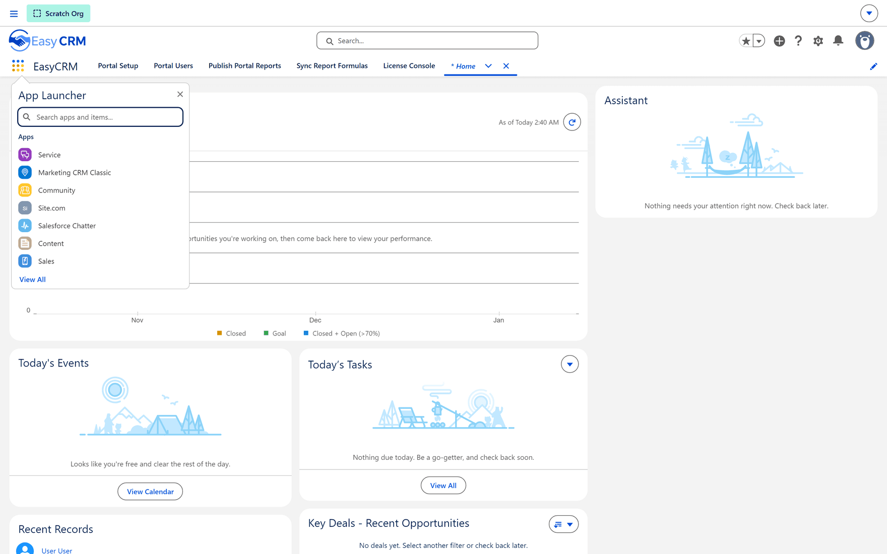
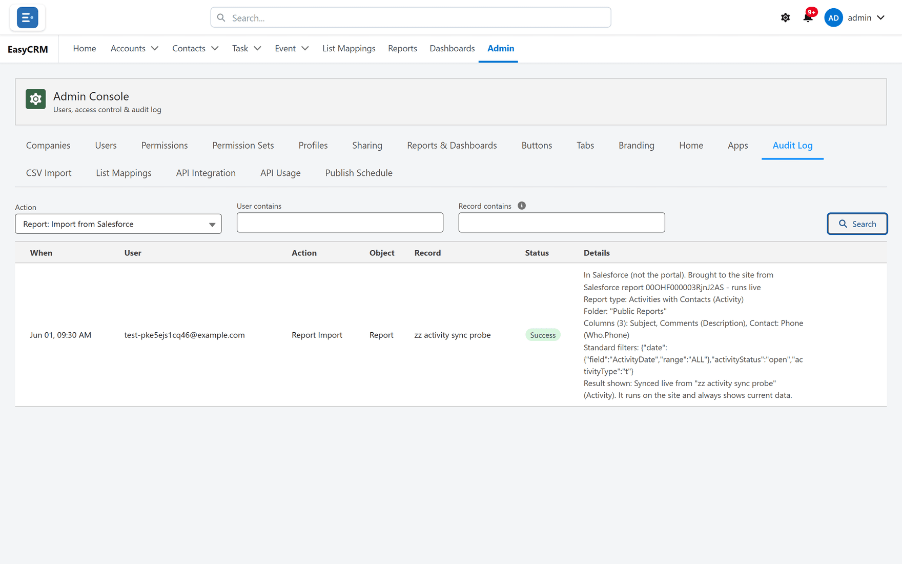

# The EasyCRM app in Salesforce

Most of what you do as an administrator happens in the **portal's own admin console**. A few
things do not. Bringing Salesforce reports into the portal, publishing a portal report into
Salesforce, pulling row-level formulas back out of it, provisioning fields and checking your
licence all happen **inside Salesforce**, in an app called **EasyCRM**.

If you have been looking for these screens in the portal, that is why you could not find them.
The exceptions are the unattended ones — scheduled publishing and
[auto-sync of new Salesforce reports](../data/report-auto-sync.md) — which a Super Admin sets up
on the portal's **Publish Schedule** tab.

## Getting to the app

**Where:** In Salesforce → **App Launcher** → **EasyCRM**

1. Sign in to **Salesforce** — not the portal. This is your normal Salesforce login.
2. Click the **App Launcher** — the grid of nine dots at the top left of any Salesforce page.
3. Type `EasyCRM` in the search box.
4. Click **EasyCRM** in the results.

The app opens on its first tab and the five tabs sit across the top.

## The five tabs

| Tab | What it is for |
|---|---|
| **[Portal Setup](../operations/setup-assistant.md)** | First-time setup and the health checks that tell you the portal is wired up correctly. |
| **[Portal Users](./portal-users.md)** | The Salesforce-side view of portal users, and how a Salesforce report becomes visible in the portal. |
| **[Publish Portal Reports](./publish-reports.md)** | Turns a report built in the portal into a real native Salesforce report. |
| **[Sync Report Formulas](./sync-formulas.md)** | Pulls row-level formulas out of Salesforce and into the matching portal report. |
| **[License Console](../operations/licence.md)** | Your licence, seat counts and limits. Behind its own password. |

Two more pages cover Salesforce-side matters that have no tab of their own:

- [What a report sync brings across](./what-syncs.md) — what survives the trip from a Salesforce
  report into the portal, and what every sync message means.
- [Settings only Salesforce can change](./switches.md) — switches on the **Portal Branding**
  record that no portal screen offers.

## Who can open this app

These tabs are part of the managed package and are controlled by Salesforce permissions, not by
portal roles. Being a portal Super Admin does **not** give you access.

| To do this | You need, in Salesforce |
|---|---|
| See the **EasyCRM** app and its five tabs | The **Portal Admin Access** permission set. It grants the app and all five tabs. |
| Use **Portal Setup** at all — the checks as well as **Run auto-configure** | **Modify All Data** or **Customize Application**. **Portal Admin Access** alone is not enough. |
| Change anything in **License Console** | The console's own username and password. See [Licence limits](../operations/licence.md). |
| Be the user unattended publishing and auto-sync run as | API access, the right to edit reports, and the **Portal Admin Access** permission set — see [The setup step in Salesforce](../data/publish-schedule.md#the-setup-step-in-salesforce). |

A Salesforce administrator assigns **Portal Admin Access** in Setup → **Permission Sets**.
Pressing **Run auto-configure** on Portal Setup also assigns it to whoever pressed it.

:::note Why Portal Setup asks for more
Setup assigns permission sets and writes org-wide settings, and Salesforce only lets an
administrator do that. Without either permission, Portal Setup shows:
*You need "Modify All Data" or "Customize Application" to run portal setup. The Portal Admin
permission set alone is not enough — setup touches org-wide configuration, so the platform
requires a Salesforce administrator.*
:::

## What you do here is recorded in the portal

Syncing, refreshing or removing a report, adding or changing a snapshot, sharing reports with
companies, syncing row-level formulas and publishing all write a row to the portal's
[Audit Log](../operations/audit-log.md). Those rows carry your **Salesforce username** rather
than a portal one, and their **Details** start with **In Salesforce (not the portal).** — so a
change made here is never mistaken for one made in the portal.

To find them, choose one of these in the Audit Log's **Action** list:

| Action | Covers |
|---|---|
| **Report: Import from Salesforce** | Every sync and re-sync from the **Portal Users** tab, and every report [auto-sync](../data/report-auto-sync.md) adds. |
| **Report: Publish to Salesforce** | Every publish, by hand or automatic. |
| **Report: Publish schedule** | Changes to the [Publish Schedule](../data/publish-schedule.md), auto-sync's included. |

Automatic publishing and auto-sync have no person behind them, so their rows carry the username
**System**.

