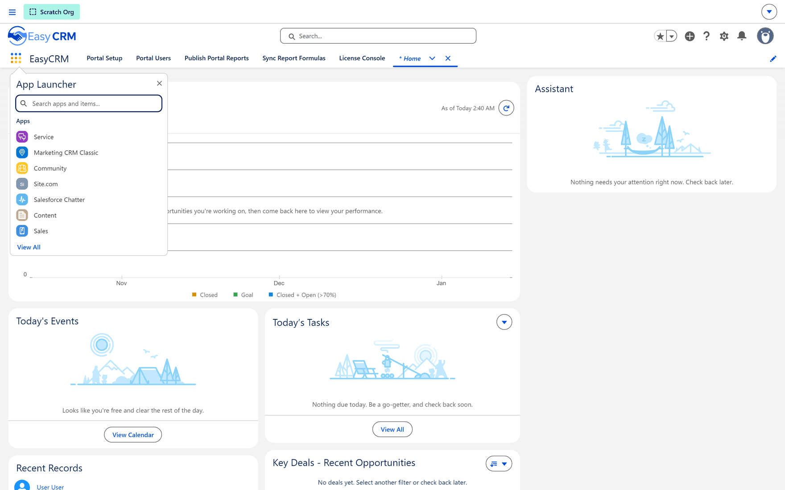

# The EasyCRM app in Salesforce

Most of what you do as an administrator happens in the **portal's own admin console**. A few
things do not. Publishing a portal report into Salesforce, pulling row-level formulas back out of
it, provisioning fields and checking your licence all happen **inside Salesforce**, in an app
called **EasyCRM**.

If you have been looking for these screens in the portal, that is why you could not find them.

## Getting to the app

**Where:** In Salesforce → **App Launcher** → **EasyCRM**

1. Sign in to **Salesforce** — not the portal. This is your normal Salesforce login.
2. Click the **App Launcher** — the grid of nine dots at the top left of any Salesforce page.
3. Type `EasyCRM` in the search box.
4. Click **EasyCRM** in the results.

The app opens on its first tab and the five tabs sit across the top.

## The five tabs

| Tab | What it is for |
|---|---|
| **[Portal Setup](../operations/setup-assistant.md)** | First-time setup and the health checks that tell you the portal is wired up correctly. |
| **[Portal Users](./portal-users.md)** | The Salesforce-side view of portal users, and how a Salesforce report becomes visible in the portal. |
| **[Publish Portal Reports](./publish-reports.md)** | Turns a report built in the portal into a real native Salesforce report. |
| **[Sync Report Formulas](./sync-formulas.md)** | Pulls row-level formulas out of Salesforce and into the matching portal report. |
| **[License Console](../operations/licence.md)** | Your licence, seat counts and limits. Behind its own password. |

:::note Who can open this app
These tabs are part of the managed package and are controlled by Salesforce permissions, not by
portal roles. Being a portal Super Admin does **not** give you access — a Salesforce administrator
grants it in Salesforce.
:::
