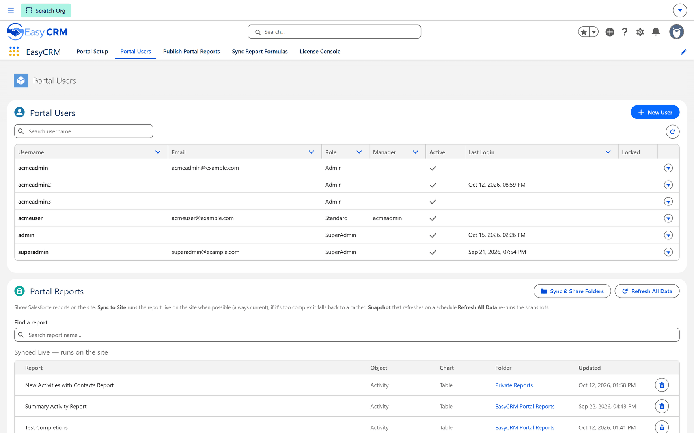

# Portal Users and Portal Reports

One Salesforce tab, two cards. **Portal Users** is the Salesforce-side view of who can sign in.
**Portal Reports** is how a Salesforce report becomes visible in the portal at all.

**Where:** In Salesforce → **App Launcher** → **EasyCRM** → **Portal Users**

1. Sign in to **Salesforce**.
2. Open the **App Launcher** (the nine dots, top left) and choose **EasyCRM**.
3. Click the **Portal Users** tab.

## Portal Users

| Control | What it does |
|---|---|
| **New User** | Creates a portal user without leaving Salesforce. |
| **Search username…** | Finds somebody in the list. |
| **Username** / **Email** / **Role** | Who they are and what they are. |
| **Manager** | Who they report to, which is what a Standard user's Admin is working from. |
| **Active** | Whether they can sign in. |
| **Last Login** | When they last did. Blank means never. |
| **Locked** | Whether they are locked out. |

A blank **Last Login** on an account somebody says is broken usually means they have never
successfully signed in, rather than that something stopped working.

## Portal Reports

This is the one that catches people out: **a Salesforce report is not visible in the portal until
it has been synced here.** Sharing it in the portal first does nothing, because there is nothing
to share.

| Control | What it does |
|---|---|
| **Sync & Share Folders** | Opens the wizard: pick Salesforce folders, sync them, then share them with companies. |
| **Refresh All Data** | Re-runs every snapshot. |
| **Find a report** | Searches what is already synced. |
| **Synced Live — runs on the site** | The reports that run live against your data each time somebody opens them. |
| **Report** / **Object** / **Chart** / **Folder** / **Updated** | What each synced report is and when it last changed. |
| The bin icon | Stops syncing that report. |

### Live or snapshot is decided for you

**Sync to Site** runs the report **live on the site when possible**, so it is always current. If
the report is too complex to run that way, it **falls back to a cached Snapshot** that refreshes
on a schedule.

That is automatic. You are not choosing between them — you are being told which one you got.

:::tip A number that disagrees with Salesforce
Check whether the report is live or a snapshot. A snapshot is a picture from its last refresh, so
disagreeing with Salesforce is normal and means only that the data has moved since. **Refresh All
Data** re-runs the snapshots.
:::

### Using the wizard

1. Click **Sync & Share Folders**.
2. Choose the Salesforce folders to bring across.
3. Sync them.
4. Choose which companies get them, and at what access.

Sharing a **folder** covers everything in it, including reports added later — which is why this
is folder-first rather than report-first.

## Related

- [Reports and Dashboards](../data/report-folders.md) — sharing, from inside the portal, once a
  report is here.
- [Publishing a portal report to Salesforce](./publish-reports.md) — the opposite direction.
