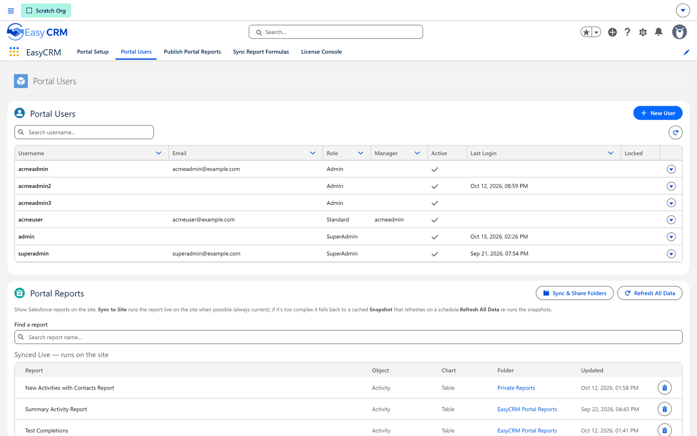

# Portal Users and Portal Reports

One Salesforce tab, two cards. **Portal Users** is the Salesforce-side view of who can sign in.
**Portal Reports** is how a Salesforce report becomes visible in the portal at all.

**Where:** In Salesforce → **App Launcher** → **EasyCRM** → **Portal Users**

1. Sign in to **Salesforce**.
2. Open the **App Launcher** (the nine dots, top left) and choose **EasyCRM**.
3. Click the **Portal Users** tab.

## Portal Users

| Control | What it does |
|---|---|
| **New User** | Creates a portal user without leaving Salesforce. |
| **Search username...** | Narrows the list to usernames containing what you type. |
| The refresh icon | Re-reads the list. |
| **Username** / **Email** / **Role** | Who they are and what they are. |
| **Manager** | The Admin who manages them. Blank means nobody does, so only a Super Admin sees them. |
| **Active** | Whether they can sign in. |
| **Last Login** | When they last did. Blank means never. |
| **Locked** | Whether they are locked out after too many wrong passwords. |
| The row menu (▾) | **Edit**, **Reset Password**, **Deactivate** or **Activate**, **Unlock** (only on a locked user) and **Delete**. |

The list shows up to **500** users, in username order. Search to reach anyone past that.

A blank **Last Login** on an account somebody says is broken usually means they have never
successfully signed in, rather than that something stopped working.

### Adding or changing a portal user

**Where:** **Portal Users** → **New User**, or the row menu → **Edit**

1. Click **New User**. The **New Portal User** dialog opens. (From **Edit** it is called
   **Edit Portal User**.)
2. Fill in:

   | Field | What to put |
   |---|---|
   | **Username** | Required. What they type to sign in. Must not already be in use. |
   | **Email** | Where their login details are emailed when you create them or reset their password. Leave it blank and a username that looks like an email address is used instead. |
   | **Password** | New users only. At least 8 characters. They sign in with this. |
   | **Role** | **Standard**, **Admin — sees the users they manage** or **Super Admin — sees everything**. |
   | **Manager** | Standard users only — it disappears for the other two roles. Lists every active Admin as *username (Company)*, up to 500. **— None —** means nobody manages them, so only a Super Admin will see them. |
   | **Active** | Ticked by default. |

3. Click **Save**.

A new user gets an email with their username, password and the portal's address, as long as
there is an address to send it to. The toast says which: **Portal user created — login details
emailed to** *address*, or just **Portal user created.**

<!-- SHOT: sf/portal-users-new-user.png | Salesforce → EasyCRM → Portal Users → New User, Role set to Standard, Manager list open showing "— None —" and Admins as "username (Company)" -->

:::caution Users created here belong to no company
This dialog has no **Company** field. An **Admin** or **Super Admin** made here belongs to no
company, and neither does a **Standard** user with no manager. Choosing a **Manager** for a
Standard user who has no company moves them into that Admin's company at the same moment.
Anyone else has to be added to a company in the portal — see
[Companies](../companies/index.md).
:::

The manager rules are the same as in the portal's own Users tab:

- Only a Standard user has a manager. Changing the role to Admin or Super Admin clears it.
- The manager has to be an active **Admin** — not a Super Admin, not a Standard user.
- The manager has to be in the same company as the user, unless the user has no company yet.

### When a licence limit is reached

If your licence caps the number of users, a create beyond the cap is refused inside the dialog
with *You have reached the maximum number of* (role) *users allowed for this company. To increase
this limit, please contact support at* (address)*.*

A **Contact support** button appears under the message. Click it and the request is emailed to
the licence owner for you; the button changes to **Thanks — your request has been sent to
support.** See [Licence limits](../operations/licence.md).

<!-- SHOT: sf/portal-users-licence-cap.png | New Portal User dialog after Save was refused by the user limit, showing the red licence message and the Contact support button -->

### Resetting a password

**Where:** **Portal Users** → the user's row menu → **Reset Password**

1. Choose **Reset Password** from the row menu. The dialog is titled **Reset Password —**
   *username*.
2. Type the new password in **New Password** — at least 8 characters. It is shown in clear
   text so you can copy it to send to the person.
3. Click **Reset Password**.

The old password cannot be shown — it is stored hashed — so this always sets a new one. The
toast reads **Password updated for** *username*, and the person is emailed their new login
details if they have an email address.

<!-- SHOT: sf/portal-users-reset-password.png | Reset Password dialog for a portal user, a new password typed in clear text -->

### The other row actions

| Action | What happens |
|---|---|
| **Deactivate** / **Activate** | Stops or restores sign-in. Nothing else about the user changes. Toast **User deactivated.** / **User activated.** |
| **Unlock** | Only offered while the user is locked out. Clears the lock and the failed-attempt count at once. Toast **User unlocked.** |
| **Delete** | Asks *Delete portal user "…"? This cannot be undone.* and then deletes the user and emails them an account-closed notice. Prefer **Deactivate** — see [Deactivating a user](../users/deactivating.md). |

<!-- SHOT: sf/portal-users-row-menu.png | Portal Users list with the row menu open on a locked user, showing Edit, Reset Password, Deactivate, Unlock, Delete -->

## Portal Reports

This is the one that catches people out: **a Salesforce report is not visible in the portal until
it has been synced here.** Sharing it in the portal first does nothing, because there is nothing
to share.

| Control | What it does |
|---|---|
| **Sync & Share Folders** | Opens the wizard: pick Salesforce reports and portal dashboards, bring them onto the site, and share them with companies. |
| **Refresh All Data** | Re-runs every **active** snapshot. Toast **All active reports updated.** |
| **Find a report** | Searches **Salesforce** report names — up to 200 matches — so you can bring one in. It does not search what is already synced. |
| **Sync to Site** / **Snapshot** | The two ways to bring a search result in. See below. |
| **Synced Live — runs on the site** | The reports that run live against your data each time somebody opens them. |
| **Report** / **Object** / **Chart** / **Folder** / **Updated** | What each live report is, its Salesforce folder (click it to open that folder in Salesforce) and when the portal copy last changed. |
| The bin icon, on a live report | **Deletes the portal copy.** See [Removing a report](#removing-a-report). |
| **Snapshots — cached results** | The reports stored as a picture of their results. See [Snapshots](#snapshots). |

### Bringing one Salesforce report in

**Where:** **Portal Users** → **Portal Reports** → **Find a report**

1. Type part of the report's name in **Find a report** (*Search report name...*). Matching
   Salesforce reports appear with their folder.
2. Click **Sync to Site** on the one you want — or **Snapshot**, if you specifically want a
   stored copy of its results.
3. Read the toast. **Synced live** means it runs live in the portal; **Snapshot synced** means it
   could only come across as a snapshot. Either way the message says what, if anything, did not
   come across — every message is explained in
   [What a report sync brings across](./what-syncs.md).

Syncing a report that is already on the site live updates the same portal copy in place, so
anything already pointing at it — company grants, re-shares, dashboard tiles — keeps working. The
exception is a report that can no longer run live: see the caution under
[Changing or removing access later](#changing-or-removing-access-later).

<!-- SHOT: sf/portal-reports-search.png | Portal Reports card with "Account" typed in Find a report, the results table showing Sync to Site and Snapshot buttons, and the Snapshots — cached results table below -->

### Live or snapshot

**Sync to Site** runs the report **live on the site when possible**, so it is always current. If
the report is too complex to run that way, it **falls back to a snapshot** on its own — you are
not choosing, you are being told which one you got.

**Snapshot** skips the attempt and stores the report's results straight away. The toast reads
*report name* **added and refreshed.**

| | Live | Snapshot |
|---|---|---|
| What the portal holds | The report's definition | A copy of its results |
| Data | Current every time it runs | As of **Last Refreshed** |
| Where it appears in the portal | In **Reports**, like any portal report | Under **Synced from Salesforce**, below the Reports list — and below the Dashboards list too when **Dashboard** is ticked |
| Who can open it | See [Who can see a synced report](#who-can-see-a-synced-report) | Everybody who can sign in |

:::tip A number that disagrees with Salesforce
Check whether the report is live or a snapshot. A snapshot is a picture from its last refresh, so
disagreeing with Salesforce is normal and means only that the data has moved since. **Refresh**
on its row, or **Refresh All Data**, brings it up to date.
:::

### Who can see a synced report

This is the one fact about syncing that surprises administrators, so it is said plainly:

**A report brought in with Sync to Site is readable by every Admin of every company, and by
every portal user who belongs to no company.** Standard users who belong to a company do not get
it. The same happens again every time the report is re-synced or refreshed from the
**Already shared** list — even if you had narrowed it to particular companies before.

The **Sync & Share Folders** wizard is the one route that narrows a report it brings in: a
report the wizard syncs is limited to the companies you share it with. A later re-sync or
**Refresh** of that report opens it to every Admin again.

If a report must stay with particular companies, bring it in through the wizard, and do not
re-sync it from **Find a report**.

### Snapshots

The **Snapshots — cached results** table lists every snapshot.

| Column | What it does |
|---|---|
| **Report** | The Salesforce report's name. |
| **Show as** | **Table**, **Bar**, **Column** or **Pie**. Saved as soon as you choose. |
| **Active** | Unticked, the snapshot is hidden from the portal and skipped by **Refresh All Data**. |
| **Dashboard** | Ticked, it also appears under **Synced from Salesforce** on the portal's Dashboards list. |
| **Last Refreshed** | When its results were last read from Salesforce. |
| **Refresh** | Re-runs that one report now. Toast **Report data updated.** |
| The bin icon | Removes it, after asking *Remove this report from the portal?* |

When there are none, the table says *No reports added yet. Search above and click "Add".* — the
button it means is now called **Snapshot**.

:::caution Nothing refreshes a snapshot for you
The card's own text says a snapshot "refreshes on a schedule", but the package installs no job
that does it. A snapshot stays exactly as it was at **Last Refreshed** until somebody presses
**Refresh** or **Refresh All Data**. A tabular snapshot also keeps only the first **200** rows.
:::

### Removing a report

| Bin on | Asks | What it removes |
|---|---|---|
| A live report | *Remove this live-synced report from the site?* | The portal copy, and with it every company grant and re-share made on it. The Salesforce report is not touched. |
| A snapshot | *Remove this report from the portal?* | The stored results. The Salesforce report is not touched. |

Removing a live report is not "stop syncing": the portal copy is deleted. Syncing it again later
creates a new copy, and its sharing has to be set up again.

### Sharing folders with companies, step by step

This is the wizard that puts Salesforce reports, and dashboards built in the portal, in front of
portal companies. It has three steps, and it will not let you past one until that step has
something chosen.

**Where:** Salesforce → **App Launcher** → **EasyCRM** → **Portal Users** tab → **Portal Reports**
→ **Sync & Share Folders**

---

#### 1. Choose content

1. Click **Sync & Share Folders**. It reads your Salesforce folders first, so it takes a moment,
   then opens with two tabs: **Share new** and **Already shared**. You start on **Share new**,
   at step **1 Choose content**.
2. Choose the kind with the two buttons at the top:

   | Button | Lists |
   |---|---|
   | **Reports** | Every Salesforce report, plus every report built in the portal, grouped by folder. |
   | **Dashboards** | Dashboards built in the portal, grouped by their portal folder. Salesforce dashboards are not offered. |

   Your ticks are kept when you switch, so one run can share reports and dashboards together.

3. Under **Folders on this org**, each folder shows how much of it is already in the portal —
   for example **4 on site · 2 not yet**.
   - Tick a **folder** to tick every item in it as it is today.
   - Click **▸** to open a folder and tick single items instead.
   - An item marked **not on site — will sync** is a Salesforce report the portal does not have
     yet. Sharing it brings it onto the site first.

   The count at the bottom reads **N reports selected** (dashboards are counted in it too).
4. Click **Next: choose companies**. **Cancel** closes the wizard and changes nothing.

<!-- SHOT: sf/sync-share-step1.png | Sync & Share Folders, step 1, Reports, one folder expanded with some items ticked and one item reading "not on site — will sync", footer showing "3 reports selected" -->

:::caution A folder tick is not a folder share
Ticking a folder ticks each item in it **now**, and **Share** writes one grant per item. A report
added to that folder next month is **not** covered — run the wizard again for it.
:::

---

#### 2. Choose companies

5. Under **Companies — who receives this**, tick each company that should get these items. Each
   one shows how many active Admins and users it has, such as **2 admins · 14 users**.

   A company with no active Admin shows **needs an Admin** and cannot be ticked. That is
   deliberate: a company grant reaches only the company's Admins, so a company without one
   would receive nothing.
6. Choose **Read** or **Edit** on **each** company's own row. Different companies can get
   different levels in the same run.

   | Access | What that company's Admins can do |
   |---|---|
   | **Read** | Open and run it |
   | **Edit** | Open it and change it — and their changes are what everyone else then sees |

   **Read is the right default.** Pick Edit only when somebody has actually asked to change the
   reports, not just to look at them.

   **Sharing these**, on the right, lists what you ticked, each tagged **report** (already on the
   site) or **will sync**.
7. Click **Review**. **Back** returns to step 1, keeping what you chose.

<!-- SHOT: sf/sync-share-step2.png | Sync & Share Folders, step 2, one company ticked at Edit, another at Read, one greyed with "needs an Admin", Sharing these listing items tagged report and will sync -->

---

#### 3. Review

8. **About to share** lists, under **Will share**, every item about to be granted. Below it,
   **Current sharing** lists the **Existing company grants** — each with **Read**, **Edit** and
   **Revoke**, which act immediately — or says **No company grants yet.** Read it; this is the
   last point before anything changes.
9. Click **Share**.

The wizard first brings every **will sync** report onto the site, one at a time, then writes the
grants. A toast confirms it — for example **6 grants written to 2 companies.** If any report could
only come across as a snapshot, the toast adds **1 report synced as a snapshot and couldn’t be
shared.** A snapshot has no company sharing.

<!-- SHOT: sf/sync-share-step3.png | Sync & Share Folders, step 3 Review, Will share with two items, Current sharing showing Existing company grants with Read/Edit/Revoke -->

:::note What the company actually gets
A company grant reaches that company's **Admins**, at the level you chose. It does **not** reach
the company's Standard users on its own. An Admin (or a Super Admin) passes it on to them in the
portal, under **Admin** → [Reports & Dashboards](../data/report-folders.md).
:::

:::note Running it twice is safe
Sharing the same item with the same company again **updates** the existing grant rather than
adding a second one. So if you shared at Read and meant Edit, simply run it again and choose Edit
— you will not end up with two grants fighting each other.
:::

---

### Changing or removing access later

1. Click **Sync & Share Folders**.
2. Click the **Already shared** tab. Its label carries the number of grants, such as
   **Already shared (12)**.

Under **Shared with companies** you get every company grant that exists.

| Control | What it does |
|---|---|
| **All** / **Reports** / **Dashboards** / **Folders** | Shows one kind of grant. The count beside them reads **N grants**, or **N grants of M** while a filter or search hides some. |
| **Search by report, dashboard, folder or company...** | Narrows the list by name. **Clear** empties the search. |
| **Read** / **Edit** | Changes that company's level on that item, in place. Toast **Access changed to Edit.** (or Read). |
| **Refresh** | Only on reports synced from Salesforce. Re-reads the report's definition from Salesforce (the tooltip says so) and updates the portal copy. Toast **Refreshed**, or **Refreshed as snapshot**. |
| **Revoke** | Removes that grant entirely. |

**Changes here take effect immediately** — there is no confirmation step and no Save. A revoke is
live the moment you click it.

The wizard writes one grant per report or dashboard. A **Folder** row is a grant on a whole
folder that was created some other way; unlike a per-report grant, it does cover reports added to
that folder later.

When the list is empty it says why: *Nothing has been shared with a company yet.*,
*Nothing matches "…".* (with your search in the quotes) or *Nothing shared of this kind. Try a
different filter.*

<!-- SHOT: sf/sync-share-already-shared.png | Sync & Share Folders, Already shared tab, Reports filter on, a search typed, showing "N grants of M" and rows with Read/Edit, Refresh and Revoke -->

:::caution Before you press Refresh
**Refresh** is a full re-sync. It opens the report to every Admin of every company again — see
[Who can see a synced report](#who-can-see-a-synced-report). And if the report can no longer run
live, it comes back **as a snapshot**: the live portal copy is deleted, and every company grant
and re-share on it goes with it.
:::

## What goes wrong

| Symptom | Cause |
|---|---|
| **Find a report** finds nothing you expect | It searches Salesforce report names you can see in Salesforce, not what is already synced. It shows at most 200 matches — type more of the name. |
| **That username is already taken.** after pressing **Save** a second time | The first **Save** created the user and then the manager was refused. Close the dialog and use **Edit** on the new row. |
| **A manager has to be in the same company as the user they manage.** | The user already belongs to a company and the Admin you picked belongs to another. |
| **Only a Standard user has a manager. Admins report to a SuperAdmin automatically.** | You gave an Admin or Super Admin a manager. |
| **Password must be at least 8 characters.** | On a new user or a reset. |
| *You have reached the maximum number of … users allowed for this company …* | A licence limit. Use **Contact support**, or see [Licence limits](../operations/licence.md). |
| A user created here does not appear for any company Admin | They belong to no company. Give a Standard user a **Manager**, or add the user to a company in the portal. |
| A company Admin can open a report you never shared with their company | It was brought in with **Sync to Site**, or re-synced or refreshed, which makes it readable by every Admin. |
| Standard users cannot see a report shared to their company | A company grant reaches Admins only. An Admin re-shares it under **Admin** → **Reports & Dashboards**. |
| A company cannot be ticked in step 2 | It shows **needs an Admin**: it has no active Admin to receive the grant. |
| A report added to a shared folder is missing in the portal | The wizard shares item by item. Run it again for the new report. |
| *… synced as a snapshot and couldn’t be shared.* | That report can only come across as a snapshot, and snapshots have no company sharing. |
| A company lost a report after **Refresh** | It came back **as a snapshot**, which deleted the live copy and its grants. |
| A snapshot's numbers are out of date | Snapshots only refresh when somebody presses **Refresh** or **Refresh All Data**. |
| *The portal integration can't run "…". This report is built on a report type or folder you don't have access to …* | Your Salesforce user cannot run that report. Share its folder with yourself, or pick another report. |
| Everybody in the portal can see a snapshot | Snapshots are not shared per company. Untick **Active** to hide one. |

## Related

- [What a report sync brings across](./what-syncs.md) — what survives the trip, and every sync
  message.
- [Reports and Dashboards](../data/report-folders.md) — passing shared reports on to Standard
  users, inside the portal.
- [Publishing a portal report to Salesforce](./publish-reports.md) — the opposite direction.
- [Adding users](../users/adding.md) — the same job from the portal's own Users tab.
- [Companies](../companies/index.md) — putting a user into a company.
