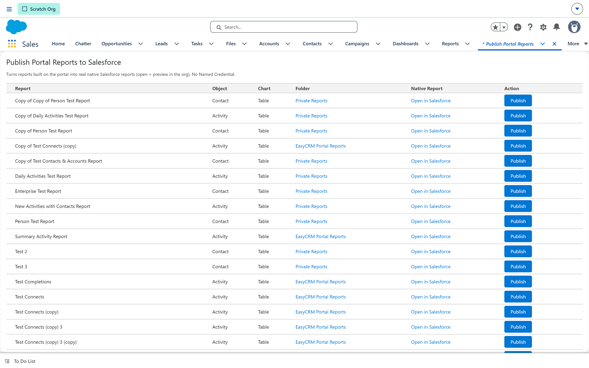

# Publishing a portal report to Salesforce

**What it is.** Taking a report somebody built in the portal and creating it as a **real native
Salesforce report** in your org.

**What it does.** It builds the equivalent Salesforce report — the same object, columns, grouping,
filters and chart — and puts it in a Salesforce folder. From then on it is an ordinary Salesforce
report: it opens in Salesforce, it can go on a Salesforce dashboard, and it can be scheduled.

**Why it helps.** People who live in Salesforce and never open the portal can still see the
numbers, without anyone rebuilding the report by hand.

## Before you start

- The report must already exist **in the portal**. This screen publishes existing reports; it does
  not create them. See [Starting a new report](../../use/reports/report-types.md).
- You need access to the **EasyCRM app in Salesforce** — see [The EasyCRM app](./index.md).

## Opening the screen

**Where:** In Salesforce → **App Launcher** → **EasyCRM** → **Publish Portal Reports**

1. Sign in to **Salesforce**.
2. Open the **App Launcher** (the nine dots, top left) and choose **EasyCRM**.
3. Click the **Publish Portal Reports** tab.

Every report built in the portal is listed here, one per row.

## What each column tells you

| Column | What it means |
|---|---|
| **Report** | The report's name in the portal. |
| **Object** | What the report is built on — Account, Contact, Activity and so on. |
| **Chart** | The chart type on the portal report, or **Table** if it has none. |
| **Folder** | The Salesforce folder the published report will go into. **Private Reports** means only you will see it. |
| **Native Report** | **Open in Salesforce** appears once it has been published. Before that, there is nothing to open. |
| **Action** | The **Publish** button. |

## Publishing one

1. Find the report's row in the list.
2. Check the **Folder** column. If it says **Private Reports**, only you will be able to see the
   result — move it to a shared folder afterwards if other people need it.
3. Click **Publish** on that row.
4. Wait for the page to come back. It is talking to Salesforce's own reporting API, so it takes a
   few seconds.
5. Click **Open in Salesforce** in that row to check the result.

Publishing the same report again **replaces** what was published before. It does not create a
second copy.

## Messages you may see, and what they mean

Publishing tells you when the Salesforce version cannot be exactly the portal version, rather than
quietly producing something that looks right and counts differently. These are the ones worth
knowing.

:::caution A different number in Salesforce than in the portal
If a message mentions the **join**, the **report type** or a **filter**, read it before trusting
the figure. It is not a failure — the report published — it is a warning that the two will not
agree, and the message says which way.

**The count can move either way.** It is worth reading rather than assuming: the most common case,
where Salesforce has no combined report type at all, makes the published count **higher**, not
lower.
:::

| If the message says | What has happened |
|---|---|
| *"Salesforce would not accept the formula column…"* | The report published without that formula column. Everything else is correct. |
| *"…no combined … report type here"* | Salesforce has no report type for this pair, so the published report shows the base object only and the related columns were dropped. See the table below for which way the count moves. |
| *"…so the published report keeps only … that HAVE a related …"* | Your "all rows" join became a Salesforce type that drops base records with nothing related. |
| *"The matched Salesforce report type also includes … without a related …"* | The opposite: your join required a related record, and the Salesforce type does not. |
| *"The filter on … could not be represented…"* | A filter was left out, so the published count is **higher**. |
| *"Salesforce counts an activity once per related…"* | Shared activities. See below. |
| *"Could not create the activity report in Salesforce"* | Nothing was published, and nothing in Salesforce was changed. |

### Which way the count moves

| Situation | Published count |
|---|---|
| No combined report type, and your join was **"with"** (related record required) | **Higher** — base records with nothing related are now included |
| No combined report type, and your join was **"all rows (with or without)"** | **Matches** — an all-rows join already kept every base record |
| Your **all-rows** join, published into a type that requires a related record | **Lower**, but only if some base records have none. Otherwise it matches |
| Your **"with"** join, published into a type that allows records with none | **Higher**, on the same condition |
| A filter could not be represented | **Higher** |

:::note Why the warnings say "if" rather than "will"
Whether the number actually moves depends on your data. An all-rows report published into a
stricter type loses nothing when every record happens to have a related one. The messages state the
condition instead of a verdict, so a warning that turns out not to matter does not teach everyone
to ignore the ones that do.
:::

### Shared activities

An activity linked to several contacts is **one row in the portal** and **one row per contact in
Salesforce**. No filter can undo it: the Salesforce report type exposes a relation count but
nothing that marks which contact is the primary one, so restricting on it would drop the shared
activity altogether rather than keep it once.

If no activity has more than one contact the counts match exactly. Otherwise each shared activity
adds one row for every extra contact on it — which is usually a handful of rows, not a discrepancy
worth investigating.

## Row-level formulas do not come across

Summary-level formulas publish with the report. **Row-level formulas do not** — Salesforce only
exposes those through a different API. After publishing, use
[Sync Report Formulas](./sync-formulas.md) to bring them across.

## If a report is not in the list

Only reports saved in the portal appear here. If one is missing, it has not been saved, or it was
saved into a personal folder that this screen cannot read.
