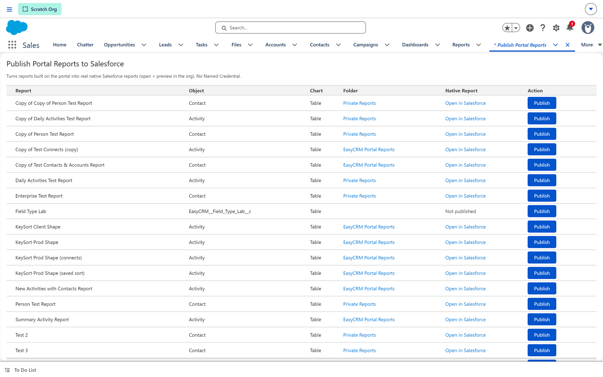

# Publishing a portal report to Salesforce

**What it is.** Taking a report from the portal and writing it into your org as a **real native
Salesforce report**.

**What it does.** It builds the equivalent Salesforce report — the same object, columns,
grouping, filters, formulas and chart — and puts it in a Salesforce folder. From then on it is an
ordinary Salesforce report: it opens in Salesforce, it can go on a Salesforce dashboard, and it
can be scheduled.

**Why it helps.** People who live in Salesforce and never open the portal can still see the
numbers, without anyone rebuilding the report by hand.

## Before you start

- The report must already exist **in the portal**. This screen publishes existing reports; it does
  not create them. See [Starting a new report](../../use/reports/report-types.md).
- You need access to the **EasyCRM app in Salesforce** — see [The EasyCRM app](./index.md).

:::caution A report that came from Salesforce is published over its original
A report you brought **in** from Salesforce stays linked to the Salesforce report it came from.
Publishing it **updates that original Salesforce report in place**, replacing it with the
portal's version — it does not make a second copy. If people in the portal have changed the
report, publishing carries their changes into the Salesforce original.
:::

## Opening the screen

**Where:** In Salesforce → **App Launcher** → **EasyCRM** → **Publish Portal Reports**

1. Sign in to **Salesforce**.
2. Open the **App Launcher** (the nine dots, top left) and choose **EasyCRM**.
3. Click the **Publish Portal Reports** tab.

Every report saved in the portal is listed here, one per row, in name order — the ones built in
the portal and the ones synced from Salesforce alike.

## What each column tells you

| Column | What it means |
|---|---|
| **Report** | The report's name in the portal. |
| **Object** | What the report is built on — Account, Contact, Activity and so on. |
| **Chart** | The chart type on the portal report, or **Table** if it has none. |
| **Folder** | The report's folder in the portal. Click it to open the Salesforce folder of that name, or the Salesforce Reports home when there is none. |
| **Native Report** | **Open in Salesforce** once the report is linked to a Salesforce report — after its first publish, or straight away for a report synced from Salesforce. **Not published** otherwise. |
| **Action** | The **Publish** button. |

## Which folder it lands in

| The portal report's folder | The published report goes to |
|---|---|
| Has the same name as a Salesforce report folder | That Salesforce folder. |
| Has no Salesforce counterpart — **Private Reports**, for example | Your own private reports in Salesforce, where only you see it. Move it to a shared folder afterwards if other people need it. |
| Has no Salesforce counterpart, on an **Activity** report | A shared Salesforce folder called **EasyCRM Portal Reports**, created the first time it is needed. |

## Publishing one

1. Find the report's row in the list.
2. Check the **Folder** column against the table above.
3. Click **Publish** on that row.
4. Wait for the page to come back. It is talking to Salesforce's own reporting API, so it takes a
   few seconds.
5. Read the message at the top:
   - **Published to Salesforce. Native report Id:** *id* — it worked. Anything after
     **— Note:** is a warning to read; see below.
   - **Error:** *message* — it did not publish.
6. Click **Open in Salesforce** in that row to check the result.

Publishing the same report again **replaces** what was published before. It does not create a
second copy.

<!-- SHOT: sf/publish-note-warning.png | Publish Portal Reports right after publishing an Activities with Contacts report: the green box reading "Published to Salesforce. Native report Id: … — Note: Salesforce counts an activity once per related Contact …" -->

### If the Salesforce report has been deleted

If somebody deleted the published report in Salesforce, **Publish** creates it again — once —
and links the portal report to the new one. Pressing the button is taken as consent.

Automatic publishing never does this. A scheduled report whose Salesforce report has gone is
paused instead — see [Publish Schedule](../data/publish-schedule.md).

## Formulas

Row-level and summary formulas publish with the report. Salesforce accepts most of them; when it
refuses one, the report still publishes without that column, and the message names it (see
below).

The **Call Duration (minutes)** column a sync adds to activity reports goes back as Salesforce's
own **Call Duration (minutes)** column, not as a formula.

To pull row-level formulas the other way — from a Salesforce report into the portal — use
[Sync Report Formulas](./sync-formulas.md).

## Messages you may see, and what they mean

Publishing tells you when the Salesforce version cannot be exactly the portal version, rather than
quietly producing something that looks right and counts differently. Several notes can appear
together after **— Note:**.

:::caution A different number in Salesforce than in the portal
If a message mentions the **join**, the **report type** or a **filter**, read it before trusting
the figure. It is not a failure — the report published — it is a warning that the two will not
agree, and the message says which way.

**The count can move either way.** It is worth reading rather than assuming: the most common case,
where Salesforce has no combined report type at all, makes the published count **higher**, not
lower.
:::

| If the message says | What has happened |
|---|---|
| *"Salesforce would not accept the formula column "…" on this report, so it was published without that one…"* | That one formula column is missing. Everything else is correct. |
| *"Salesforce would not accept the formula columns on this report, so it was published without them…"* | Every formula column is missing. Records and count are correct. |
| *"The formula column … was left out: a Salesforce report formula cannot read a checkbox field…"* | Rewrite the portal formula without the checkbox if you need it in Salesforce. |
| *"The formula column … uses something a Salesforce report formula cannot refer to…"* | That formula column is missing. |
| *"The formula column … was left out too, because it is calculated from a formula above…"* | A summary formula fell because the formula it uses fell. Fix that one and both come back. |
| *"The summary … is not one a Salesforce report can show…"* | That summary was left out rather than published as a different calculation. |
| *"The column … has no equivalent in the Salesforce report type, so it was left out…"* | A column is missing. Rows and count are unaffected. |
| *"Salesforce has no combined … report type here…"* | Salesforce has no report type for this pair, so the published report shows the base object only and the related columns were dropped. See the table below for which way the count moves. |
| *"…so the published report keeps only … that HAVE a related …"* | Your "all rows" join became a Salesforce type that drops base records with nothing related. |
| *"The matched Salesforce report type also includes … without a related …"* | The opposite: your join required a related record, and the Salesforce type does not. |
| *"The matched Salesforce report type is …-based, not …-based…"* | The Salesforce report counts a different object's rows than the portal report does. |
| *"The filter on … could not be represented in a Salesforce report…"* | A filter was left out, so the published count is **higher**. |
| *"Salesforce counts an activity once per related…"* | Shared activities. See below. |
| *"This Salesforce report was created on the "…" report type, which counts an activity once per related contact…"* | See [An activity report published on the older report type](#an-activity-report-published-on-the-older-report-type). |
| *"Could not create the activity report in Salesforce…"* | Nothing was published. |

### Which way the count moves

| Situation | Published count |
|---|---|
| No combined report type, and your join was **"with"** (related record required) | **Higher** — base records with nothing related are now included |
| No combined report type, and your join was **"all rows (with or without)"** | **Matches** — an all-rows join already kept every base record |
| Your **all-rows** join, published into a type that requires a related record | **Lower**, but only if some base records have none. Otherwise it matches |
| Your **"with"** join, published into a type that allows records with none | **Higher**, on the same condition |
| A filter could not be represented | **Higher** |

:::note Why the warnings say "if" rather than "will"
Whether the number actually moves depends on your data. An all-rows report published into a
stricter type loses nothing when every record happens to have a related one. The messages state the
condition instead of a verdict, so a warning that turns out not to matter does not teach everyone
to ignore the ones that do.
:::

### Shared activities

An activity linked to several contacts is **one row in the portal** and **one row per contact in
Salesforce**. No filter can undo it: the Salesforce report type exposes a relation count but
nothing that marks which contact is the primary one, so restricting on it would drop the shared
activity altogether rather than keep it once.

If no activity has more than one contact the counts match exactly. Otherwise each shared activity
adds one row for every extra contact on it — which is usually a handful of rows, not a discrepancy
worth investigating.

### An activity report published on the older report type

A Salesforce report's type is fixed when it is created. An activity report first published on a
report type that counts an activity once per related contact keeps that type, so its count can be
higher than the portal's — and the message says so on every publish.

Nothing on this screen changes it, and it never deletes a Salesforce report for you. If you want
the exact count, **delete that Salesforce report yourself** and publish again: the new one is
created on a report type that matches the portal.

## Recorded in the audit log

Every publish writes a row to the portal's [Audit Log](../operations/audit-log.md) under
**Report: Publish to Salesforce**, with your Salesforce username. Its details say whether a
Salesforce report was **created** or **updated**, or begin
*Publish to Salesforce failed - nothing in Salesforce was changed by the portal:* when it did not
work.

## What goes wrong

| Symptom | Cause |
|---|---|
| A Salesforce report changed after someone published a synced report | Publishing a report that came from Salesforce updates the original. See the caution at the top. |
| Nobody else can see the published report | It went to your private reports, because the portal folder has no Salesforce counterpart. Move it to a shared folder in Salesforce. |
| A formula column is missing in Salesforce | Salesforce refused it, or it uses something a Salesforce formula cannot — the message names it. |
| The Salesforce count is higher than the portal's on an activity report | Shared activities, or the report was created on the older report type. Both are explained above. |
| **Error:** *Analytics API …* | Salesforce refused the report. The rest of the message is Salesforce's own explanation. |
| A report is missing from the list | It has not been saved in the portal yet. A report only exists once it is saved. |

## Where this fits

- [Publish Schedule](../data/publish-schedule.md) — publishing automatically, on a timetable or
  when a report is saved.
- [Syncing row-level formulas](./sync-formulas.md) — the other direction, for formulas.
- [Portal Users and Portal Reports](./portal-users.md) — bringing Salesforce reports in.
