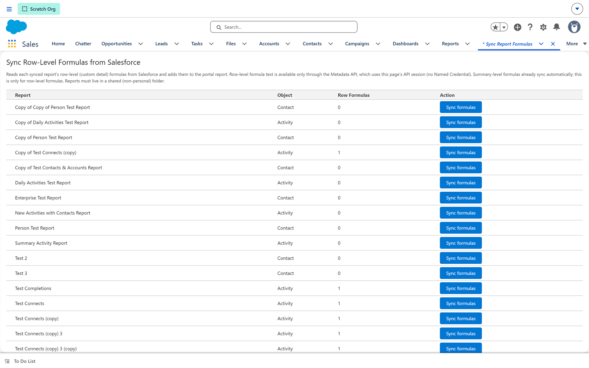

# Syncing row-level formulas from Salesforce

**What it is.** Reading the **row-level formula columns** off a Salesforce report and adding them
to the matching portal report.

**What it does.** For one report at a time, it finds the row-level (custom detail) formulas in
Salesforce and writes them into the portal's copy, so the portal report calculates the same
columns.

**Why it helps.** A sync normally brings row-level formulas across by itself. When it cannot —
the sync message then says *Row-level formulas and the chart setting could not be read* — this
screen fetches them the long way round, through Salesforce's Metadata API, using the API session
this page has. It is also the quickest way to pick up a formula you have just changed in
Salesforce without re-syncing the whole report.

:::note Summary formulas are already automatic
This screen is **only** for row-level formulas. Summary-level formulas sync with the report and
need nothing here.
:::

## Before you start

- The Salesforce report must be in a **shared folder**. A report in a personal folder cannot be
  read, and its formulas will not sync.
- The report must already be in the portal — synced from Salesforce, or built in the portal and
  published to Salesforce. Only reports linked to a Salesforce report are listed.

## Opening the screen

**Where:** In Salesforce → **App Launcher** → **EasyCRM** → **Sync Report Formulas**

1. Sign in to **Salesforce**.
2. Open the **App Launcher** (the nine dots, top left) and choose **EasyCRM**.
3. Click the **Sync Report Formulas** tab.

The page is headed **Sync Row-Level Formulas from Salesforce**. With nothing linked yet it says
*No synced reports yet. Sync a report on the portal first, then return here to bring across its
row-level formulas.*

## What each column tells you

| Column | What it means |
|---|---|
| **Report** | The report's name. |
| **Object** | What it is built on. |
| **Row Formulas** | How many row-level formulas the portal copy has now. **0** means none. |
| **Action** | The **Sync formulas** button. |

:::caution The count includes the portal's own Call Duration (minutes) column
On an activity report that shows **Call Duration (minutes)**, the sync adds a row-level formula of
its own to display it — see [What a report sync brings across](./what-syncs.md#activity-report-columns).
It is counted here too, so such a report can show **1** under **Row Formulas** when Salesforce has
no row-level formulas at all, and is always one higher than the formulas that came from
Salesforce.
:::

## Syncing one

1. Find the report's row.
2. Click **Sync formulas**.
3. Wait for the page to come back, then read the message at the top.

The usual result is **2 of 2 row-level formula(s) synced.** — how many came across, out of how
many the Salesforce report has. If some could not, it adds
*(The rest reference fields the portal cannot compute and were skipped.)*

On an activity report with **Call Duration (minutes)**, the first number includes that column, so
a report with two Salesforce formulas can read **3 of 2**. That is not an error. The same extra
column also means a skipped formula is not always announced — compare the formula columns with
Salesforce's if a count looks odd.

Syncing again is safe. It re-reads Salesforce and replaces the formulas it found before (the
portal's own Call Duration (minutes) column is kept), so it is the right thing to do after
changing a formula in Salesforce.

<!-- SHOT: sf/sync-formulas-activity-row.png | Sync Report Formulas after pressing Sync formulas on an activity report with Call Duration (minutes): message "3 of 2 row-level formula(s) synced." and the row's Row Formulas count -->

## Messages you may see

| Message | What it means |
|---|---|
| *N of M row-level formula(s) synced.* | It worked. See above for why N can be higher than M. |
| *This report has no row-level formulas in Salesforce.* | Nothing to bring across. Summary formulas do not count here. |
| *The portal does not run this report type live, so its row-level formulas are not synced.* | The portal cannot run this report live, so it has nowhere to put formulas. |
| *Could not retrieve the report from Salesforce. Open this from the "Sync Report Formulas" Visualforce tab (it supplies the API session), and make sure the report is in a shared folder.* | Usually a personal folder. Move the report and sync again. |
| *Could not read the report definition:* … | The Salesforce report could not be read. The rest of the message is Salesforce's reason. |
| *This report has no source Salesforce report to read formulas from.* | The portal report is no longer linked to a Salesforce report. |

:::note Read the words, not the colour
The message box is green whatever it says, including when nothing could be synced. Only an
unexpected fault shows red, starting **Error:**.
:::

## If the count stays at 0

In order of likelihood:

1. **The Salesforce report has no row-level formulas.** Summary formulas do not count here.
2. **The report is in a personal folder.** Move it to a shared folder and sync again.
3. **The formulas use fields the portal cannot calculate.** They are skipped rather than
   brought across wrongly.

Every sync is recorded in the portal's [Audit Log](../operations/audit-log.md) under
**Report: Import from Salesforce**, with your Salesforce username.

## Where this fits

- [What a report sync brings across](./what-syncs.md) — formulas normally arrive with the sync.
- [Publishing a portal report to Salesforce](./publish-reports.md) — the other direction, which
  takes row-level formulas with it.
