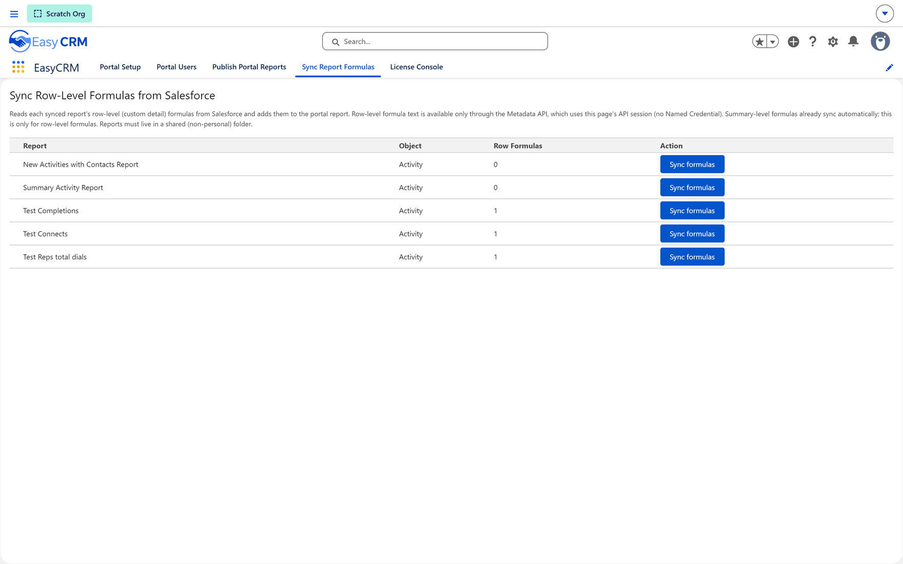

# Syncing row-level formulas from Salesforce

**What it is.** Reading the **row-level formula columns** off a Salesforce report and adding them
to the matching portal report.

**What it does.** For one report at a time, it finds the row-level (custom detail) formulas in
Salesforce and writes them into the portal's copy, so the portal report calculates the same
columns.

**Why it helps.** Row-level formula *text* is only available through Salesforce's Metadata API, so
it cannot travel with an ordinary publish. This screen is the one place that can fetch it.

:::note Summary formulas are already automatic
This screen is **only** for row-level formulas. Summary-level formulas sync on their own and need
nothing here.
:::

## Before you start

- The Salesforce report must be in a **shared folder**. A report in a personal folder cannot be
  read, and its row will not sync.
- The report must already be synced to the portal.

## Opening the screen

**Where:** In Salesforce → **App Launcher** → **EasyCRM** → **Sync Report Formulas**

1. Sign in to **Salesforce**.
2. Open the **App Launcher** (the nine dots, top left) and choose **EasyCRM**.
3. Click the **Sync Report Formulas** tab.

## What each column tells you

| Column | What it means |
|---|---|
| **Report** | The report's name. |
| **Object** | What it is built on. |
| **Row Formulas** | How many row-level formulas the portal copy currently has. **0** means none have been brought across yet. |
| **Action** | The **Sync formulas** button. |

## Syncing one

1. Find the report's row.
2. Look at **Row Formulas**. A **0** is the normal starting point.
3. Click **Sync formulas**.
4. Wait for the page to come back, then check the **Row Formulas** count — it should now match the
   number of row-level formulas on the Salesforce report.

Syncing again is safe. It re-reads Salesforce and overwrites what it found before, so it is the
right thing to do after changing a formula in Salesforce.

## If the count stays at 0

In order of likelihood:

1. **The Salesforce report has no row-level formulas.** Summary formulas do not count here.
2. **The report is in a personal folder.** Move it to a shared folder and sync again.
3. **The portal report is not matched to a Salesforce report.** Nothing can be read until it is.
