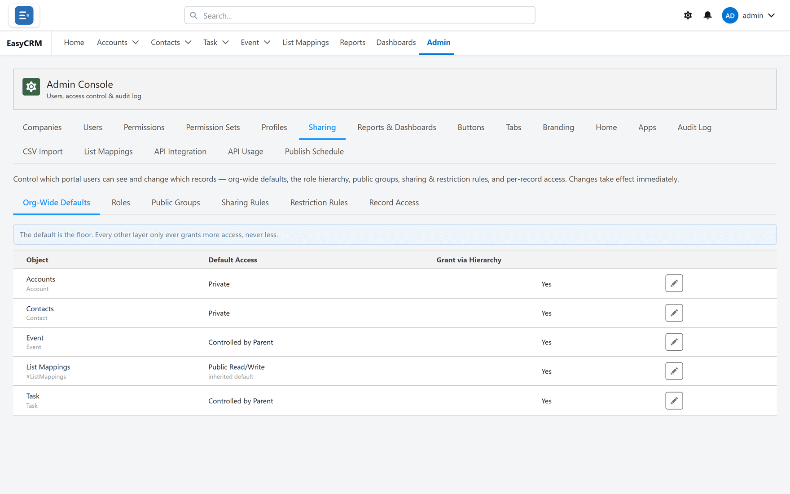

# Who sees what, by default

**What it is.** The starting rule for each kind of record: who can see it before any other
rule applies.

**What it does.** It sets the floor. Everything else only ever raises access from here.

**Why it matters.** This is the most important setting in the portal. Get it wrong and either
nobody can do their job, or everybody sees everybody else's customers.

## Opening it

**Where:** In the portal → **Admin** → **Sharing** → **Org-Wide Defaults**

1. Click **Admin** in the top menu.
2. Click **Sharing** in the row of tabs.
3. Click **Org-Wide Defaults**.

Each kind of record has its own setting, so accounts and tasks can be different.

## Setting one

1. Find the kind of record in the list.
2. Click **Edit** beside it.
3. Choose the default access.
4. Click **Save**.

| Setting | What it means |
|---|---|
| **Private** | You see only records you own. |
| **Public Read Only** | Everybody sees them. Only the owner can change them. |
| **Public Read/Write** | Everybody sees and changes them. |
| **Controlled by Parent** | This record has no access of its own. Whoever can see the record it belongs to can see it. |

## Controlled by Parent

Choose this for records that only make sense as part of something else — a note on an account,
a line on an order. Rather than deciding who can see them, you say **which field points at the
parent**, and access follows that parent.

Picking it reveals a second control: **the parent field**. Choose the lookup that points at the
record this one belongs to.

| | |
|---|---|
| **You set** | the parent field, not who can see the record |
| **A person sees it** | whenever they can see the parent |
| **They lose it** | the moment they lose the parent |

:::note Why this is often better than Private
With Private you would have to grant access twice — once to the account, once to every note on
it — and keep the two in step for ever. Controlled by Parent has one rule, on the parent, and the
children follow it automatically.
:::

:::caution Pick the parent field carefully
Access flows down whichever field you choose. If it points at the wrong record, people will see
children of records they were never meant to reach — and it will look like the sharing rules are
wrong rather than the parent field.
:::

## How to choose

**Start with Private and open it up.** It is much easier to grant access to the people who
need it than to work out, months later, who should never have had it.

Use **Public Read Only** for reference data everybody needs and nobody should edit.

Use **Public Read/Write** only where a team genuinely shares ownership of everything, which is
rarer than people expect.

Use **Controlled by Parent** for records that have no meaning on their own.

## Grant via Hierarchy

Beside each setting is **Grant via Hierarchy**.

With it on, a manager automatically sees whatever the people they manage can see. Set who
manages whom under [Roles](./roles.md).

Leave it on unless you have a specific reason not to. Without it you have to build a sharing
rule for every manager, and keep adding to it as the team changes.

## Changing it later

You can, and the change takes effect immediately.

**Tightening** a default — Public to Private — can make records disappear for people who could
see them a minute ago. Tell people before you do it, and check with
[Record Access](./record-access.md) first.
