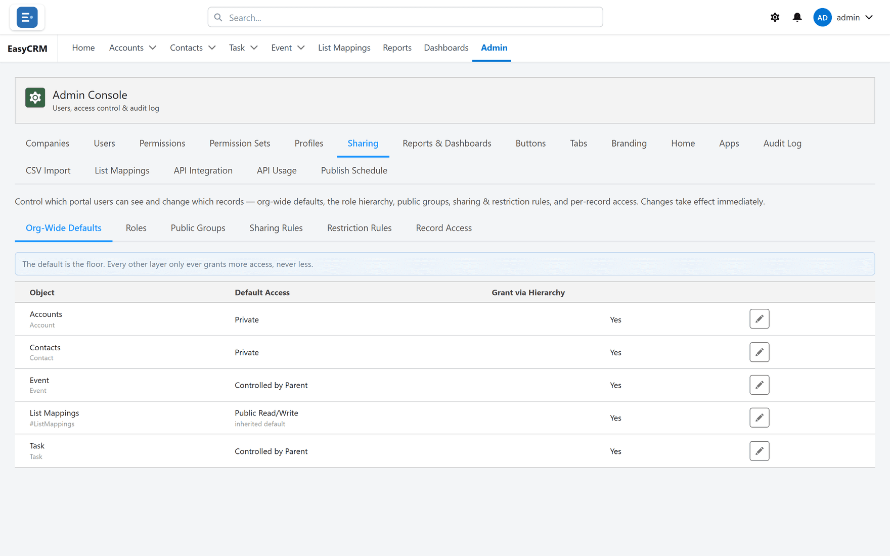
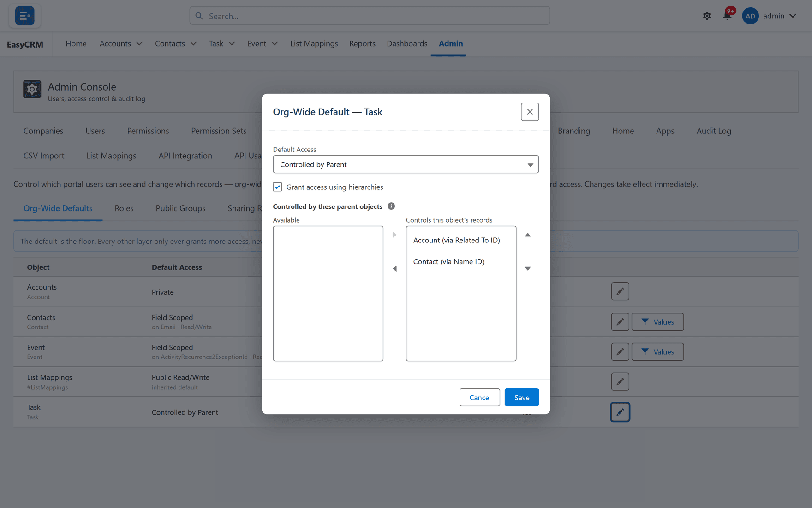

# Who sees what, by default

**What it is.** The starting rule for each kind of record: who can see it before any other
rule applies.

**What it does.** It sets the floor. Sharing rules, groups and the role hierarchy only ever raise
access from here — with one exception: **Field Scoped** narrows it.

**Why it matters.** This is the most important setting in the portal. Get it wrong and either
nobody can do their job, or everybody sees everybody else's customers.

## Opening it

**Where:** In the portal → **Admin** → **Sharing** → **Org-Wide Defaults**

1. Click **Admin** in the top menu.
2. Click **Sharing** in the row of tabs.
3. Click **Org-Wide Defaults**.

Each kind of record has its own setting, so accounts and tasks can be different. A row marked
**inherited default** has never been set; it shows the default the portal falls back to.

## Setting one

1. Find the kind of record in the list.
2. Click the pencil (**Edit**) beside it. The **Org-Wide Default — *object*** dialog opens.
3. Choose the **Default Access**.
4. Click **Save**. The message **Org-wide default saved.** confirms it.

| Setting | What it means |
|---|---|
| **Private** | You see only records you own. |
| **Public Read Only** | Everybody sees them. Only the owner can change them. |
| **Public Read/Write** | Everybody sees and changes them. |
| **Controlled by Parent** | This record has no access of its own. Whoever can see the record it belongs to can see it. |
| **Field Scoped** | Each person sees only the records whose chosen field holds one of their values. Super Admin only — see [Field Scoped sharing](./field-scoped.md). |

## Controlled by Parent

Choose this for records that only make sense as part of something else — a note on an account,
a task on a contact. Rather than deciding who can see them, you say **which parent records**
decide, and access follows those parents.

Picking it reveals a two-column picker, **Controlled by these parent objects**:

- **Available** on the left — every portal object this one has a lookup to, shown with the lookup
  it uses, for example **Account (via Account ID)**.
- **Controls this object's records** on the right — the parents that decide.

Move one or more parents to the right, then click **Save**.

| | |
|---|---|
| **You set** | which parents decide, not who can see the record |
| **A person sees it** | when they can see **any one** of its selected parents — with the highest access any of them gives |
| **They lose it** | when they can see none of them, or it points at none of them |

A record that points at none of the selected parents is **hidden**. Under a Task controlled by
Account and Contact, a task linked only to an opportunity is reached only through other grants,
such as owning it.

If the object has no lookups to other portal objects, the picker is replaced by **This object has
no lookups to other portal objects, so there is no parent to control it by.** That message can
also appear for a moment the first time you open the dialog after loading the page, for an object
that does have lookups — if you see it on Tasks or Events, close the dialog and open it again.

If a parent is itself [Field Scoped](./field-scoped.md), the children follow it: people see only the
children of in-scope parents.

:::note Why this is often better than Private
With Private you would have to grant access twice — once to the account, once to every note on
it — and keep the two in step for ever. Controlled by Parent has one rule, on the parent, and the
children follow it automatically.
:::

:::caution Pick the parents carefully
Access flows down every parent you select. Add one that does not belong and people will see
children of records they were never meant to reach — and it will look like the sharing rules are
wrong rather than the parent list.
:::

## How to choose

**Start with Private and open it up.** It is much easier to grant access to the people who
need it than to work out, months later, who should never have had it.

Use **Public Read Only** for reference data everybody needs and nobody should edit.

Use **Public Read/Write** only where a team genuinely shares ownership of everything, which is
rarer than people expect.

Use **Controlled by Parent** for records that have no meaning on their own.

Use **Field Scoped** when each company or person should see only the records carrying their own
value in one field — their region, their territory, their accounts. It is the only default that
hides records from their owners.

## Grant via Hierarchy

The list has a **Grant via Hierarchy** column; in the dialog it is the **Grant access using
hierarchies** box.

With it on, a manager automatically sees whatever the people they manage can see. Set who
manages whom under [Roles](./roles.md).

Leave it on unless you have a specific reason not to. Without it you have to build a sharing
rule for every manager, and keep adding to it as the team changes.

## Changing it later

You can, and the change takes effect immediately.

**Tightening** a default — Public to Private, or anything to Field Scoped — can make records
disappear for people who could see them a minute ago. Tell people before you do it, and check
with [Record Access](./record-access.md) first.

Every change is written to the [Audit Log](../operations/audit-log.md) as **Change Permission**,
for example `OWD Account = Private`.
