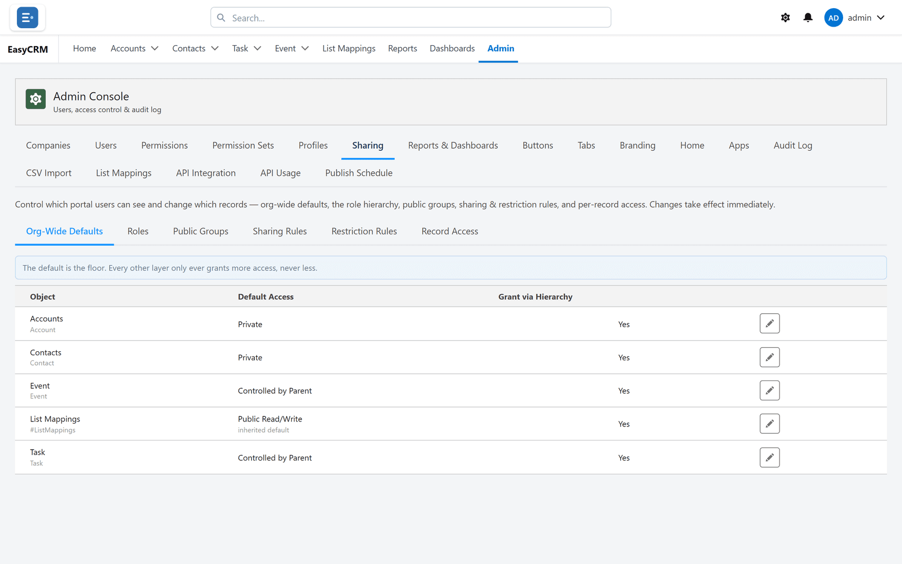

# Sharing

**What it is.** Which records each person can see.

**How it differs from permissions.** [Permissions](../access/permissions.md) say what somebody may
**do** — read, create, edit, delete. Sharing says which **records** they may do it to.

**Why it matters most.** Get this wrong and either nobody can do their job, or everybody sees
everybody else's customers.

## Opening it

**Where:** In the portal → **Admin** → **Sharing**

1. Click **Admin** in the top menu.
2. Click **Sharing** in the row of tabs.

Inside Sharing there are several areas, each with its own page here:

| Area | What it is for |
|---|---|
| [Org-Wide Defaults](./defaults.md) | The starting rule for each kind of record. |
| [Sharing Rules](./rules.md) | Standing rules that open access up. |
| [Public Groups](./public-groups.md) | Named lists of people, used by rules. |
| [Roles](./roles.md) | Who reports to whom. |
| [Restriction Rules](./restriction-rules.md) | The only thing that takes access away. |
| [Record Access](./record-access.md) | Check who can see one record, and why. |

## How the pieces fit together

Think of it as a floor, then things that raise it.

1. **The default** sets the floor for everybody.
2. **Sharing rules**, **groups** and the **role hierarchy** raise it for particular people.
3. **Restriction rules** are the only thing that lowers it again.

Everything except restriction rules can only ever **add** access. Nothing you do in a sharing
rule will hide a record somebody can already see.

## The order to set it up

1. Start with [Org-Wide Defaults](./defaults.md) set to **Private**.
2. Turn on **Grant via Hierarchy** so managers see their team's records.
3. Add [sharing rules](./rules.md) for teams that need each other's records.
4. Only then consider [restriction rules](./restriction-rules.md).

Starting Private and opening up is far easier than starting open and working out later who
should never have seen what.

## When somebody says they cannot see a record

Use [Record Access](./record-access.md). It lists everybody who can see a given record and
why, which turns a guess into an answer in about ten seconds.

## The whole screen, control by control

### Org-Wide Defaults

The starting position for every object: what somebody can see before any rule widens it.

| Control | What it does |
|---|---|
| **Object** | The object this row is about. |
| **Default Access** | The baseline — what everyone gets without a rule. |
| **Grant access using hierarchies** | Whether a manager inherits what the people below them can see. |
| **Controls this object's records** / **Controlled by these parent objects** | Where an object takes its access from a parent instead of having its own. |

Set defaults **tight** and open them with rules. A default that is too broad cannot be narrowed
by adding rules on top.

### Sharing rules

| Control | What it does |
|---|---|
| **New Sharing Rule** | Creates a rule that widens access. |
| **Rule Type** / **Owned By / Criteria** | Share by who owns the record, or by what is in its fields. |
| **Filter Criteria** / **Field** / **Operator** / **Add Filter** / **Filter Logic** | Which records a criteria rule covers. |
| **Applies To** | Who gains the access. |
| **Access Level** | How much they gain. |

### Groups and roles

| Control | What it does |
|---|---|
| **New Group** / **Group Name** / **Public Group** | A named set of people to share with. |
| **Member** / **Members** / **Add** | Who is in the group. |
| **New Role** / **Role Name** | A position in the hierarchy. |
| **Grant via Hierarchy** | Whether this role inherits from below. |

### Restriction rules

| Control | What it does |
|---|---|
| **New Restriction Rule** | Narrows what somebody can see, even where another rule grants it. |
| **Object (optional)** | What it applies to. |
| **Active** / **Inactive** | Whether it is enforced. |

A restriction rule **wins**. If access is missing and the rules look right, check here first.

### One record at a time

| Control | What it does |
|---|---|
| **Find a record** / **Find record** / **Browse by owner** | Locate a specific record. |
| **Owner** / **Current owner:** / **New owner** / **Set Owner** | See and change who owns it. |
| **Access** | Who can reach this record now, and why. |

### Empty states

**No public groups yet**, **No restriction rules**, **No shares on this record**,
**No portal objects are configured yet** and **No active portal users** all mean exactly what
they say — nothing has been set up yet, not that something failed.
