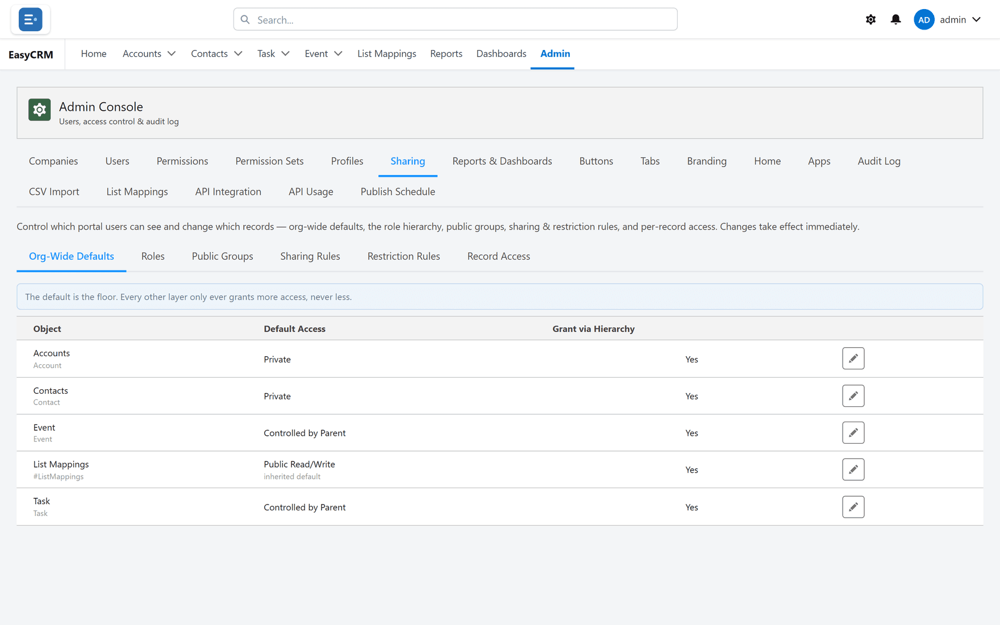

# Checking who can see a record

**What it is.** A screen that answers "who can see this, and why".

**What it does.** You pick a record, and it lists every active user, how much access each one has,
and the reason.

**Why it helps.** When somebody says "I cannot see this", or "why can they see this?", this
turns a guess into an answer in about ten seconds.

## Opening it

**Where:** In the portal → **Admin** → **Sharing** → **Record Access**

1. Click **Admin** in the top menu.
2. Click **Sharing**, then **Record Access**.

## Finding a record

Two ways:

- **Find a record** — choose the **Object**, then type in **Find record**: a name, or paste a
  record Id.
- **Browse by owner** — choose a person in **Owned by**, and narrow with **Object (optional)** if
  you like.

Click the record in **Results**. Three panels open:

| Panel | What it shows |
|---|---|
| **Ownership — *record*** | The **Current owner:**, and **New owner** with **Set Owner** to change it. |
| **Sharing** | Manual shares on this record. Add one with the user or group, the access, and **Share**; remove a manual share with its bin. |
| **Who has access — and why** | Every active user — the first 200, alphabetically — with **Access** and **Reason**. |

## Reading the reasons

**Access** is **Full Access**, **Read/Write**, **Read Only** or **No Access**. The **Reason** is the
thing that gave that level — when several things grant access, the one that gave the most is named.

<!-- SHOT: admin/sharing-record-access-field-scope.png | Sharing → Record Access on a Contact of a Field Scoped object; "Who has access — and why" showing one user with "In your field scope (AccountId)" and another with "Outside your field scope" / No Access -->

| Reason | Means | To change it |
|---|---|---|
| **Owner of this record** | They own it. | [Change the owner](../../use/records/changing-owner.md), or **Set Owner** here. |
| **Modify All on the object** / **View All on the object** | Their permissions reach every record of this kind. | [Permissions](../access/permissions.md). |
| **In scope for your record-visibility mode** | An Admin, reaching it through the mode in [What an Admin can see](../users/what-admins-can-see.md). | That setting. |
| **Org-wide default: Public Read/Write** / **Org-wide default: Public Read Only** | Everybody has it. | [Defaults](./defaults.md). |
| **Inherited from the parent record** | Controlled by Parent: they can see a parent. | [Controlled by Parent](./defaults.md#controlled-by-parent). |
| **In your field scope (*field*)** | Field Scoped: the record carries one of their values. | [Field Scoped sharing](./field-scoped.md). |
| **Role hierarchy: the owner reports to this user** | They manage the owner. **…the Salesforce owner reports to this user** when the record has no portal owner. | [Roles](./roles.md). |
| **Field match: *field* matches this user** | An account match set up in Salesforce. | [Account scoping](./account-scoping.md). |
| **Shared directly with this user** / **Shared with group *name*** | A manual share. | The **Sharing** panel above. |
| **Owner-based sharing rule "*name*"** / **Criteria-based sharing rule** | A sharing rule grants it. A criteria rule is not named. | [Sharing rules](./rules.md). |

When **Access** is **No Access**, the reason says why:

| Reason | Means |
|---|---|
| **No Read permission on the object** | Sharing is not the problem — they cannot read this kind of record at all. See [Permissions](../access/permissions.md). |
| **Outside your field scope** | The object is Field Scoped and this record does not carry one of their values. Nothing else can reach it. See [Field Scoped sharing](./field-scoped.md). |
| **Blocked by a restriction rule** | Something granted access, and a [restriction rule](./restriction-rules.md) took it away. |
| **No access** | Nothing grants it. |

## Using it to solve the two common complaints

**"I cannot see this record."**

Find the person in the list and read the reason.

- **No access** — nothing grants it. Add a [sharing rule](./rules.md) or a manual share, or check
  the [default](./defaults.md).
- **No Read permission on the object** — the problem is [permissions](../access/permissions.md),
  not sharing.
- **Outside your field scope** — give them the value under **Values**, or leave it: that is
  exactly what Field Scoped is for.
- **Blocked by a restriction rule** — the rule is doing its job, or is too broad.

That distinction is the whole reason this screen exists, and it saves a great deal of guessing.

**"Why can they see this?"**

Find them in the list and read the reason. It names the layer — and for an owner-based rule, the
rule — so you know exactly what to change.

## Before you tighten anything

Check here first. It shows who is about to lose access, which is much better than finding out
from the people who lost it.
