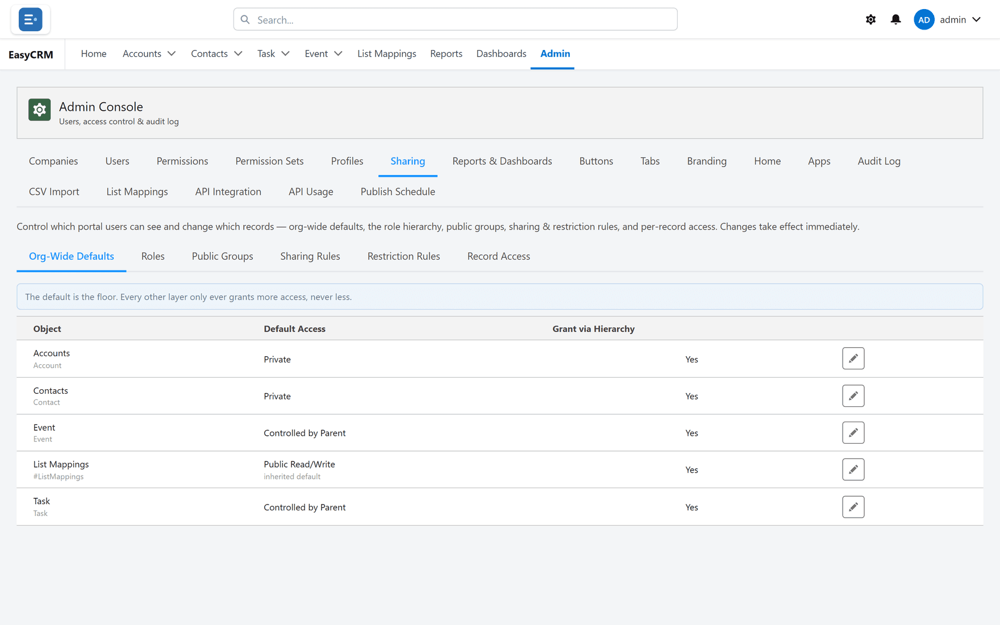

# Restriction rules

**What it is.** A rule that narrows what somebody can see, rather than widening it.

**What it does.** Of the records a person could otherwise see, it keeps only those matching
your criteria.

**Why it matters.** It is one of only two things in the portal that take access away. The other
is the [Field Scoped](./field-scoped.md) default, which hides every record outside a person's own
values. Everything else — the other defaults, sharing rules, groups, hierarchy — only ever adds.

## Opening it

**Where:** In the portal → **Admin** → **Sharing** → **Restriction Rules**

1. Click **Admin** in the top menu.
2. Click **Sharing**, then **Restriction Rules**.

## Creating one

1. Click **New Restriction Rule**.
2. Choose the **Object** — the kind of record.
3. Choose who it **Applies To** — **All Portal Users**, a **Role**, **Roles & Subordinates**, or a
   **Public Group**. To restrict one person, put them in a group.
4. Under **Records must match**, set what records must match for them to keep seeing them.
5. Click **Save**.

From then on, those people see only records that match. When several rules apply to the same
person and object, a record must match **every** one of them.

On a [Field Scoped](./field-scoped.md) object a restriction rule narrows the in-scope records
further. It never brings back a record outside the person's values.

## Use it carefully

A restriction rule can make records vanish for somebody who could see them a minute ago, and
from their side it looks exactly like data loss.

Three habits worth keeping:

1. **Test with one person first** — a public group with just them in it — not a whole role.
2. **Tell people before you turn it on.**
3. **Check with [Record Access](./record-access.md)** afterwards, on a record you expect them
   to keep and one you expect them to lose.

## When it is the right tool

When somebody needs broad permission for most of their job but must not see one slice of the
data — a contractor who works on one company's records only, for example.

If you find yourself reaching for a restriction rule often, the
[default](./defaults.md) is probably too open. Tightening the floor is usually
cleaner than cutting people back one rule at a time.

If the rule is really "each company sees only the records with its own value in one field", use
[Field Scoped](./field-scoped.md) instead. It takes one setting and a list of values per company,
not a rule per company.

## Turning one off

Set it to **Inactive**. Access returns immediately to whatever the other rules allow.
