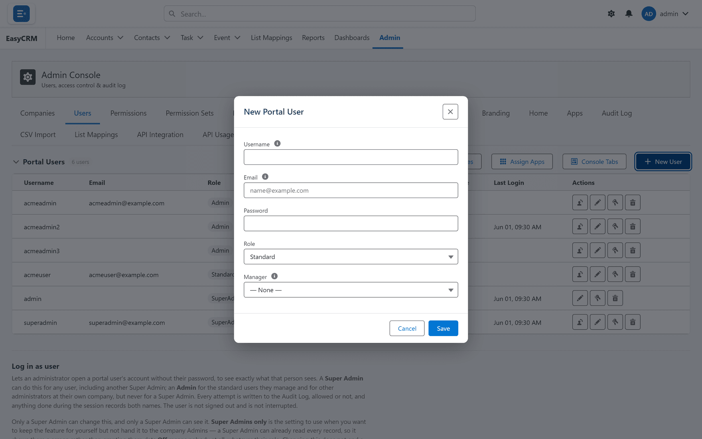

# Adding a user

## Before you start

Create the person's [company](../companies/index.md) first, and give it an **Admin** before you add
its Standard users. Company drives most access rules, and a user left without one is the most
common setup mistake in the product.

## Adding somebody

**Where:** In the portal → **Admin** → **Users** → **+ New User**

1. Click **Admin** in the top menu.
2. Click **Users** in the row of tabs.
3. Click the blue **+ New User** button on the right. The **New Portal User** window opens.

   

4. Fill in each field:

| Field | Notes |
|---|---|
| **Username** | What they type to sign in. Must be unique across the portal. |
| **Email** | Where their sign-in details are sent. Must be real and reachable. Left blank, a username that looks like an e-mail address is used. |
| **Password** | You choose it. |
| **Role** | See below. |
| **Manager** | Appears for a **Standard** user only: the Admin who manages them. **— None —** means nobody manages them, and only a Super Admin will see them. |

5. Click **Save**.

The message **User created.** confirms it, with a note on whether the e-mail went. The e-mail gives
them their username and the password you typed.

## Putting them in a company

The window has **no Company field**. A new user joins a company in one of two ways:

- **Pick a Manager.** A Standard user who has no company yet joins the company of the Admin you
  pick. Every active Admin is offered, labelled with their company.
- **Add them on the Companies tab.** A Super Admin opens [Companies](../companies/index.md) →
  the company → **People**, chooses them under **Add a user who has no company**, and clicks
  **Add to company**. This is how an Admin joins a company. A Standard user added this way to a
  company with exactly one Admin gets that Admin as their manager automatically.

A Super Admin never belongs to a company — they administer all of them. Once a user is in a
company, only that company's Admins are offered as their **Manager**.

## Choosing the role

| Role | Shown as | Can | Give it to |
|---|---|---|---|
| **Standard** | **Standard** | See and work on their own records | Most people |
| **Admin** | **Admin — sees the users they manage** | The above, plus manage the people at their own company | One or two per company |
| **Super Admin** | **Super Admin — sees everything** | Everything, for every company | Whoever runs the portal |

**Be sparing with Super Admin.** It crosses company boundaries, which is precisely what the
rest of the model exists to prevent. Only a Super Admin can give it.

## Why the company matters so much

A user with no company matches no company rule. The symptoms are confusing and rarely point at the
cause:

- Their Admin cannot see or manage them.
- Report folders shared with their company do not appear.
- Apps assigned to their company do not appear.

All three are the same missing company.

## After creating them

A new user has a role but no specific access yet. Decide:

| Next | Page |
|---|---|
| What they may do | [Permissions](../access/permissions.md) |
| Which records they may do it to | [Sharing](../sharing/index.md) |
| Whether they see only certain values of a field | [Field Scoped sharing](../sharing/field-scoped.md) |

## What goes wrong

| Symptom | Cause |
|---|---|
| **That username already exists.** | Usernames are unique portal-wide, including inactive users. |
| **Username and password are required.** | One of the two is empty. |
| **Only a Super Admin can grant the Super Admin role.** | An Admin chose **Super Admin — sees everything**. |
| **A manager has to be in the same company as the user they manage.** | The user already belongs to another company. |
| **You can only assign users to yourself as their manager.** | An Admin picked another Admin as **Manager**. |
| **You can only manage the users at your own company.** after **Save**, when a company Admin adds a Standard user | The user has been created, but outside any company, so the Admin cannot manage them yet. Do not click **Save** again — that tries to create them a second time. A Super Admin adds them to the company under [Companies](../companies/index.md) and sets the **Manager**. |
| A limit message, with **Contact support** | You have hit a [licence limit](../operations/licence.md). **Contact support** e-mails a request; **Thanks — your request has been sent to support.** confirms it. |
| No welcome e-mail | Check spam; then ask a Salesforce administrator to check Salesforce's e-mail deliverability (Setup → **Deliverability**). [Setup Assistant](../operations/setup-assistant.md) does not check it. The user can still sign in with the password you set. |
| They sign in but see nothing | Permissions without sharing — or, on a [Field Scoped](../sharing/field-scoped.md) object, no values. |
