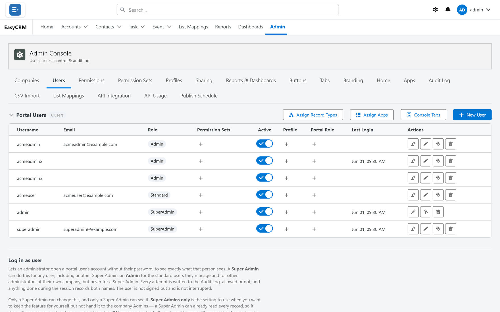
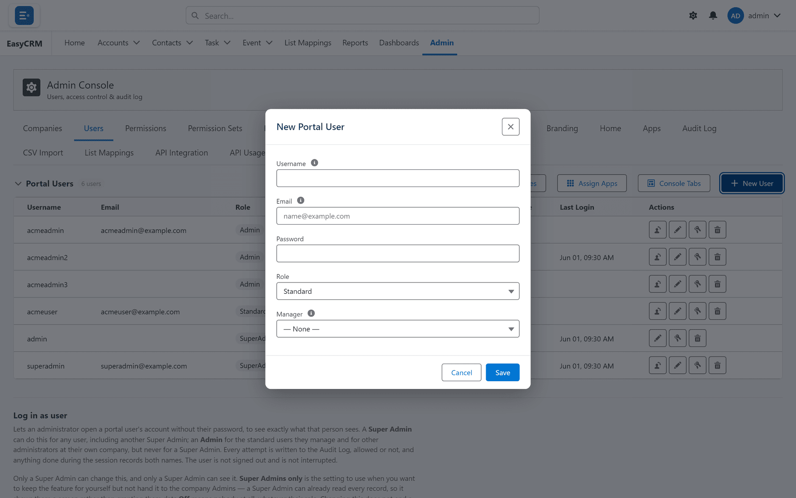
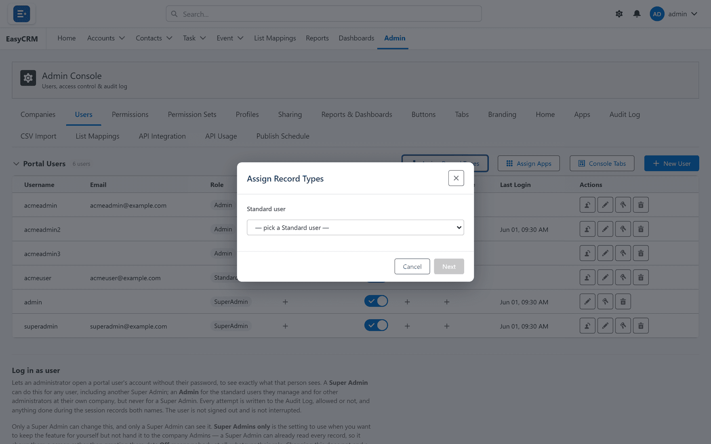
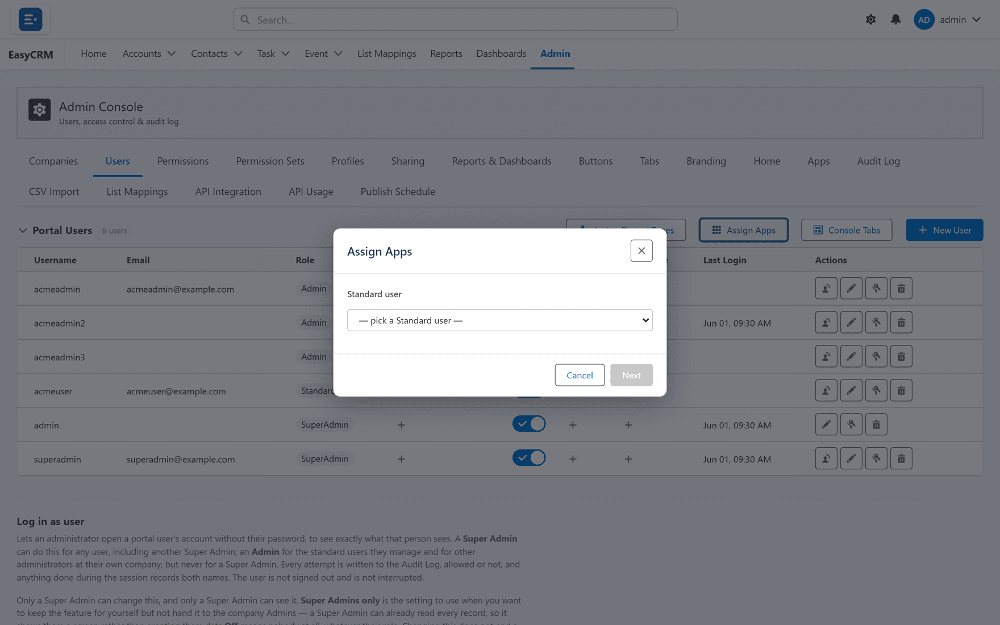
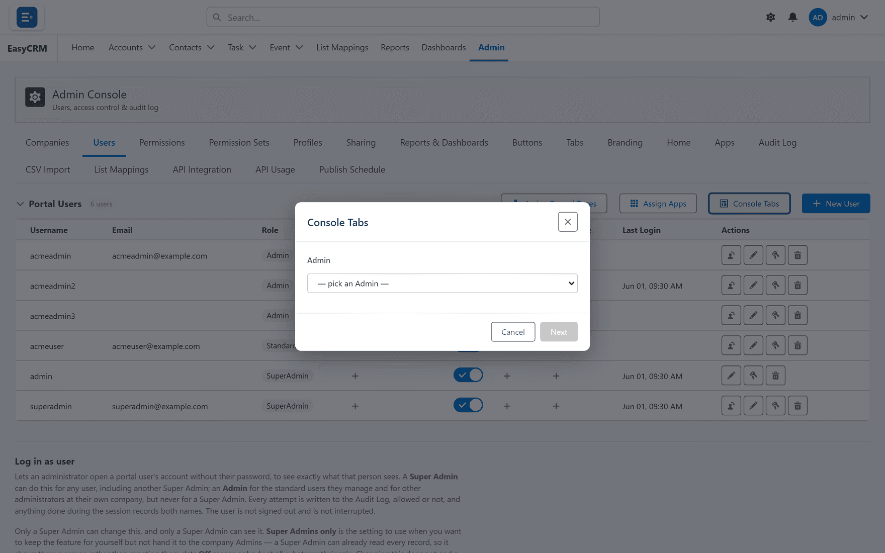
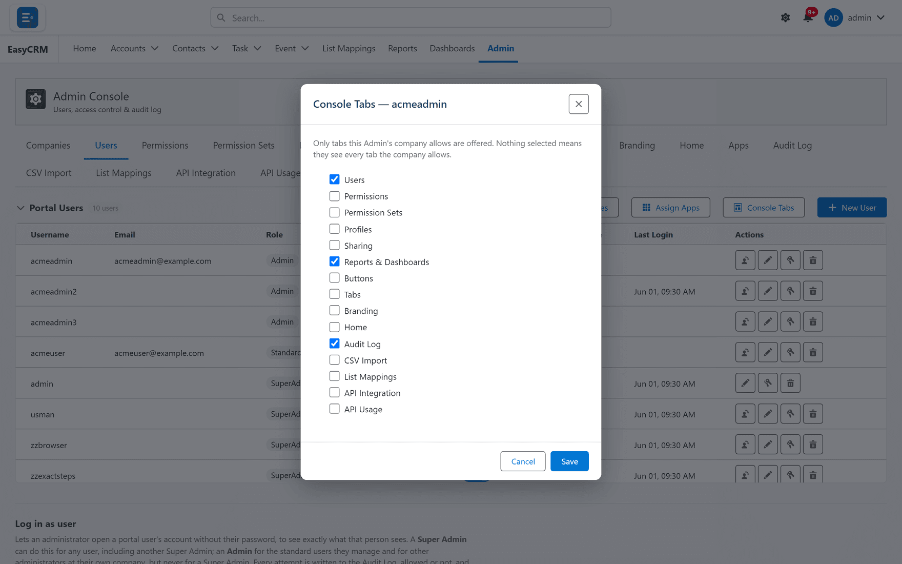

# Users

**What it is.** Everybody who can sign in to the portal.

**What you do here.** Add people, set what kind of user they are, reset passwords, and switch
off anybody who has left.

**Why it matters.** This is the front door. Somebody switched off here cannot get in at all,
whatever any other setting says.

## In this section

| Page | Covers |
|---|---|
| [Adding a user](./adding.md) | Creating somebody, choosing their role |
| [When somebody leaves](./deactivating.md) | Deactivating, and what to do with their records |
| [Seeing the portal as somebody else](./login-as.md) | Reproducing a reported problem |
| [What an Admin can see](./what-admins-can-see.md) | The Super Admin settings below the user list |

## Opening it

**Where:** In the portal → **Admin** → **Users**

1. Click **Admin** in the top menu.
2. Click **Users** in the row of tabs under the heading.

**Portal Users** lists every person who can sign in, with a count beside the heading. Click the
heading to fold the list away.

| Column | Shows |
|---|---|
| **Username**, **Email**, **Role** | Who they are. |
| **Permission Sets**, **Profile**, **Portal Role** | Their access — the **+** beside each changes it. |
| **Active** | Whether they can sign in. |
| **Last Login** | When they last signed in. |
| **Actions** | **Log in as this user**, **Edit**, **Reset password**, **Delete**. |

A Super Admin sees everybody. An Admin sees the users they manage and the Standard users at their
company; other Admins at their company are listed too, but without any controls.

## Adding somebody

**Where:** In the portal → **Admin** → **Users** → **+ New User**

1. Click **Admin**, then **Users**.
2. Click the blue **+ New User** button on the right.
3. The **New Portal User** window opens.

   

4. Fill in:
   - **Username** — what they type to sign in. It must be unique.
   - **Email** — where their sign-in details are sent.
   - **Password** — you choose it. It is e-mailed to them with their username.
   - **Role** — see the table below.
   - **Manager** — for a Standard user only: the Admin who manages them.
5. Click **Save**.

There is **no Company box**. A Standard user given a **Manager** joins that Admin's company. Anybody
else is added to a company afterwards, by a Super Admin, under [Companies](../companies/index.md) →
**People** → **Add a user who has no company**. See [Adding a user](./adding.md).

### Which role to choose

| Role | Shown as | Can do |
|---|---|---|
| **Standard** | **Standard** | See and work on their own records. Most people. |
| **Admin** | **Admin — sees the users they manage** | The above, plus manage the people at their own company. |
| **Super Admin** | **Super Admin — sees everything** | Everything, for every company. Keep this to a few people. Only a Super Admin can give it. |

## When somebody leaves

**Do not delete them.** Switch them off instead.

1. Find them in the list.
2. Click the **Active** switch so it turns grey.

They can no longer sign in. Their records, and the history of what they did, stay exactly as
they are. Deleting would break both. See [When somebody leaves](./deactivating.md).

## Resetting a password

1. Find the person in the list.
2. Click the **key** symbol — **Reset password** — in the **Actions** column.
3. The **Reset password — *username*** window opens. Type the **New password**.
4. Click **Reset**.

The new password is e-mailed to them. The message **Password reset.** confirms it, followed by a
note on whether the e-mail went.

## Seeing the portal as somebody else

Useful when a colleague reports a problem you cannot reproduce.

1. Find the person in the list.
2. Click **Log in as this user** in the **Actions** column.
3. Read the **Log in as *username*** window, then click **Log in as user**.

You now see the portal exactly as they see it. A banner reads **You are logged in as *username*.
Everything you do is recorded as them.** Click **Return to my account** in it to come back.

**What you should know:**

- Every attempt is written to the [Audit Log](../operations/audit-log.md), allowed or refused.
- Anything you do while in there records both names.
- The person is not signed out and does not notice.

**Who may do it** depends on **Who may log in as portal users**, a Super Admin setting below the
list. It is **Off** until a Super Admin changes it. See
[Seeing the portal as somebody else](./login-as.md).

## The buttons above the table

Each of these sets something for **one person**. The company-wide versions are under
[Companies](../companies/index.md) → **Edit**.

| Button | Who sees it | What it controls |
|---|---|---|
| **Assign Record Types** | A Super Admin; an Admin whose company allows it | Which record types one Standard user may use. |
| **Assign Apps** | A Super Admin; an Admin whose company allows it | Which apps one Standard user sees in the app launcher. |
| **Console Tabs** | A Super Admin only | Which Admin Console tabs one Admin sees. |

**Assign Record Types** and **Assign Apps** each start by asking for the user: choose one in
**Standard user** (**— pick a Standard user —**) and click **Next**.

- **Record Types — *username*** offers only what the user's company holds. Unticking everything
  for an object falls back to the site's own assignments.
- **Apps — *username*** offers only the apps the user's company allows. Nothing selected means
  they see all of the company's apps.

**Console Tabs** asks for an **Admin** (**— pick an Admin —**) and **Next**.

It then opens **Console Tabs — *username***: *Only tabs this Admin's company allows are offered. Nothing selected means they see
every tab the company allows.*

In all three, leaving everything unticked means "everything allowed", not "nothing".

## The settings below the list

A Super Admin also sees six panels under the user list: **Log in as user**, **Report speed**,
**Long text filters on large reports**, **FrontSpin sync buttons**, **Page layout editor**, and
**Who manages whom**.
They are described in [What an Admin can see](./what-admins-can-see.md#the-settings-beside-it).
