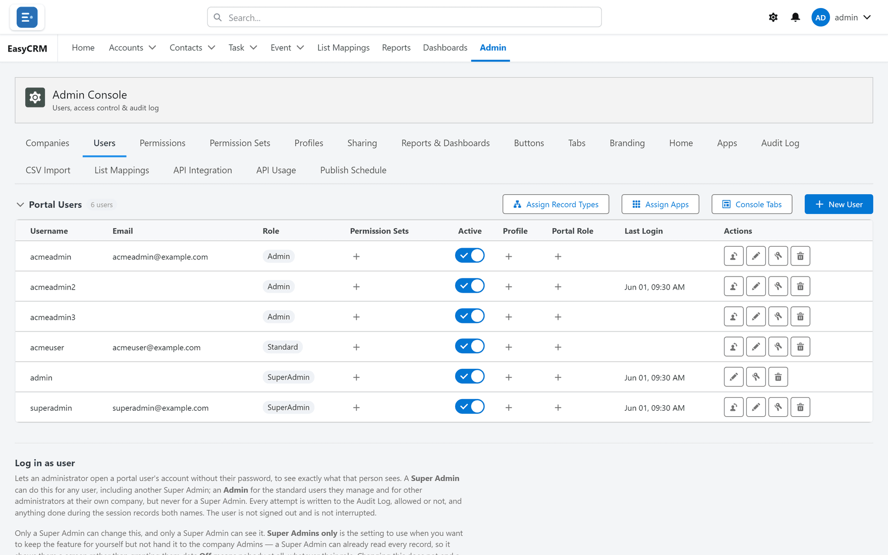

# Access and users

How people get in, what kind of user they are, and how one installation serves many companies.

## Username and password sign-in

**What it is.** Portal users sign in with their own credentials, created in EasyCRM.

**What it does.** No Salesforce login is involved. The person never sees Salesforce and does
not need an account there.

**What you gain:** the whole licence argument. This single capability is why the product exists.

## Self-service password reset

**What it is.** A **Forgot password?** link on the sign-in page.

**What it does.** The person enters their username or email and a new password is emailed.

**What you gain:** password resets stop being an administrator's job.

## Three roles

**What it is.** Standard, Admin and Super Admin.

**What it does.** The role decides the scope of what somebody can manage — their own records,
their company's people, or everything.

**What you gain:** you can hand day-to-day user management to each company without giving
anybody keys to the whole portal.

## Multi-company

**What it is.** People belong to companies, and most settings apply per company. Super Admins
sit above every company.

**What it does.** Apps, tabs, report folders, admin tabs and branding can all differ by company.

**What you gain:** one installation serves many client companies, each seeing only its own —
the difference between a product and a deployment per customer.

## Delegated administration

**What it is.** Admins manage only their own company's people.

**What it does.** A Super Admin also decides which Admin Console tabs each company's admins can
see at all. **Companies**, **Apps** and **Publish Schedule** are never handed out: they stay with
Super Admins, because each one reaches every company at once.

**What you gain:** client companies run their own users without reaching anything else.

## Deactivation that preserves history

**What it is.** An **Active** switch rather than a delete.

**What it does.** The person cannot sign in. Their records keep them as owner and their audit
history stays intact.

**What you gain:** leavers handled in one click with nothing orphaned and nothing erased.

## Administrator password resets

**What it is.** A key icon beside each user in the portal, and **Reset Password** on the
Salesforce-side Portal Users tab.

**What it does.** The administrator types a new password, and the person is emailed their new
login details. The old password is never shown — it is stored only as a hash.

**What you gain:** an administrator can unblock somebody in a minute, without ever learning the
password they had.

## Support impersonation

**What it is.** Viewing the portal exactly as another person sees it, without their password.

**What it does.** Every attempt is logged whether allowed or refused, actions record both names,
and the user is not interrupted. It is off until deliberately switched on.

**What you gain:** "it looks different on my screen" is solved in a minute, with a complete
record of who did it.

## Account lockout

**What it is.** Five wrong passwords in a row lock an account for 15 minutes.

**What it does.** The person is emailed that it happened. An administrator can unlock it at
once — on the Salesforce-side Portal Users tab, **Unlock** appears on a locked user.

**What you gain:** brute-force attempts stop automatically, and the account's owner finds out.

## Sessions that warn before they end

**What it is.** A session lasts two hours. Five minutes before the end a countdown appears and
a warning offers **Stay signed in**, which adds another two hours — up to twelve hours after
signing in, when the person has to sign in again.

**What it does.** When a session does end, the person signs in again in a box over the page they
were on, and anything they had not saved is still there. Signing in somewhere else ends the
earlier session.

**What you gain:** an abandoned browser on a shared machine does not stay signed in, and nobody
loses half-typed work to a timeout.

## Sign-in hours and IP ranges

**What it is.** Per-profile limits on **when** and **from where** people may sign in.

**What you gain:** access confined to working hours and to your offices or VPN, without
touching anybody's permissions.

## Landing page per profile

**What it is.** Each profile can start its people on a particular tab.

**What you gain:** people arrive where their work is instead of navigating there every morning.

## Managers, and linking to a Salesforce user

**What it is.** Each Standard user can have a manager — the Admin who looks after them and sees
their records. A portal user can also be linked to a Salesforce user, so that records that
person owns in Salesforce count as theirs in the portal.

**What it does.** The manager is set in the portal's Users tab or on the Salesforce-side Portal
Users tab. The Salesforce link is the **Salesforce User** field on the portal user's record in
Salesforce; the portal's own control for it is currently hidden.

**What you gain:** ownership and responsibility carry over from Salesforce without re-assigning
records by hand.

## In-portal notifications

**What it is.** A bell with an unread count.

**What it does.** Lists the latest records created, updated, deleted or given a new owner — a
Standard user's own, an Admin's whole group, and everyone's for a Super Admin.

**What you gain:** people notice what has changed without anybody sending a chasing email.

## Automatic emails

**What it is.** The portal emails people on its own: credentials when an account is created, a
new password when one is reset, a warning when an account locks, and a notice when one is
closed.

**What you gain:** accounts are handed over and recovered without an administrator relaying
passwords by hand.

## Where to do it

- [Users](../admin/users/index.md)
- [Permissions](../admin/access/index.md)
- [Staying signed in](../use/start/session.md)
- [Portal Users in Salesforce](../admin/salesforce/portal-users.md)
