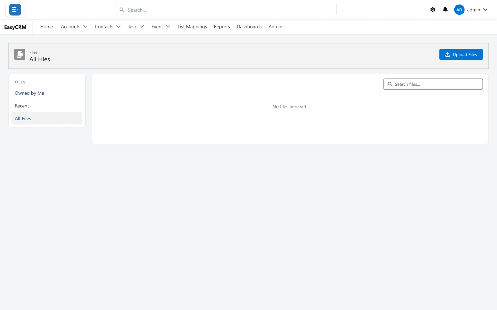

# Activities and files

Keeping the history of a customer with the customer.

## Activity tracking

**What it is.** Calls, tasks, meetings and emails recorded against the record they concern, in
one timeline grouped into **Upcoming & Overdue** and then month by month.

**What it does.** Each entry says who did what with whom — "Ryan Reisert logged a call with John
Moster" — with the contact as a link. Open tasks can be ticked off in place.

**What you gain:** customer history that belongs to the company rather than to one person's
inbox.

## Four activity types

**What it is.** Log a Call for something that already happened, New Task for something still to
do, New Event for a meeting with a start and end, and Email for a message.

**What it does.** Each opens in a panel docked at the bottom of the screen, so the record stays
in view; several can be open, minimised or enlarged at once. Emails go out from the portal with
Cc, Bcc, templates and attachments, and are kept in the timeline.

**What you gain:** the difference between a record of the past and a commitment for the future
is kept explicit, rather than everything being a "note".

## Account roll-up

**What it is.** An account's timeline also shows the activities logged on its contacts, as
Salesforce does.

**What it does.** Only activities linked to a contact are added — not those on the account's
opportunities or cases. An administrator can switch the roll-up off in Salesforce.

**What you gain:** the whole relationship with a company in one place, however the calls were
logged.

## Timeline filters

**What it is.** Narrowing the timeline by date — the last 7 or 30 days, or overdue only — and by
type: tasks, events, calls or emails.

**What you gain:** a record with three years of history is still readable.

## Expand all and full history

**What it is.** Opening every entry at once, or the whole history as cards over the page.

**What you gain:** reading a customer's story without clicking twenty times.

## Tasks on the home page

**What it is.** **My Tasks** lists open tasks on the records each person has opened most
recently, flagged **Overdue**, **Today**, **Upcoming** or **Open**.

**What you gain:** commitments on the accounts people are actually working surface where they
look, instead of being buried on a record.

## Upcoming events

**What it is.** Events from today onwards on the records each person has opened most recently
appear on their home page.

**What you gain:** the day ahead is visible without opening a calendar.

## File upload and preview

**What it is.** Uploading documents — by button or by dragging them onto a record — previewing
pictures and PDFs in the browser, downloading, renaming and deleting.

**What it does.** **Upload New Version** replaces a file's contents in place, and **Public
Link** makes a link that people outside the portal can open.

**What you gain:** paperwork lives with the data rather than in an inbox.

## Files attached to records

**What it is.** A file uploaded to a record stays with it, on the record's **Files** card.

**What it does.** Administrators choose whether a record page shows the **Files** card and the
activity panel, and where — above or below the related lists, or anywhere on the page, even in a
tab, with the [layout builder](../admin/layouts/layout-builder.md).

**What you gain:** anybody working on the customer finds the contract where they expect it.
Note that every file uploaded through the portal is also listed under **All Files** for every
portal user, whether or not they can open the record — see [Files](../use/files/index.md).

## Three file views

**What it is.** Owned by Me, Recent (the most recently changed), and All Files — which includes
files attached to records in Salesforce, not only those uploaded through the portal.

**What you gain:** finding your own upload again without searching everything.

## Where to do it

- [Calls, tasks and meetings](../use/activities/index.md)
- [Files](../use/files/index.md)
