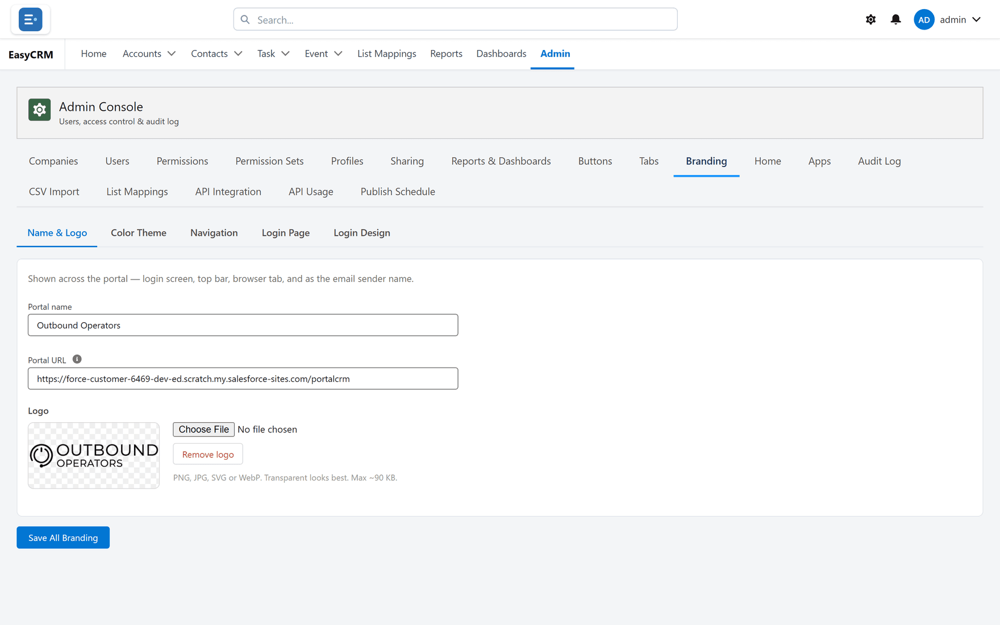

# Configuration and branding

Everything shaped on screen, without code.

## Page layouts

**What it is.** Choosing which fields appear, grouping them into named sections, ordering them,
and choosing which related lists show beside them.

**What it does.** A separate, shorter field set is configured for the new-record window.

**What you gain:** record pages matched to how your company actually works — and a creation
form short enough that people use it.

## Tabs

**What it is.** Which tabs exist and in what order, and whether the built-in **Home** tab is
shown at all.

**What you gain:** people see a portal shaped for their job rather than a directory of
everything.

## Apps

**What it is.** Named groups of tabs, set up by a Super Admin and assignable per company.

**What you gain:** sales and support see different sets without either ignoring the other's.

## Custom buttons

**What it is.** Your own buttons on record pages, which can open a web address with the record
loaded, start a Salesforce flow, create a linked child record, open a screen of your own or run
a background action. Web-address and flow buttons can go on list pages too.

**What it does.** Each button can be limited by role and by record type, and can ask for
confirmation first. Developers add bespoke screens and background actions through an extension
class named in Salesforce — see
[Settings only Salesforce can change](../admin/salesforce/switches.md#extension-class).

**What you gain:** your other systems are one click away, with the record already in context.

## Home page configuration

**What it is.** Which cards appear on everybody's home page, with an announcement you write, and
optionally a different home page per app.

**What you gain:** a landing screen that tells each person what needs attention today.

## Name, logo and theme

**What it is.** The portal's name, your logo, the browser tab icon, and colour presets or your
own colours.

**What you gain:** people see their own company's name, not a product they have never heard of.

## Navigation default

**What it is.** Top bar or side bar as the starting layout, overridable by each person.

**What you gain:** a sensible default without taking the choice away.

## The sign-in page designer

**What it is.** A block-based editor for the sign-in page — headings, text, logos, links,
separators and spacers, placed across the two halves of the screen, with alignment, width,
height and tone per block.

**What it does.** Preview on desktop and phone. Save drafts privately, publish when ready, and
restore an earlier version if a change was wrong. Switch back to the standard design at any time
without losing your custom one.

**What you gain:** the first screen customers see looks like your company, changed in minutes
without a developer.

## Protected credential fields

**What it is.** The username box, password box and sign-in button cannot be moved, hidden or
imitated by anything added in the designer.

**What you gain:** no design change — by anybody, deliberate or not — can turn the sign-in page
into something that collects credentials elsewhere.

## Automatic field setup

**What it is.** One button — **Run auto-configure**, on the Salesforce-side Portal Setup tab —
works out which of the portal's own fields are missing from which objects, creates them and
gives the portal access to them, alongside the rest of setup.

**What it does.** **Remove portal fields** takes them away again, with their data, so that an
uninstall is not blocked by them.

**What you gain:** installation and upgrades do not become a list of fields to create correctly
by hand — and leaving does not become one either.

## Salesforce's own field labels

**What it is.** Where a layout was brought over from Salesforce, the portal keeps that layout's
own labels — **Account Name** rather than "Account ID" — on record pages, list columns,
related-list headings and filters, and the layout editor preserves them.

**What it does.** Nothing to set up for layouts already brought over. The screen that imported a
Salesforce page layout is not currently offered, so new layouts are built in the portal's own
layout editor.

**What you gain:** people see the names they already know from Salesforce.

## Where to do it

- [Branding](../admin/appearance/branding.md)
- [Layouts](../admin/layouts/index.md)
- [Buttons](../admin/appearance/buttons.md)
- [Setup Assistant](../admin/operations/setup-assistant.md)
