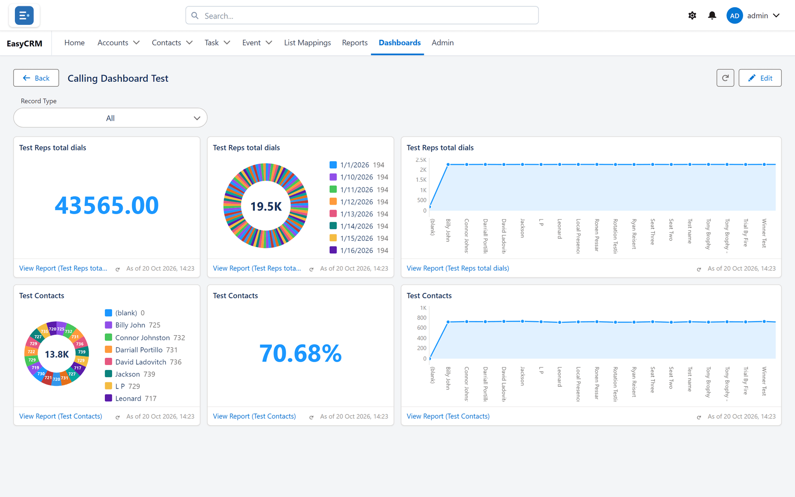

# Dashboards

Several answers on one screen, built from your reports.

## Eleven ways to draw a tile

**What it is.** Horizontal and vertical bars, stacked horizontal and vertical bars, line, donut,
funnel, metric, gauge, scatter and table — plus text and picture tiles. A tile can also take its
report's own chart, including a pie.

**What you gain:** the morning questions answered at a glance instead of five reports opened one
at a time.

## Drag-and-drop layout

**What it is.** Moving tiles by their title bar and resizing them from any edge or corner, on a
grid of 9 or 12 columns.

**What you gain:** dashboards arranged without design help.

## Page and tile themes

**What it is.** Light or dark for the whole dashboard, and light or dark for each tile on a light
dashboard.

**What you gain:** dashboards that suit a desk or a wall screen, with the key figures picked out.

## Filters across every tile

**What it is.** A filter bar that narrows the whole dashboard at once. Viewers tick one or several
values per filter, and up to five filters can sit on one dashboard.

**What it does.** Because each tile reads a different report, the author maps the filter to the
matching field on each one. Where a report is on the same object, or has a lookup straight to it,
the field is filled in automatically. As in Salesforce, a filter applies to every tile: one whose
report cannot be narrowed by it says so on the tile rather than showing unfiltered numbers. Date
filters can use relative ranges such as **This Month** or **Last 30 Days**.

**What you gain:** one dashboard serves every team and every region, instead of a copy for each.

## Filters that stay set

**What it is.** The values each person leaves ticked on a dashboard are remembered for them, on
any computer, and reapplied the next time they open it.

**What you gain:** people who always look at their own region do not have to pick it every
morning — and nobody else's view is affected.

## From a tile to the records behind it

**What it is.** Every report tile links to its report. The report opens narrowed by the
dashboard's filters. Clicking a bar, slice or point narrows it further, to that group. A **Back**
button returns to the dashboard with its filters as they were.

**What it does.** When a click cannot be written as one exact filter, the report opens whole and
says why, rather than showing the wrong records.

**What you gain:** "why is that number so high?" is answered in one click, with the records in
front of you.

## Exact values on hover

**What it is.** Resting the pointer on a bar, slice, point or number shows a box with the group,
the measure and the full value, and its share of the whole on donuts, pies and funnels.

**What you gain:** a chart shortened to "1.2K" for readability still gives the exact 1,151 when
somebody needs it.

## Audience control

**What it is.** Every dashboard counts, for each viewer, only the records that viewer may see — no
setting shows anybody records their sharing hides. **The logged-in user** scopes every tile to the
viewer further still, as a dynamic dashboard. Admins are never narrowed by it.

**What you gain:** one dashboard can be a personal worklist for twenty people from a single
definition, and nobody sees records their sharing hides.

## Figures that match the report

**What it is.** A **Metric** or **Gauge** shows its report's grand total of the measure — an
average stays the report's overall average. A table tile's total and a donut's centre count every
group, even when only the top ones are drawn. A tile that cannot show its numbers says why on the
tile.

**What you gain:** a figure on a dashboard is the same figure the report gives, and an empty tile
is never mistaken for zero.

## Stored results with refresh

**What it is.** Dashboards show each tile's last stored result so they open at once, with an
**As of** time on every tile. One button refreshes the whole dashboard, and each tile has its own.

**What you gain:** a thirty-tile dashboard opens without waiting, everybody can see how old each
number is, and anybody who needs the very latest figure can ask for it.

## An editor that opens at once

**What it is.** **Edit** opens the builder with every tile as the dashboard already shows it,
without working any of them out again. Tiles with no stored result fill in behind while you work.

**What you gain:** a twenty-tile dashboard is ready to edit in a moment.

## Safe editing

**What it is.** The builder will not save until the dashboard has finished loading, asks before
your save replaces changes somebody else saved meanwhile, warns before you leave with unsaved
changes (including the browser's Back button), and lets anyone with read access **Clone** a
dashboard into their own copy.

**What you gain:** nobody wipes a dashboard by saving too early, overwrites a colleague's work
without knowing, or loses an afternoon's layout by clicking away.

## Where to do it

- [Dashboards](../use/dashboards/index.md)
