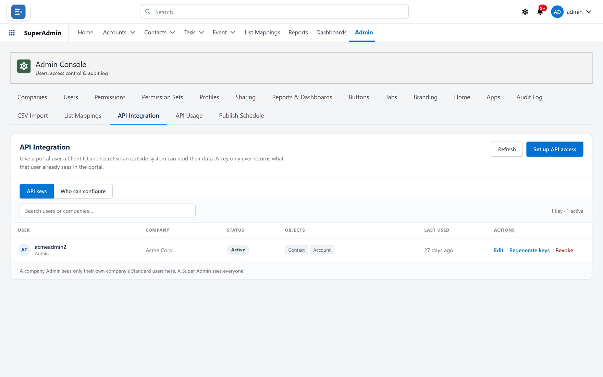

# Data and integration

Getting information in, out to other systems, and back and forth with Salesforce's own reports.

## Spreadsheet import

**What it is.** Loading a list of accounts and their contacts from a **.csv**, **.xlsx** or
**.xlsm** file — up to 1,000 rows — matching the file's columns to fields on screen.

**What it does.** You choose what the list should do — **Add new & update existing
(recommended)**, update only, add only, or always add the contact — how existing accounts and
contacts are matched, and whether a value in the file replaces what is already there or **Only
fill in blanks**. The import then runs in the background, with a progress page showing what was
created, updated and failed, and an email when it finishes. **Fix the rows that failed** shows
each failed row with the reason, lets you correct it on screen, and **Import these rows again**
with the same settings.

**What you gain:** onboarding a new client's data — and keeping it current — without a
data-loading tool or a developer.

## Report-to-calling-list mappings

**What it is.** For orgs that use the FrontSpin dialler: which Salesforce report fills which
FrontSpin calling list, set once per company.

**What it does.** Everybody the report returns is added to the calling list on FrontSpin's
schedule. Where a Super Admin has switched the **Sync** buttons on, a list can also be pushed
straight away, with its progress shown as it runs.

**What you gain:** calling lists that stay as fresh as the report behind them, without anybody
exporting a spreadsheet.

## An API that reads and writes

**What it is.** Keys that let another system work with your portal data. Each key is attached to
a person, scoped to chosen objects and fields, and can be filtered to a subset of records.

**What it does.** Every object starts read-only. Create, update and delete are granted
separately, per object, and a key can only set the fields it is allowed to write — any other
field is refused by name, never silently dropped. One record per call, no bulk operations, and
your org's validation rules run exactly as on screen. Writes have their own hourly
ceiling — 100 an hour by default, against 500 reads. Secrets are shown once; keys can be edited,
regenerated or revoked.

**What you gain:** integrations without exposing your Salesforce org — and because a key can
never do more than its portal user could in the portal, an integration cannot reach data that
person could not.

## API usage analytics

**What it is.** Request volumes by period, company and user, with export.

**What you gain:** integrations you can supervise, and unused keys you can retire.

## API log retention

**What it is.** Request logs kept for a period and then tidied up automatically.

**What you gain:** usage history for as long as it is useful, without a log table that grows
for ever.

## Bringing Salesforce reports into the portal

**What it is.** Syncing an existing Salesforce report onto the portal, from the EasyCRM app in
Salesforce — one at a time, or folder by folder with the **Sync & Share Folders** wizard, which
also shares them with chosen companies.

**What it does.** The report's definition is translated so the portal runs it live: columns with
Salesforce's own labels, groupings, filters including relative dates and multi-select
includes/excludes, record types, the sort, summaries and unique counts, bucket columns, formulas
and the chart. Activity columns such as **Call Duration (minutes)** come across too. Anything
that cannot is **named** in the message the sync shows, with which way it moves the count,
rather than quietly dropped. A report the portal cannot run live is stored only as a
snapshot, which the portal no longer lists — so the message saying why is the thing to act on. Syncing a report again keeps what the portal copy has that Salesforce cannot
hold, keeps its sharing, and leaves a copy alone when nothing changed in Salesforce.

**What you gain:** the reports your company already relies on, in front of portal users,
without anybody rebuilding them.

## New Salesforce reports, brought in by themselves

**What it is.** A switch for Super Admins: a report saved in a shared Salesforce folder is added to
the portal folder of the same name, within about a minute — or seconds, when somebody opens the
Reports tab.

**What it does.** Every new report is listed with what happened to it — added, or why not, such as
no portal folder of that name — with **Try again** and **Ignore**. An added report runs live and is
seen through its folder's company grants, never by everybody. It never changes anything already in
the portal, and never makes a snapshot. Off until deliberately enabled.

**What you gain:** reports built in Salesforce reach the portal without waiting for anybody to
sync them.

## Publishing reports back to Salesforce

**What it is.** Portal reports written into your org as real Salesforce reports — by hand from
the EasyCRM app, on a schedule, or within seconds of being saved.

**What it does.** Columns, groupings, filters, the sort, buckets, row-level and summary formulas
and the chart all go across. Where Salesforce cannot reproduce the portal's count exactly, the
publish says so and in which direction. Automatic publishing is off until deliberately enabled;
schedules run from every minute to weekly, and a Super Admin chooses how often the schedule is
checked, whether unchanged reports are skipped, whether only reports not yet in Salesforce are
published, which schedule new portal reports start with, and which Salesforce folder new reports
go to. An estimate shows what the schedules cost in Salesforce API calls. If a published report
is deleted in Salesforce, its schedule pauses rather than silently re-creating it. When anything
fails or publishes with a warning, Super Admins get one summary email.

**What you gain:** portal users and Salesforce users looking at the same numbers, without
anybody maintaining the report twice.

## Activity emails

**What it is.** Emails composed against a record and sent from the portal, plain or formatted.

**What you gain:** correspondence recorded with the customer it concerns.

## Where to do it

- [CSV Import](../admin/data/csv-import.md)
- [List Mappings](../admin/data/list-mappings.md)
- [API Integration](../admin/data/api-integration.md)
- [Portal Users and Portal Reports](../admin/salesforce/portal-users.md) — bringing Salesforce
  reports in
- [Publishing a portal report to Salesforce](../admin/salesforce/publish-reports.md)
- [Publish Schedule](../admin/data/publish-schedule.md)
- [Auto-sync of new Salesforce reports](../admin/data/report-auto-sync.md)
