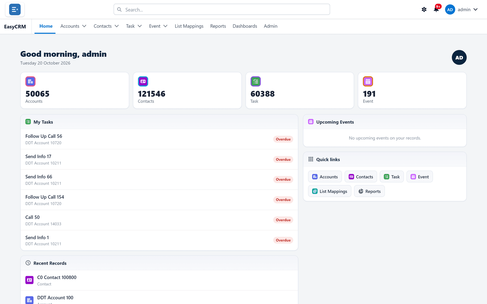

# Features

The complete catalogue of what EasyCRM does, grouped by area. Each feature says what it is,
what it does, and what it gives you.

If you want the short version, the [feature checklist](./checklist.md) lists everything on one
page.

## The six things it changes

Before the detail, the argument. These are the reasons companies adopt it.

### 1 · Cost

People who only read, or only update a few fields, use EasyCRM instead of a Salesforce seat.

**What you gain:** the number of full Salesforce licences you buy is driven by who really works
in Salesforce, not by who needs to see the data.

### 2 · Simplicity

A short list of tabs, the fields you choose, and nothing else. No Salesforce vocabulary on
screen.

**What you gain:** training measured in minutes, and fewer mistakes from people navigating a
product built for specialists.

### 3 · Live data

Lists and record pages read your Salesforce data at the moment they are opened, and edits go
straight back into it. Reports and dashboards run against the same live data, but to stay fast
they reuse an earlier result: a report one worked out within the last day, a dashboard the one
it last showed, stamped with its time. **Refresh** — or a change to the report — works it out
again. Where freshness matters more than speed, a Super Admin can make reports always run live,
for every company or for one.

**What you gain:** no exported spreadsheets going stale, and no arguments about whose copy is
right.

### 4 · Control

A full access model — per-person permissions, record sharing, a management hierarchy, scoping
each person to their own slice of the data, and rules that narrow access where needed.

**What you gain:** you can open data to more people and still be specific about who sees what.

### 5 · It looks like your company

Your name, logo, colours and a sign-in page you design yourself.

**What you gain:** something you can put in front of customers and partners, not an obviously
third-party tool.

### 6 · No code to change it

Fields, layouts, tabs, apps, buttons, reports, dashboards and the sign-in page are all
configured on screen.

**What you gain:** an administrator makes changes the same afternoon, without a developer or a
release.

## The catalogue

| Area | Covers |
|---|---|
| [Access and users](./access-and-users.md) | Sign-in, sessions, roles, multi-company, delegated administration |
| [Records](./records.md) | Lists, views, filters, record pages, editing in lists and on records, cloning, ownership |
| [Activities and files](./activities-and-files.md) | Calls, tasks, events, timelines, documents |
| [Reporting](./reporting.md) | The report builder in full |
| [Dashboards](./dashboards.md) | Tiles, filters, audience control |
| [Security](./security.md) | Permissions, sharing, field scoping, diagnostics |
| [Configuration and branding](./configuration.md) | Layouts and the layout builder, tabs, apps, buttons, white-labelling |
| [Data and integration](./data.md) | Import, the read-and-write API, Salesforce report sync (by hand or automatic) and publishing |
| [Operations and scale](./operations.md) | Audit, health checks, performance, licensing |
| [Checklist](./checklist.md) | Everything, on one page |

## Where to do it

- [Using EasyCRM](../use/index.md)
- [Administering](../admin/index.md)
