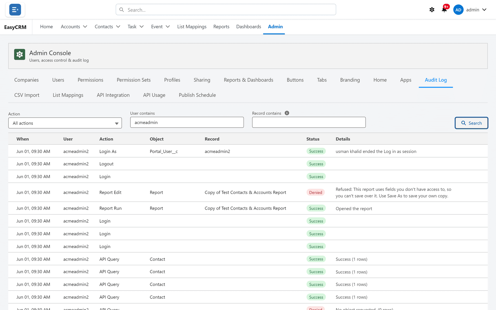

# Operations and scale

Running it, and running it at volume.

## Audit log

**What it is.** Sign-ins, failed sign-ins, password changes, administration changes and every
impersonation attempt — and record changes too: records created, edited, deleted or given a new
owner.

**What it does.** Reports and dashboards have a full trail of their own: opened, run, refreshed,
exported, shared, favourited and filed, and every save listed change by change. A deleted report
or dashboard keeps its whole definition in the log, so it can be rebuilt. An attempt the portal
refused is recorded as **Denied**, with the reason. Changes made in the EasyCRM app in Salesforce
— syncing, sharing and publishing reports — are logged under the Salesforce user who made them,
and the portal's own background work — scheduled publishing, publishing on save and adding new
Salesforce reports — under **System**.
Filter by action, by user, and by a report, dashboard or record name or Id. The log cannot be
edited, deleted or disabled by anybody, including a Super Admin.

**What you gain:** evidence rather than recollection, and a straight answer to "who changed
this?".

## Installation health checks

**What it is.** A checklist confirming the portal's site is live, its own permissions and yours,
the sharing default, that objects and an Admin user exist, and that the portal's fields are on
your objects and visible to it.

**What it does.** One button — **Run auto-configure** — fixes everything Salesforce lets it fix,
and each remaining step is spelled out with links and values to copy. Email deliverability is
not something it can check; that stays a Salesforce setting to look at yourself.

**What you gain:** setup problems named instead of guessed at — especially after adding new
fields, which do not become visible automatically.

## Large lists

**What it is.** Lists of tens of thousands of records open and scroll smoothly, drawing only
what is on screen.

**What you gain:** the portal stays usable as your data grows.

## Exact counts

**What it is.** Totals are the true figure, not a capped approximation.

**What you gain:** nobody has to wonder whether a number is real.

## Wide reports

**What it is.** Matrix reports with many columns render without stalling the browser.

**What you gain:** cross-tabulations stay practical at real widths.

## Long text filters on large reports

**What it is.** A report can filter on a long text field — a description, an activity's
comments — even when more than 40,000 records match its other filters, by answering from
prepared copies of that text.

**What it does.** On by default; a Super Admin can switch it off, or delete the prepared copies,
from the Admin console. The first such report may take a few seconds longer while its copy is
prepared.

**What you gain:** the same long text filters as Salesforce, at volumes where they would
otherwise be refused.

## Cache control

**What it is.** Report caching can be switched off, org-wide or per company.

**What you gain:** speed by default, and live figures where that matters more.

## Licence limits

**What it is.** Caps on how many companies there may be, how many Super Admins in total, and
how many Admins and Standard users per company, with per-company overrides.

**What it does.** Reaching a limit refuses **new** users with a message, and the user dialogs
offer a one-click request to raise it. Nobody already created is affected.

**What you gain:** an installation that cannot quietly outgrow what was agreed.

## Where to do it

- [Audit log](../admin/operations/audit-log.md)
- [Setup Assistant](../admin/operations/setup-assistant.md)
- [Long text filters on large reports](../admin/operations/long-text-filters.md)
- [Licence limits](../admin/operations/licence.md)
- [Publish Schedule](../admin/data/publish-schedule.md)
